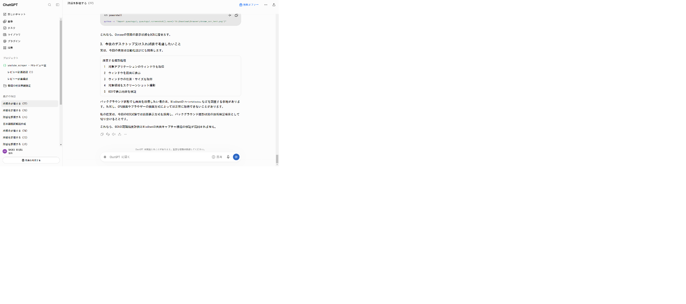
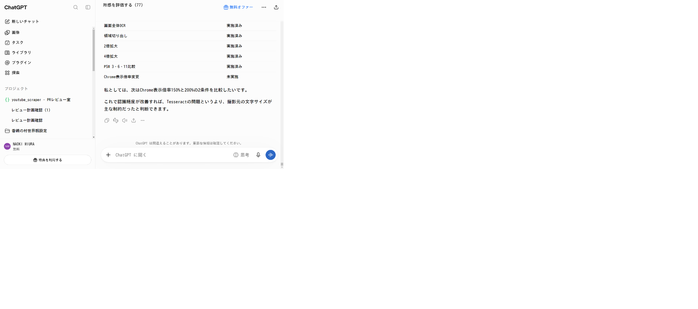
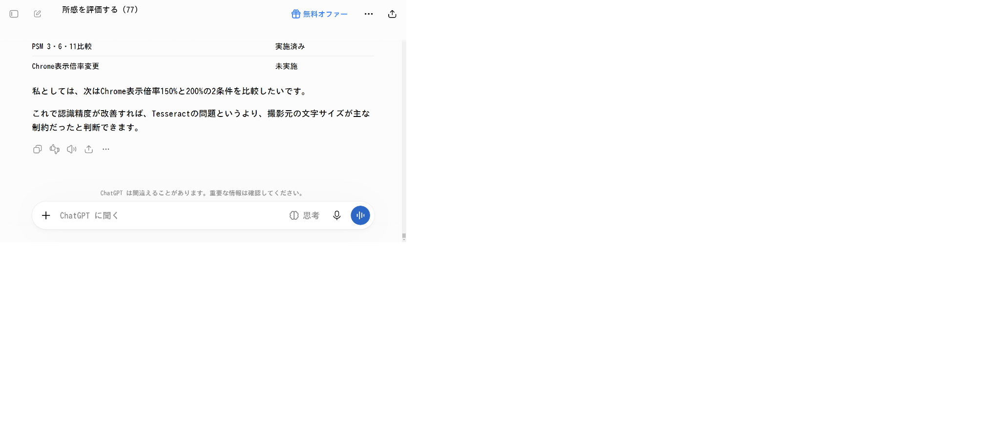

> From: https://chatgpt.com/c/6b045171-5914-83ee-b94f-1a6fbdd70d69

# chatgpt response

調査を進めました。配布元のアーカイブまで確認できたので、具体的な候補を提示できます。

## 1. 導入候補を確定

**Tesseract 4.1.0（64 bit）** (第一検証候補)

# 2019-03-14

UB Mannheim配布・Windowsインストーラー

- ファイル名：`tesseract-ocr-w64-setup-v4.1.0.20190314.exe`
- 配布元：マンハイム大学図書館（UB Mannheim）
- アーカイブ上のサイズ：約28 MB
- Tesseract 4.1.0を使用する64 bit版
  
  出典：UB Mannheimの配布アーカイブ  [digi.bib.uni-mannheim.de](https://digi.bib.uni-mannheim.de/tesseract/?utm_source=chatgpt.com)
  
  [インストーラーをダウンロードする](https://digi.bib.uni-mannheim.de/tesseract/tesseract-ocr-w64-setup-v4.1.0.20190314.exe)

一点、訂正があります。先ほど候補として挙げた4.1.3については、UB Mannheimの公式アーカイブにWindows用4.1.3インストーラーを確認できませんでした。実際に確認できた4.x系の64 bitインストーラーは4.1.0です。そのため、今回はこちらを候補とします。

## 2. 導入時の注意事項

UB Mannheimは、インストール先について重要な注意を掲載しています。

**アンインストーラーがインストール先ディレクトリ全体を削除する仕様です。** 既存のファイルがあるディレクトリをインストール先に指定しないでください。 [GitHub](https://github.com/UB-Mannheim/tesseract/wiki?utm_source=chatgpt.com)

今回の推奨先は次のとおりです。

```text
C:\Tools\Tesseract-4.1.0\
```

また、最初の検証では以下を変更しません。

- WindowsのシステムPATH
- Pythonのインストール環境
- Visual C++ランタイム
- 既存プロジェクトのソースコード

## 3. 今回の作業手順

まずはインストーラーをダウンロードするだけにしましょう。

1. 上記リンクからインストーラーを取得。
2. ダウンロードしたファイルのプロパティでサイズとデジタル署名を確認。
3. まだ実行せず、確認結果を共有。

その後、インストール先と日本語学習データの準備を確認してから、実際の導入に進みます。

**今回の目的はTesseractを導入すること自体ではなく、Windows 7 SP1で安定して動作するOCR環境を確保することです。** ここは焦らず、一段階ずつ確認していきましょう。

---

# you asked

message time: 2026-11-23 23:45:05

tesseract-ocr-w64-setup-v4.1.0.20190314.exe
28.1 MB (29,489,520 バイト)

---

# chatgpt response

ファイルサイズは、今回の候補として案内したインストーラーと整合しています。

- ファイル名：`tesseract-ocr-w64-setup-v4.1.0.20190314.exe`
- 実測サイズ：29,489,520 バイト（28.1 MB）
- 先ほど確認した配布情報：約28 MB

**サイズの点では問題なさそうです。** ただし、ファイル名とサイズが一致していても、配布元の正規ファイルであることまでは証明できません。次はデジタル署名とハッシュ値を確認しましょう。

配布元のファイル一覧も再確認しました。UB Mannheimのアーカイブに、同じファイル名の64 bit版が掲載されています。サイズ表示も28 MBで、今回の実測値と矛盾しません。 [digi.bib.uni-mannheim.de](https://digi.bib.uni-mannheim.de/tesseract/?utm_source=chatgpt.com)

## 次は2つの検証をお願いします

インストーラーはまだ実行しないでください。

**1\. デジタル署名の確認**

```powershell
Get-AuthenticodeSignature "インストーラーのフルパス" | Format-List Status,StatusMessage,SignerCertificate
```

`"インストーラーのフルパス"` は実際の保存場所に置き換えてください。

**2\. SHA-256ハッシュ値の取得**

```powershell
certutil -hashfile "インストーラーのフルパス" SHA256
```

こちらも同じく実際の保存場所に置き換えます。

この2つで確認したいのは、

- デジタル署名の状態と署名者
- ファイルのSHA-256ハッシュ値

です。

なお、今回確認できたUB Mannheimの一覧にはSHA-256値が掲載されていません。第三者サイトのMD5値だけで正規性を判断することは避けます。

結果を共有していただければ、インストーラーの確認を続けます。

---

# you asked

message time: 2026-11-23 23:48:50

PS P:\python-scripts\youtube_scraper> Get-AuthenticodeSignature "D:\Download\Browser\tesseract-ocr-w64-setup-v4.1.0.20190314.exe" | Format-List Status,StatusMessage,SignerCertificate


Status            : NotSigned
StatusMessage     : ファイル D:\Download\Browser\tesseract-ocr-w64-setup-v4.1.0.20190314.exe はデジタル署名されていません。このスクリプトはシステムで実行されません。詳細に
                    ついては、「get-help about_signing」と入力してヘルプを参照してください。
SignerCertificate :


PS P:\python-scripts\youtube_scraper>
PS P:\python-scripts\youtube_scraper> certutil -hashfile "D:\Download\Browser\tesseract-ocr-w64-setup-v4.1.0.20190314.exe" SHA256
SHA256 ハッシュ (ファイル D:\Download\Browser\tesseract-ocr-w64-setup-v4.1.0.20190314.exe):
09 7f f3 85 0e 01 28 12 57 61 7e 30 99 d8 b2 22 39 24 3f a2 e3 ff 97 56 f2 da fa 7a b4 4b 9f 98
CertUtil: -hashfile コマンドは正常に完了しました。
PS P:\python-scripts\youtube_scraper>

---

# chatgpt response

確認しました。今回の結果には、重要な注意点があります。

## 1. 検証結果

**ファイルサイズ** (整合)

29,489,520 バイト。UB Mannheimの配布アーカイブに掲載されている同名ファイルのサイズ表示と整合しています。 [digi.bib.uni-mannheim.de](https://digi.bib.uni-mannheim.de/tesseract/?utm_source=chatgpt.com)

---

**デジタル署名** (未署名)

`NotSigned` なので、Windowsのデジタル署名による発行元の検証はできません。

---

**SHA-256**

`097ff3850e01281257617e3099d8b22239243fa2e3ff9756f2dafa7ab44b9f98`

(照合先なし)

ハッシュ値は取得できましたが、UB Mannheimの配布一覧には、このファイルの公式SHA-256値が掲載されていません。したがって、現時点では一致確認ができません。

## 2. 私の判断

**未署名であることだけを理由に、危険なファイルとは断定できません。** 一方、ファイル名・サイズ・ハッシュ値だけでも安全性を保証できません。

今回の配布元はTesseract公式ドキュメントから案内されているUB Mannheimです。ただし、Windowsインストーラー自体はサードパーティ配布物です。 [GitHub](https://github.com/tesseract-ocr/tessdoc/blob/main/Installation.md?utm_source=chatgpt.com) [GitHub](https://github.com/tesseract-ocr/tessdoc/blob/main/Downloads.md?plain=1&utm_source=chatgpt.com)

したがって、現時点の判定は次のとおりです。

- 配布元・ファイル名：整合
- ファイルサイズ：整合
- デジタル署名：なし
- SHA-256：取得済み、公式値との照合不可
- ファイルの完全性・安全性：未確定

## 3. 次の確認

一つ確認させてください。

今回のファイルは、先ほど私が案内した次のUB MannheimのHTTPSリンクから直接ダウンロードしたものでしょうか？

[UB Mannheim：Tesseract 4.1.0 64 bit](https://digi.bib.uni-mannheim.de/tesseract/tesseract-ocr-w64-setup-v4.1.0.20190314.exe)

直接ダウンロードしたのであれば、その取得経路を前提に次の判断へ進めます。

**まだインストーラーは実行しないでください。** 今回は安全性の確認を曖昧にしたまま進めないことを優先します。

---

# you asked

message time: 2026-11-23 23:52:54

**Tesseract 4.1.0（64 bit）**

第一検証候補

# **2019-03-14**

UB Mannheim配布・Windowsインストーラー

- ファイル名：`tesseract-ocr-w64-setup-v4.1.0.20190314.exe`

- 配布元：マンハイム大学図書館（UB Mannheim）

- アーカイブ上のサイズ：約28 MB

- Tesseract 4.1.0を使用する64 bit版

  出典：UB Mannheimの配布アーカイブ&#x20;

  digi.bib.uni-mannheim.de

  [インストーラーをダウンロードする](https://digi.bib.uni-mannheim.de/tesseract/tesseract-ocr-w64-setup-v4.1.0.20190314.exe?utm_source=chatgpt.com)


これをダウンロードしています。

---

# chatgpt response

ありがとうございます。これでダウンロード経路も確認できました。

私が案内したUB Mannheimの公式配布アーカイブに掲載されているファイルを、同じ配布元から直接取得したということですね。アーカイブには、今回のファイル名と2019年3月14日の更新日時が掲載されています。 [digi.bib.uni-mannheim.de](https://digi.bib.uni-mannheim.de/tesseract/?C=D%3BO%3DA&utm_source=chatgpt.com) [digi.bib.uni-mannheim.de](https://digi.bib.uni-mannheim.de/tesseract/?utm_source=chatgpt.com)

## 現時点の判定

| 確認項目 | 結果 |
|--------|--------|
| ダウンロード元 | UB Mannheim |
| ファイル名 | 一致 |
| ファイルサイズ | 一致 |
| デジタル署名 | なし |
| SHA-256 | 取得済み・公式値との照合不可 |
| 取得経路 | 本人確認済み |

(条件付きで次の検証へ)

未署名という点は残りますが、取得経路とファイル情報は整合しています。これだけで安全性を保証できるわけではありませんが、出所不明のファイルとは区別できます。

## 次の作業：インストーラーの実行

今回は専用ディレクトリにインストールします。

```text
C:\Tools\Tesseract-4.1.0
```

インストール時の注意点：

1. インストール先を上記の新規ディレクトリに指定する。
2. 日本語（Japanese）と英語（English）の言語データを選択する。
3. 追加のトレーニングツールは今回不要。
4. システムPATHは変更しない。
5. 既存のPython環境やVC++ランタイムは変更しない。

なお、この4.1.0インストーラーはUB Mannheimの履歴上、**2019年3月14日版のRC1**です。トレーニング関連の実行ファイルにはICU DLLの不足が記載されていますが、今回の目的である通のOCR実行とは区別して考えます。 [GitHub](https://hypi.ai/wp/wp-content/uploads/2019/10/wiki/?utm_source=chatgpt.com) [GitHub](https://ccn.web.tr/web-api/iframe-proxy?url=https%3A%2F%2Fgithub.com%2FUB-Mannheim%2Ftesseract%2Fwiki&utm_source=chatgpt.com)

インストール画面でコンポーネントの選択肢が表示されたら、判断に迷う場合はその画面の内容を共有してください。こちらで確認してから進めましょう。

---

# you asked

message time: 2026-11-24 00:01:35

インストール完了しました。

---

# chatgpt response

インストール完了ですね。ここからは、いよいよ **Windows 7 SP1上でTesseract 4.1.0が正常に動作するか**を確認していきます。

まずはPythonとの連携には進まず、Tesseract本体の単体試験を行いましょう。

## 1. 実行ファイルの確認

先ほど指定した場所にインストールした場合、次のコマンドを実行してください。

```powershell
Test-Path "C:\Tools\Tesseract-4.1.0\tesseract.exe"
```

`True` なら実行ファイルが存在します。

## 2. バージョン確認

```powershell
& "C:\Tools\Tesseract-4.1.0\tesseract.exe" --version
```

Tesseractのバージョンと、使用しているライブラリなどが表示されるか確認します。

## 3. 言語データの確認

```powershell
& "C:\Tools\Tesseract-4.1.0\tesseract.exe" --list-langs
```

今回必要なのは次の2つです。

- `eng`：英語・数字
- `jpn`：日本語

## 4. 確認結果の評価

| 試験 | 合格条件 |
|---|---|
| ファイル確認 | `True` |
| バージョン確認 | エラーなくバージョン表示 |
| 言語データ確認 | `eng` と `jpn` が表示 |

なお、インストール先を別の場所に変更した場合は、コマンド内のパスも変更してください。

**まずはこの3つの実行結果を共有してください。** Windows 7上での起動を確認できたら、次に日本語OCRの実動作試験、最後にPythonの`pytesseract`との連携試験へ進みます。

---

# you asked

message time: 2026-11-24 00:08:28

PS P:\python-scripts\youtube_scraper> Test-Path "C:\Tools\Tesseract-OCR\tesseract.exe"
True
プログラムファイルスディレクトリをツー留守ディレクトリに書き直しただけです。

---

# chatgpt response

了解しました。インストール先は次のとおりですね。

```text
C:\Tools\Tesseract-OCR\
```

`Test-Path` が `True` なので、実行ファイルの配置は確認できました。

以降はこのパスを基準にします。先ほどのコマンドのパスだけ置き換えてください。

**1. バージョン確認**

```powershell
& "C:\Tools\Tesseract-OCR\tesseract.exe" --version
```

**2. 言語データ確認**

```powershell
& "C:\Tools\Tesseract-OCR\tesseract.exe" --list-langs
```

この2つの結果を確認しましょう。

特に `--list-langs` で `jpn` と `eng` が表示されるかが重要です。まだPython側の設定変更は必要ありません。

---

# you asked

message time: 2026-11-24 00:09:32

PS P:\python-scripts\youtube_scraper> & "C:\Tools\Tesseract-OCR\tesseract.exe" --version
tesseract v4.0.0.20190314
 leptonica-1.78.0
  libgif 5.1.4 : libjpeg 8d (libjpeg-turbo 1.5.3) : libpng 1.6.34 : libtiff 4.0.9 : zlib 1.2.11 : libwebp 0.6.1 : libopenjp2 2.2.0
 Found AVX
 Found SSE
PS P:\python-scripts\youtube_scraper> & "C:\Tools\Tesseract-OCR\tesseract.exe" --list-langs
List of available languages (5):
eng
enm
jpn
osd
script/Japanese
PS P:\python-scripts\youtube_scraper>

---

# chatgpt response

素晴らしいです。**Windows 7 SP1上でTesseract本体が正常に起動し、日本語・英語の言語データも認識されています。**

今回の単体起動試験は成功です。

## 1. 試験結果

**実行ファイルの配置** (合格)

`C:\Tools\Tesseract-OCR\tesseract.exe` が存在。

---

**Tesseractの起動** (合格)

バージョン情報とLeptonicaなどのライブラリ情報を正常に表示。

---

**言語データ** (合格)

`eng`、`jpn`、`osd` など5種類を認識。

## 2. バージョンについて重要な訂正

ここは正確に記録しておきたい点です。

インストーラーのファイル名は、

```text
tesseract-ocr-w64-setup-v4.1.0.20190314.exe
```

でしたが、実際の実行結果は、

```text
tesseract v4.0.0.20190314
```

です。

したがって、今回導入したエンジンは **Tesseract 4.0.0.20190314** と記録するのが正確です。インストーラーのファイル名を、そのままエンジンのバージョンとして扱わないようにしましょう。

## 3. 次は日本語OCRの実動作試験

次は実際のスクリーンショットを読み取らせます。

まず、PyAutoGUIでスクリーンショットを保存してください。保存先はリポジトリの外にします。

```powershell
python -c "import pyautogui; pyautogui.screenshot().save(r'D:\Download\Browser\tesseract_ocr_test.png')"
```

続いて、その画像をTesseractに読み取らせます。

```powershell
& "C:\Tools\Tesseract-OCR\tesseract.exe" "D:\Download\Browser\tesseract_ocr_test.png" stdout -l jpn+eng --psm 6
```

`--psm 6` は、画像内の文字を単一のまとまったテキスト領域として扱う設定です。

※スクリーンショットに個人情報や秘密情報が表示されていないことを確認してから実行してください。

## 4. 現在の進捗

| 段階 | 状態 |
|--------|--------|
| Python環境確認 | (完了) |
| Tesseract導入 | (完了) |
| Windows 7での起動 | (成功) |
| 日本語・英語モデル認識 | (成功) |
| 日本語OCR実動作 | 未確認 |
| pytesseract連携 | 未確認 |
| PyAutoGUIとの連携 | 未確認 |

ここまで来れば大きな前進です。次の日本語OCR試験に成功したら、Pythonからの連携に進みましょう。

---

# you asked

message time: 2026-11-24 00:13:22

文字化け出力ですが、読み取りと認識は出来ているようです。

---

# chatgpt response

なるほど。これは重要な結果です。

**Tesseractが画像を読み込み、OCR処理を実行できていることは確認できた**ということですね。ただし、文字化けが発生しているため、現段階では日本語OCRの出力品質まで合格とは判定しません。

まず、文字化けの原因を切り分けましょう。

今回の環境では、次の2つを区別する必要があります。

1. Tesseractが日本語を正しく認識できているが、Windows PowerShellのコンソール表示で文字化けしている。
2. Tesseractの認識結果そのものが文字化け・誤認識している。

特にWindows PowerShell 5.1では、コンソールのコードページと外部プログラムの出力エンコーディングが一致しないことがあります。

Tesseractの標準テキスト出力はUTF-8です。一方、Windows PowerShell 5.1側の文字コード設定によっては、正常な日本語出力でも文字化けします。 [Tesseract documentation](https://tesseract-ocr.github.io/tessdoc/FAQ?utm_source=chatgpt.com) [Microsoft Learn](https://learn.microsoft.com/en-us/powershell/module/microsoft.powershell.core/about/about_character_encoding?view=powershell-5.1&utm_source=chatgpt.com)

## まずは出力をファイルに保存して検証しましょう

コンソールの表示問題を切り離すため、次のコマンドを実行してください。

```powershell
& "C:\Tools\Tesseract-OCR\tesseract.exe" "D:\Download\Browser\tesseract_ocr_test.png" "D:\Download\Browser\tesseract_ocr_result" -l jpn+eng --psm 6
```

続いて、PythonでUTF-8として読み込みます。

```powershell
python -c "from pathlib import Path; p=Path(r'D:\Download\Browser\tesseract_ocr_result.txt'); print(p.read_text(encoding='utf-8'))"
```

## 判定方法

- 日本語が正常に表示される → OCR認識は成功。PowerShellの表示エンコーディングが原因。
- ファイル内も文字化けしている → OCR結果そのものを調査。
- 日本語は表示されるが誤認識が多い → 画像品質やOCR設定を調整。

この方法なら、コンソール表示の問題とOCRの認識精度を分離できます。

**まず、この2つの実行結果を見せてください。** まだPythonのプロジェクトコードには変更を加えません。

---

# you asked

message time: 2026-11-24 00:20:00

エンコーディング違いと、認識率は60パーセントくらいですかね。
文字ではないアイコンなども読み取っているため、余計なノイズになっているのと、文字の表示の大きさに制度が左右されているような感じです。

---

# chatgpt response

その観察はかなり的確だと思います。今回の結果から、Tesseract 4.0.0の基本動作には問題がなく、次の課題は **OCRに渡す画像の品質と、文字領域の抽出方法** だと考えられます。

特に、Windowsアプリケーションの画面全体をそのままOCRにかける場合、文書画像とは異なる難しさがあります。

## 1. 認識率が下がる原因

挙げていただいた問題を整理すると、次のようになります。

| 問題 | 原因 | 対策 |
|--------|--------|--------|
| アイコンを文字として認識 | OCR対象に画像・装飾が混在 | 文字領域だけを切り出す |
| 小さな文字の誤認識 | 文字の画素数が不足 | 拡大処理 |
| 文字サイズによる認識差 | 表示倍率・フォントサイズの違い | 解像度・拡大率を調整 |
| 背景と文字の区別が難しい | 背景色・コントラスト | グレースケール・二値化 |
| ボタンやラベルの誤認識 | UI特有の配置 | 領域別にOCRする |

Tesseractの公式資料でも、画像の拡大、二値化、ノイズ除去、文字領域の分割方法などが認識精度に影響すると説明されています。 [tessdoc](https://tesseract-ocr.github.io/tessdoc/ImproveQuality.html?utm_source=chatgpt.com) [Tesseract documentation](https://tesseract-ocr.github.io/tessdoc/FAQ.html?utm_source=chatgpt.com)

## 2. 改善方針

私は、次の順番で改善することを推奨します。

**第1段階：OCR対象の限定**

- 画面全体ではなく、アプリケーションウィンドウを対象にする。
- さらに必要に応じて、ボタン・ラベル・メッセージ領域を切り出す。
- アイコンや装飾画像を極力除外する。

---

**第2段階：画像の前処理**

- グレースケール化
- 文字領域の拡大（まず2倍）
- コントラスト調整
- 必要に応じて二値化

---

**第3段階：OCR設定の比較**

- `--psm 3`：画面内の配置を自動解析
- `--psm 6`：単一の文字ブロックとして解析
- `--psm 11`：画面内の散在する文字を検出

---

**第4段階：認識結果の評価**

- 正しく読めた文字数
- 誤認識された文字数
- 認識できなかった文字数
- 認識に要した時間

なお、PyAutoGUIで撮影した画面は印刷文書の300 DPIとは性質が異なるため、単純にDPI値だけを変更するより、実際の文字の画素サイズを確保することが重要です。

## 3. 今回のプロジェクトに適したOCRの使い方

ここは少し重要です。

YouTube Scraperのデスクトップ受け入れ試験では、OCRをすべての確認に使う必要はありません。

| 検証対象 | 推奨方法 |
|--------|--------|
| ボタンの表示文字 | OCR |
| ダイアログのメッセージ | OCR |
| 処理中・完了表示 | OCR＋ログ |
| コメント取得件数 | JSON・ログ |
| ファイル保存結果 | ファイル実体・JSON |
| ウィンドウの位置・サイズ | PyGetWindow |
| ボタン操作 | PyAutoGUI |

つまり、OCRは画面表示の確認に集中させ、内部処理の正確性は既存のログや出力ファイルで検証する構成が合理的です。

## 4. 次に実施したい比較試験

いきなり自動化スクリプトを作るのではなく、同じスクリーンショットを使って3種類の設定を比較したいです。

**OCR比較試験の設定案**

文字領域の対象

画面全体

アプリケーションウィンドウ

特定の文字領域だけ

---

画像の拡大倍率

1倍

2倍

3倍

[この設定で試験手順を作成]

**私の推奨は、まずアプリケーションウィンドウ全体・2倍拡大です。**

今回の60%程度という評価は、あくまで目視による暫定値ですが、前処理と領域限定で改善できる余地は十分にあります。まずはTesseractの性能限界と、画像側の問題を切り分けていきましょう。


---

# you asked

message time: 2026-11-24 00:24:29

このチャットをしているクロームのOCRでためしてみましょう、

---

# chatgpt response

いいですね！ 今回はYouTube Scraperの画面ではなく、**このChatGPTを表示しているChromeの画面**をOCRの評価対象にしましょう。

Chromeの画面なら、日本語・英数字・ボタン・アイコン・複数サイズの文字が混在しているので、OCRの比較試験に適しています。

## 1. 試験対象

**Chromeブラウザーの画面**

- ブラウザーのタブ・アドレスバー
- ChatGPTの会話本文
- 日本語・英数字
- ボタン・アイコン
- 入力欄と操作アイコン

## 2. スクリーンショットの取得

まず、現在のChrome画面を撮影します。

```powershell
python -c "import pyautogui; pyautogui.screenshot().save(r'D:\Download\Browser\chrome_ocr_test.png')"
```

撮影したら、次のコマンドでOCRを実行してください。

```powershell
& "C:\Tools\Tesseract-OCR\tesseract.exe" "D:\Download\Browser\chrome_ocr_test.png" stdout -l jpn+eng --psm 11
```

今回は `--psm 11` を使います。画面内に散在する文字を検出する設定なので、ブラウザー画面のようなUIの初回試験に向いています。

## 3. 比較試験

同じ画像に対して、次の3種類を比較します。

| 試験 | PSM | 目的 |
|--------|--------|--------|
| A | 3 | 自動レイアウト解析 |
| B | 6 | 単一ブロックとして解析 |
| C | 11 | 散在する文字を検出 |

実行例：

```powershell
& "C:\Tools\Tesseract-OCR\tesseract.exe" "D:\Download\Browser\chrome_ocr_test.png" "D:\Download\Browser\chrome_psm3" -l jpn+eng --psm 3

& "C:\Tools\Tesseract-OCR\tesseract.exe" "D:\Download\Browser\chrome_ocr_test.png" "D:\Download\Browser\chrome_psm6" -l jpn+eng --psm 6

& "C:\Tools\Tesseract-OCR\tesseract.exe" "D:\Download\Browser\chrome_ocr_test.png" "D:\Download\Browser\chrome_psm11" -l jpn+eng --psm 11
```

出力はそれぞれUTF-8のテキストファイルになります。

## 4. 評価したいポイント

- 日本語の会話本文をどの程度正しく読めるか
- 英数字やコマンドを正確に読めるか
- 小さな文字と大きな文字の認識差
- アイコンを文字として誤認識する頻度
- ブラウザーのUIと会話本文を区別できるか

なお、ChatGPTの会話には個人情報や機密情報が含まれる可能性があります。スクリーンショットを外部に共有する必要はありません。

**まずはA・B・Cの3種類を同じスクリーンショットで試しましょう。** 結果を貼っていただければ、認識精度と誤認識の傾向を比較評価します。


---

# you asked

message time: 2026-11-24 00:34:20

統合ターミナルでの撮影コマンド実行時、バックグラウンドにいるアプリウィンドウの撮影は不可能なことに気が付きました。

---

# chatgpt response

その気付きは重要です。今回の試験で、PyAutoGUIによるスクリーンショット取得の制約が一つ明確になりました。

正確には、`pyautogui.screenshot()` は基本的に**Windowsのデスクトップに現在表示されている画面全体**を撮影します。バックグラウンドに隠れているウィンドウの内容を個別に取得する機能ではありません。

## 1. 撮影方法の違い

| 撮影方法 | バックグラウンドのウィンドウ |
|--------|--------|
| PyAutoGUI `screenshot()` | 不可 |
| PyAutoGUI `screenshot(region=...)` | 不可 |
| ウィンドウを前面に表示して撮影 | 可能 |
| WindowsのウィンドウキャプチャAPI | 条件付きで可能 |
| Windows UI Automation | 画面画像ではなくUI情報を取得 |

`region` は画面上の矩形領域を切り取るだけなので、背後にあるウィンドウを取り出せるわけではありません。

## 2. 今回のOCR試験での対応

まずはChromeを前面に表示してから撮影する方式でよいと思います。

```powershell
python -c "import pyautogui; pyautogui.screenshot().save(r'D:\Download\Browser\chrome_ocr_test.png')"
```

これなら、Chromeの実際の表示状態をOCRに渡せます。

## 3. 今後のデスクトップ受け入れ試験で考慮したいこと

実は、今回の発見は自動化設計にも関係します。

**推奨する撮影処理**

1. 対象アプリケーションのウィンドウを取得
2. ウィンドウを前面に表示
3. ウィンドウの位置・サイズを取得
4. 対象領域をスクリーンショット撮影
5. OCRで表示内容を検証

バックグラウンド状態でも画面を取得したい場合は、Windowsの`PrintWindow`などを調査する余地があります。ただし、GPU描画やブラウザーの描画方式によっては正常に取得できないことがあります。

**私の提案は、今回のOCR試験では前面表示方式を採用し、バックグラウンド撮影は別の技術検証項目として切り分けることです。**

これなら、OCRの認識精度評価とWindowsの画面キャプチャ機能の検証が混同されません。

---

# you asked

message time: 2026-11-24 00:47:56



別のスクリーンショットソフトを使ってクリップボードに取得し、ペイントに貼り付けて保存しました。
これを試験チェックに使いましょう。

---

# chatgpt response

いいですね！ これを今回のOCR比較試験の基準画像にしましょう。

今回の方法なら、Chromeがバックグラウンドにある状態でも、取得済みの画像ファイルを使ってOCRを検証できます。PyAutoGUIによる撮影機能の制約にも左右されません。

実際に添付画像を確認しました。

## 1. 試験画像の特徴

**画像サイズ** 2048 × 909 px

**形式** PNG / RGBA

**画面内容の範囲** 約832 × 497 px

---

**確認できるOCR対象**

- Chrome上のChatGPT画面
- 日本語の会話本文
- 英数字・コマンド
- 左側のナビゲーション
- ボタン・アイコン
- 小さな補助テキスト

一つ気になる点があります。画像の大部分が白い余白になっています。実際の画面内容は左上に集中しているため、画像全体をOCRにかけるより、画面部分を切り出した方が比較しやすいです。

## 2. まず試験画像を切り出す

元画像を `D:\Download\Browser\chrome_ocr_test.png` に保存したものとして、次のコマンドを実行してください。

```powershell
python -c "from PIL import Image; p=r'D:\Download\Browser\chrome_ocr_test.png'; im=Image.open(p); im.crop((0,0,850,510)).save(r'D:\Download\Browser\chrome_ocr_crop.png')"
```

さらに、切り出した画像を2倍に拡大します。

```powershell
python -c "from PIL import Image; p=r'D:\Download\Browser\chrome_ocr_crop.png'; im=Image.open(p).convert('RGB'); im.resize((im.width*2,im.height*2),Image.Resampling.LANCZOS).save(r'D:\Download\Browser\chrome_ocr_crop_2x.png')"
```

これで次の3種類を比較できます。

| 画像 | 内容 | 目的 |
|--------|--------|--------|
| 元画像 | 2048×909 | 基準 |
| 切り出し | 850×510 | 余白除去の効果 |
| 切り出し2倍 | 1700×1020 | 文字拡大の効果 |

## 3. OCR比較試験

まずは拡大画像に対して、3種類のPSMを試しましょう。

```powershell
& "C:\Tools\Tesseract-OCR\tesseract.exe" "D:\Download\Browser\chrome_ocr_crop_2x.png" "D:\Download\Browser\chrome_test_psm3" -l jpn+eng --psm 3

& "C:\Tools\Tesseract-OCR\tesseract.exe" "D:\Download\Browser\chrome_ocr_crop_2x.png" "D:\Download\Browser\chrome_test_psm6" -l jpn+eng --psm 6

& "C:\Tools\Tesseract-OCR\tesseract.exe" "D:\Download\Browser\chrome_ocr_crop_2x.png" "D:\Download\Browser\chrome_test_psm11" -l jpn+eng --psm 11
```

出力はそれぞれUTF-8の `.txt` ファイルになります。

## 4. 今回の評価基準

今回は単純な文字認識率だけでなく、次の観点も評価したいです。

1. 日本語本文の認識精度
2. 英数字・コマンドの認識精度
3. 小さな文字の認識精度
4. アイコンなどの誤認識数
5. 画面上の文章の順序を維持できているか

特に5番目は重要です。OCRが文字を正しく認識していても、画面上の配置順序が崩れてしまうと、デスクトップアプリケーションの状態判定には使いにくくなります。

**今回の画像を基準画像として固定し、元画像・切り出し・拡大画像の3条件で比較する**方針にしましょう。これなら、画像前処理によってどの程度改善するかを具体的に評価できます。

---

# you asked

message time: 2026-11-24 00:52:10

ローカルファイルはここです。
""P:\python-scripts\資料\ocrtestsample.png"

---

# chatgpt response

了解しました。では、今後はこのファイルを基準画像として扱います。

```text
P:\python-scripts\資料\ocrtestsample.png
```

先ほどのコマンドで使用した `D:\Download\Browser\` は不要です。出力先も同じ `資料` ディレクトリに統一しましょう。

## 1. 元画像の確認

```powershell
Test-Path "P:\python-scripts\資料\ocrtestsample.png"
```

`True` になることを確認してください。

## 2. 画像の切り出し

```powershell
python -c "from PIL import Image; p=r'P:\python-scripts\資料\ocrtestsample.png'; im=Image.open(p); im.crop((0,0,850,510)).save(r'P:\python-scripts\資料\chrome_ocr_crop.png')"
```

## 3. 2倍に拡大

```powershell
python -c "from PIL import Image; p=r'P:\python-scripts\資料\chrome_ocr_crop.png'; im=Image.open(p).convert('RGB'); im.resize((im.width*2,im.height*2),Image.Resampling.LANCZOS).save(r'P:\python-scripts\資料\chrome_ocr_crop_2x.png')"
```

## 4. OCR比較試験

```powershell
& "C:\Tools\Tesseract-OCR\tesseract.exe" "P:\python-scripts\資料\chrome_ocr_crop_2x.png" "P:\python-scripts\資料\chrome_test_psm3" -l jpn+eng --psm 3

& "C:\Tools\Tesseract-OCR\tesseract.exe" "P:\python-scripts\資料\chrome_ocr_crop_2x.png" "P:\python-scripts\資料\chrome_test_psm6" -l jpn+eng --psm 6

& "C:\Tools\Tesseract-OCR\tesseract.exe" "P:\python-scripts\資料\chrome_ocr_crop_2x.png" "P:\python-scripts\資料\chrome_test_psm11" -l jpn+eng --psm 11
```

出力ファイルは以下の3つです。

- `chrome_test_psm3.txt`
- `chrome_test_psm6.txt`
- `chrome_test_psm11.txt`

**今回の試験画像と生成物は `資料` ディレクトリにまとめ、YouTube ScraperのGit管理対象には入れない構成にします。**

まずはここまで実行して、3種類のOCR結果を比較しましょう。

---

# you asked

message time: 2026-11-24 00:56:52

PS P:\python-scripts\youtube_scraper> Test-Path "P:\python-scripts\資料\ocrtestsample.png"
True
PS P:\python-scripts\youtube_scraper> python -c "from PIL import Image; p=r'P:\python-scripts\資料\ocrtestsample.png'; im=Image.open(p); im.crop((0,0,850,510)).save(r'P:\python-scripts\資料\chrome_ocr_crop.png')"
PS P:\python-scripts\youtube_scraper> python -c "from PIL import Image; p=r'P:\python-scripts\資料\chrome_ocr_crop.png'; im=Image.open(p).convert('RGB'); im.resize((im.width*2,im.height*2),Image.Resampling.LANCZOS).save(r'P:\python-scripts\資料\chrome_ocr_crop_2x.png')"
PS P:\python-scripts\youtube_scraper> & "C:\Tools\Tesseract-OCR\tesseract.exe" "P:\python-scripts\資料\chrome_ocr_crop_2x.png" "P:\python-scripts\資料\chrome_test_psm3" -l
jpn+eng --psm 3
Tesseract Open Source OCR Engine v4.0.0.20190314 with Leptonica
Warning: Invalid resolution 0 dpi. Using 70 instead.
Estimating resolution as 336
PS P:\python-scripts\youtube_scraper> & "C:\Tools\Tesseract-OCR\tesseract.exe" "P:\python-scripts\資料\chrome_ocr_crop_2x.png" "P:\python-scripts\資料\chrome_test_psm6" -l
jpn+eng --psm 6
Tesseract Open Source OCR Engine v4.0.0.20190314 with Leptonica
Warning: Invalid resolution 0 dpi. Using 70 instead.
PS P:\python-scripts\youtube_scraper> & "C:\Tools\Tesseract-OCR\tesseract.exe" "P:\python-scripts\資料\chrome_ocr_crop_2x.png" "P:\python-scripts\資料\chrome_test_psm11" -l jpn+eng --psm 11
Tesseract Open Source OCR Engine v4.0.0.20190314 with Leptonica
Warning: Invalid resolution 0 dpi. Using 70 instead.
Estimating resolution as 336
PS P:\python-scripts\youtube_scraper>

---

# chatgpt response

3種類ともOCR処理が実行され、エラーによる中断は見られません。ここまで順調です。

今回の実行ログで、確認しておきたい点が2つあります。

## 1. 実行ログの評価

| 試験 | PSM | 実行結果 |
|---|---:|---|
| A | 3 | OCR処理実行・解像度推定あり |
| B | 6 | OCR処理実行 |
| C | 11 | OCR処理実行・解像度推定あり |

表示された警告：

```text
Warning: Invalid resolution 0 dpi. Using 70 instead.
```

これは画像にDPI情報が設定されていないためです。

今回の画像はPillowで加工・保存しているので、DPI情報が引き継がれなかった可能性があります。

ただし、**この警告だけでOCRの失敗を意味するわけではありません。**

PSM 3と11では解像度336 DPI相当と推定されています。

## 2. 次は3種類の認識結果を比較

生成されたテキストファイルを読み出しましょう。

次のコマンドを実行してください。

```powershell
python -c "from pathlib import Path; d=Path(r'P:\python-scripts\資料'); files=['chrome_test_psm3.txt','chrome_test_psm6.txt','chrome_test_psm11.txt']; [(print('\n'+'='*25+'\n'+f+'\n'+'='*25),print((d/f).read_text(encoding='utf-8'))) for f in files]"
```

これで3種類のOCR結果がまとめて表示されます。

## 3. 比較時に注目するポイント

今回は次のように評価します。

- **PSM 3**：文章のまとまりや配置を正しく把握できるか。
- **PSM 6**：日本語本文の連続した認識に強いか。
- **PSM 11**：画面内の小さな文字や離れた文字を拾えるか。

特に、今回のChrome画面は左側のナビゲーションと中央の会話本文が分かれています。文章の読み取りだけでなく、どの程度読み取り順序を維持できているかも確認したいです。

まずは3つのテキスト出力を見せてください。そこから認識率を比較し、次の改善策を決めましょう。

---

# you asked

message time: 2026-11-24 00:59:34

PS P:\python-scripts\youtube_scraper> python -c "from pathlib import Path; d=Path(r'P:\python-scripts\資料'); files=['chrome_test_psm3.txt','chrome_test_psm6.txt','chrome_test_psm11.txt']; [(print('\n'+'='*25+'\n'+f+'\n'+'='*25),print((d/f).read_text(encoding='utf-8'))) for f in files]"

=========================
chrome_test_psm3.txt
=========================
ChatGPT                          O 所感を評価する(77)


(用 新しいチャット
@9 画像
(タスク

M 34754

(⑯ プラグイン
86 探素

プロジェクト

() youtube_scraper - PRレビュー室
レビュー計画確認 (1)
レビュー計画確認

円 香織の村世界観設定

<〈/〉 powershell

python -c “import pyautogui; pyautogui.scre

THRH, ChromeD RRO RAI OCR;

3. SEDFAD bY TFRIGANAR
実は、今回の発見は自動化設計にも関係し

推奨する撮影処理

1

2
3
4
5

対象アプリケーションのウィンドウ
ウィンドウを前面に表示

ウィンドウの位置・サイズを取得
対象領域をスクリーンショット撮影
0CRで表示内容を検証


=========================
chrome_test_psm6.txt
=========================
ChatGPT              OKA0 2
(用 新しいチャット                                                   </> powershel |
@ 画像                              .                           python -c “import pyautogui; pyautogui.scre
 タスク
M 34754                                                THAS, ChromeODRRORARIKRE OCR
プラグイン                                                                                                           -
@79                                                    3. 今後のデスクトップ受け入れ試験
Oo
ot                                                    実は、今回の発見は自動化設計にも関係し
ーー                                                                  推奨する撮影処理
{} youtube_scraper - PRレビュー室                                            1 対象アプリケーションのウィンドウ.
レビュー計画確認 (1)                                                    2 ウィンドウを前面に表示
レビュー計画確認                                                         3 ウィンドウの位置・サイズを取得
5 S#onureee                                                4 対象領域をスクリーンショット撮影
5 0CRで表示内容を検証


=========================
chrome_test_psm11.txt
=========================
所感を評価する (77)

ChatGPT

Q

O

(用 新しいチャット

<〈/〉 powershell

@) 画像

python -c “import pyautogui; pyautogui.scre

YO タスク

M 31754

これなら、Chromeの実際の表示状態を0CR(

(⑯ プラグイン

3. 今後のデスクトップ受け入れ試験

Oo  RS

実は、今回の発見は自動化設計にも関係し

プロジェクト

推奨する撮影処理

() youtube_scraper - PRレビュー室

1

対象アプリケーションのウィンドウ

レビュー計画確認 (1)

2

ウィンドウを前面に表示

レビュー計画確認

3

D4vEUOWE: $4 REM

円 香織の村世界観設定

対象領域をスクリーンショット撮影

0CRで表示内容を検証


PS P:\python-scripts\youtube_scraper>

---

# chatgpt response

3種類の結果を比較しました。今回の試験では、PSMの設定によって認識の仕方がかなり違いますね。

私の評価では、**PSM 3が文章の構造把握、PSM 6が画面内の文字の拾い上げ、PSM 11が散在する文字の検出に向いている**という傾向が見えています。

## 1. 3種類のOCR結果の比較

| 評価項目 | PSM 3 | PSM 6 | PSM 11 |
|--------|--------|--------|--------|
| 日本語本文 | 一部認識 | 一部認識 | 一部認識 |
| 英数字 | 一部認識 | 一部認識 | 一部認識 |
| 文字の配置順序 | 比較的良好 | 崩れやすい | 崩れやすい |
| 左側ナビゲーション | 認識 | 認識 | 認識 |
| 番号付きリスト | 認識 | 認識 | 不完全 |
| アイコン・記号のノイズ | あり | あり | あり |

### PSM 3

今回の結果では、比較的自然な読み取り順序になっています。

例えば、

- ChatGPT
- 所感を評価する (77)
- 新しいチャット
- 画像
- タスク
- プロジェクト
- 今後のデスクトップ受け入れ試験

といった画面構造をある程度把握しています。

ただし、中央の会話本文は一部しか読み取れていません。

### PSM 6

画面内の文字を幅広く拾っていますが、左右の領域や異なる段組みの文章が混ざっています。

例えば、左側のナビゲーションと中央の会話本文が交互に出力されています。

画面全体を単一の文字ブロックとみなす設定なので、今回のような複数領域のUIには不利です。

### PSM 11

散在する文字の検出には成功しています。

一方で、文章のまとまりや番号付きリストの構造が失われています。

画面上の文字を見つける用途には使えますが、会話内容の読み取りには不向きです。

## 2. 今回の問題の本質

添付画像を確認すると、画面は大きく次の領域に分かれています。

### 画面領域の分割案

(領域A)

**左側ナビゲーション**

チャット履歴、プロジェクト、メニューなど

(領域B：優先対象)

**中央の会話本文**

見出し、段落、コードブロック、番号付きリストなど

(領域C)

**下部の入力欄・操作アイコン**

メッセージ入力欄、音声入力、送信ボタンなど

問題は、これらを全部まとめてOCRに渡していることです。

これはTesseractの性能だけの問題ではありません。**異なるレイアウトを持つ領域を一度に解析させていること自体が、認識結果を悪化させています。**

## 3. 次の試験：中央の会話本文だけをOCRする

次は画像を領域別に分割します。

今回の画像サイズに合わせて、中央の会話領域を切り出します。

```powershell
python -c "from PIL import Image; p=r'P:\python-scripts\資料\ocrtestsample.png'; im=Image.open(p); im.crop((170,0,755,450)).save(r'P:\python-scripts\資料\chrome_ocr_main.png')"
```

続いて2倍に拡大します。

```powershell
python -c "from PIL import Image; p=r'P:\python-scripts\資料\chrome_ocr_main.png'; im=Image.open(p).convert('RGB'); im.resize((im.width*2,im.height*2),Image.Resampling.LANCZOS).save(r'P:\python-scripts\資料\chrome_ocr_main_2x.png')"
```

そして、PSM 3と6を比較します。

```powershell
& "C:\Tools\Tesseract-OCR\tesseract.exe" "P:\python-scripts\資料\chrome_ocr_main_2x.png" "P:\python-scripts\資料\chrome_main_psm3" -l jpn+eng --psm 3

& "C:\Tools\Tesseract-OCR\tesseract.exe" "P:\python-scripts\資料\chrome_ocr_main_2x.png" "P:\python-scripts\資料\chrome_main_psm6" -l jpn+eng --psm 6
```

## 4. 現時点での暫定結論

(次の検証方式を決定)

今回の用途では、次の構成が有望です。

1. スクリーンショット取得
2. アプリケーション画面の領域分割
3. 会話本文・操作領域などを個別に切り出す
4. 必要に応じて拡大・画像補正
5. 領域に適したPSMでOCR
6. 認識結果を統合して検証

なお、今回の出力だけでは正解文字列との照合ができないため、認識率を正確に60%などと数値化することはまだできません。

**私は今回の結果を受けて、画面全体を一度にOCRする方式から、領域別OCR方式に切り替えることを推奨します。**

これがうまくいけば、YouTube Scraperのデスクトップ受け入れ試験でも、ボタン・ダイアログ・処理状態をそれぞれ独立して検証できるようになります。

---

# you asked

message time: 2026-11-24 01:02:56

PS P:\python-scripts\youtube_scraper> python -c "from PIL import Image; p=r'P:\python-scripts\資料\ocrtestsample.png'; im=Image.open(p); im.crop((170,0,755,450)).save(r'P:\python-scripts\資料\chrome_ocr_main.png')"
PS P:\python-scripts\youtube_scraper> python -c "from PIL import Image; p=r'P:\python-scripts\資料\chrome_ocr_main.png'; im=Image.open(p).convert('RGB'); im.resize((im.width*2,im.height*2),Image.Resampling.LANCZOS).save(r'P:\python-scripts\資料\chrome_ocr_main_2x.png')"
PS P:\python-scripts\youtube_scraper> & "C:\Tools\Tesseract-OCR\tesseract.exe" "P:\python-scripts\資料\chrome_ocr_main_2x.png" "P:\python-scripts\資料\chrome_main_psm3" -l
jpn+eng --psm 3
Tesseract Open Source OCR Engine v4.0.0.20190314 with Leptonica
Warning: Invalid resolution 0 dpi. Using 70 instead.
Estimating resolution as 336
PS P:\python-scripts\youtube_scraper>
PS P:\python-scripts\youtube_scraper> & "C:\Tools\Tesseract-OCR\tesseract.exe" "P:\python-scripts\資料\chrome_ocr_main_2x.png" "P:\python-scripts\資料\chrome_main_psm6" -l
jpn+eng --psm 6
Tesseract Open Source OCR Engine v4.0.0.20190314 with Leptonica
Warning: Invalid resolution 0 dpi. Using 70 instead.
PS P:\python-scripts\youtube_scraper>

---

# chatgpt response

今回も2種類とも正常にOCR処理が完了しています。エラーによる中断はありません。

これで、中央の会話本文だけを対象にした比較試験の準備ができました。

## 1. 今回の実行結果

| 項目 | PSM 3 | PSM 6 |
|---|---|---|
| 画像 | 中央領域・2倍拡大 | 同左 |
| OCRエンジン起動 | 成功 | 成功 |
| OCR処理 | 完了 | 完了 |
| DPI警告 | あり | あり |
| 出力ファイル | 生成対象 | 生成対象 |

DPI警告は前回と同じです。現時点では無視して構いません。

## 2. 認識結果を取得

次のコマンドで2種類の結果を表示してください。

```powershell
python -c "from pathlib import Path; d=Path(r'P:\python-scripts\資料'); files=['chrome_main_psm3.txt','chrome_main_psm6.txt']; [(print('\n'+'='*30+'\n'+f+'\n'+'='*30),print((d/f).read_text(encoding='utf-8'))) for f in files]"
```

## 3. 今回の比較で確認したいこと

特に注目するのは次の4点です。

1. 会話本文の日本語をどれだけ正確に認識できたか。
2. 見出し・段落・番号付きリストの順序が維持されているか。
3. コードブロックや英数字を正しく読み取れているか。
4. 左側ナビゲーションなどの不要な文字が除外されたか。

今回は画像の切り出しによる改善効果を評価する試験です。

**結果が出たら、画面全体を対象にした前回のPSM 3・6と比較して、領域分割の効果を判定しましょう。**

---

# you asked

message time: 2026-11-24 01:03:44

PS P:\python-scripts\youtube_scraper> python -c "from pathlib import Path; d=Path(r'P:\python-scripts\資料'); files=['chrome_main_psm3.txt','chrome_main_psm6.txt']; [(print('\n'+'='*30+'\n'+f+'\n'+'='*30),print((d/f).read_text(encoding='utf-8'))) for f in files]"

==============================
chrome_main_psm3.txt
==============================
Qa oO   所感を評価する (77)


<〈/〉 powershell

python -c “import pyautogui;

これなら、Chromeの実際の表

3. 今後のデスクトップ受
実は、今回の発見は自動化設

推奨する撮影処理

1 対象アプリケーション(
2 ウィンドウを前面に表:
3 ウィンドウの位置・サ

DRレビュー室

D


==============================
chrome_main_psm6.txt
==============================
Qa oO      所感を評価する (77)
<〈/〉 powershell

_                           python -c “import pyautogui;
これなら、Chromeの実際の表
3. 今後のデスクトップ受
実は、今回の発見は自動化設

推奨する撮影処理
5Rレビュー室                                 1 対象アプリケーション(
)                                   2 ウィンドウを前面に表:
3 ウィンドウの位置・サ-


PS P:\python-scripts\youtube_scraper>

---

# chatgpt response

結果を確認しました。今回の比較では、少し興味深い傾向が出ています。

**中央の会話領域だけに限定しても、認識できる文字はあまり増えていません。** つまり、画面全体をOCRにかけたときのノイズは減りましたが、本文の認識精度はまだ十分ではありません。

## 1. PSM 3・6の比較

| 評価項目 | PSM 3 | PSM 6 |
|--------|--------|--------|
| 会話タイトル | 一部認識 | 一部認識 |
| コードブロック | 一部認識 | 一部認識 |
| 本文 | 断片的 | 断片的 |
| 見出し | 一部認識 | 一部認識 |
| 番号付きリスト | 一部認識 | 一部認識 |
| 不要な文字 | 少し残る | 少し残る |

今回の結果から、PSM 3と6のどちらかが明確に優れているとは判断できません。

また、切り出した画像でも認識されている文字が少ないため、次は画像の解像度と切り出し範囲を調整したいです。

## 2. 次の改善：会話本文の範囲をさらに狭める

前回は左側のナビゲーションをある程度含んだ範囲でした。

今回は中央の文章が表示されている領域だけを切り出します。

**次回の切り出し条件**

| 項目 | 設定 |
|--------|--------|
| 左端 | 260 px |
| 上端 | 0 px |
| 右端 | 660 px |
| 下端 | 400 px |
| 元画像からの切り出し | 400 × 400 px |
| 拡大倍率 | 4倍 |
| 拡大後 | 1600 × 1600 px |

次のコマンドを実行してください。

**① 会話本文の切り出し**

```powershell
python -c "from PIL import Image; p=r'P:\python-scripts\資料\ocrtestsample.png'; im=Image.open(p).convert('RGB'); im.crop((260,0,660,400)).save(r'P:\python-scripts\資料\chrome_ocr_textonly.png')"
```

**② 4倍に拡大**

```powershell
python -c "from PIL import Image; p=r'P:\python-scripts\資料\chrome_ocr_textonly.png'; im=Image.open(p); im.resize((1600,1600),Image.Resampling.LANCZOS).save(r'P:\python-scripts\資料\chrome_ocr_textonly_4x.png')"
```

**③ PSM 3・6で比較**

```powershell
& "C:\Tools\Tesseract-OCR\tesseract.exe" "P:\python-scripts\資料\chrome_ocr_textonly_4x.png" "P:\python-scripts\資料\chrome_textonly_psm3" -l jpn+eng --psm 3

& "C:\Tools\Tesseract-OCR\tesseract.exe" "P:\python-scripts\資料\chrome_ocr_textonly_4x.png" "P:\python-scripts\資料\chrome_textonly_psm6" -l jpn+eng --psm 6
```

## 3. DPI警告について

これも今後の改善候補です。

Tesseract公式資料では、認識精度を高める方法として画像の拡大、二値化、ノイズ除去、適切な領域分割などが紹介されています。 [tessdoc](https://tesseract-ocr.github.io/tessdoc/ImproveQuality.html?utm_source=chatgpt.com)

ただし、今回のDPI警告を消すこと自体が認識精度の改善を意味するわけではありません。まずは文字の画素数を増やして比較します。

## 4. 今回の暫定評価

- (成功) Tesseract 4.0.0による日本語OCR実行
- (成功) 画像領域の切り出し
- (成功) PSM 3・6の比較
- (改善余地あり) 日本語本文の認識精度
- (未検証) 拡大倍率による改善効果

私としては、ここでいきなりOCRエンジンを変更する必要はないと思います。

まずは同じ画像を使い、切り出し範囲と拡大倍率を調整して、Tesseract 4.0.0の実力を確認しましょう。

---

# you asked

message time: 2026-11-24 01:06:11

PS P:\python-scripts\youtube_scraper> python -c "from PIL import Image; p=r'P:\python-scripts\資料\ocrtestsample.png'; im=Image.open(p).convert('RGB'); im.crop((260,0,660,400)).save(r'P:\python-scripts\資料\chrome_ocr_textonly.png')"
PS P:\python-scripts\youtube_scraper> python -c "from PIL import Image; p=r'P:\python-scripts\資料\chrome_ocr_textonly.png'; im=Image.open(p); im.resize((1600,1600),Image.Resampling.LANCZOS).save(r'P:\python-scripts\資料\chrome_ocr_textonly_4x.png')"
PS P:\python-scripts\youtube_scraper> & "C:\Tools\Tesseract-OCR\tesseract.exe" "P:\python-scripts\資料\chrome_ocr_textonly_4x.png" "P:\python-scripts\資料\chrome_textonly_psm3" -l jpn+eng --psm 3
Tesseract Open Source OCR Engine v4.0.0.20190314 with Leptonica
Warning: Invalid resolution 0 dpi. Using 70 instead.
Estimating resolution as 667
PS P:\python-scripts\youtube_scraper>
PS P:\python-scripts\youtube_scraper> & "C:\Tools\Tesseract-OCR\tesseract.exe" "P:\python-scripts\資料\chrome_ocr_textonly_4x.png" "P:\python-scripts\資料\chrome_textonly_psm6" -l jpn+eng --psm 6
Tesseract Open Source OCR Engine v4.0.0.20190314 with Leptonica
Warning: Invalid resolution 0 dpi. Using 70 instead.
PS P:\python-scripts\youtube_scraper>

---

# chatgpt response

今回もPSM 3・6の両方でOCR処理が正常に完了しています。

今回の試験では、前回の2倍拡大から**4倍拡大に変更した効果**を確認できます。Tesseract 4.0.0が推定した解像度も336から667に上がっています。

ただし、これはOCRの認識精度が上がったことを意味するものではありません。実際の出力を比較する必要があります。

## 1. OCR結果を取得

次のコマンドで、2種類の結果を表示してください。

```powershell
python -c "from pathlib import Path; d=Path(r'P:\python-scripts\資料'); files=['chrome_textonly_psm3.txt','chrome_textonly_psm6.txt']; [(print('\n'+'='*30+'\n'+f+'\n'+'='*30),print((d/f).read_text(encoding='utf-8'))) for f in files]"
```

## 2. 今回、特に確認したいこと

| 比較項目 | 確認内容 |
|---|---|
| 文字の大きさ | 2倍拡大時より認識しやすくなったか |
| 日本語本文 | 認識できる文章が増えたか |
| 見出し | 見出しの文字列を正確に拾えるか |
| 記号・アイコン | ノイズが減ったか |
| 読み取り順序 | 文章の並びが自然か |

## 3. 次の判断

結果によって、次の試験を分けます。

- 認識精度が改善した → 4倍拡大を採用候補にする。
- ほとんど変化しない → 二値化・コントラスト調整を試す。
- かえって悪化した → 2倍拡大に戻し、切り出し範囲を再調整する。

なお、4倍拡大は画像の画素数を増やす処理であり、元画像に存在しない文字情報を復元するわけではありません。

**まずは今回のPSM 3・6の出力を確認しましょう。** これで拡大倍率の効果を判断できます。

---

# you asked

message time: 2026-11-24 01:07:01

PS P:\python-scripts\youtube_scraper> python -c "from pathlib import Path; d=Path(r'P:\python-scripts\資料'); files=['chrome_textonly_psm3.txt','chrome_textonly_psm6.txt']; [(print('\n'+'='*30+'\n'+f+'\n'+'='*30),print((d/f).read_text(encoding='utf-8'))) for f in files]"

==============================
chrome_textonly_psm3.txt
==============================
所感を評価する (77)

</> powershel

python -c “imp

これなら、Chro

3 今後のデス
実は、今回の発

推奨する撮影2
1 対象アプ

4 pp vw wk


==============================
chrome_textonly_psm6.txt
==============================
Q OV    所感を評価する (77)

</> powershel

=                           python -c “imp

これなら、Chrol

3. 今後のデス

実は、今回の発

推奨する撮影2

1 対象アプ!

4 pp vw wk


PS P:\python-scripts\youtube_scraper>

---

# chatgpt response

結果を確認しました。今回の4倍拡大では、残念ながら認識精度の明確な改善は見られません。

むしろ、今回の結果から重要なことが分かりました。

## 1. PSM 3・6の比較

| 評価項目 | PSM 3 | PSM 6 |
|--------|--------|--------|
| 会話タイトル | 認識 | 認識 |
| コードブロック | 一部認識 | 一部認識 |
| 本文 | 断片的 | 断片的 |
| 見出し | 一部認識 | 一部認識 |
| 番号付きリスト | ほぼ認識できず | ほぼ認識できず |
| アイコン・記号 | ノイズあり | ノイズあり |

PSM 3と6の出力はかなり似ています。PSMの違いよりも、元画像に含まれる文字情報の少なさがボトルネックになっているようです。

## 2. 4倍拡大でも改善しなかった理由

今回の処理は、元画像の画素を補間して4倍に拡大したものです。

**画像拡大の違い**

# 400

元画像の幅（px）

# 1600

4倍拡大後の幅（px）

拡大後の画素数は増えますが、元画像で潰れていた文字の輪郭や細部が復元されるわけではありません。

今回の結果を見る限り、単純な拡大処理をさらに続けても、大幅な改善は期待しにくいでしょう。

## 3. 次は撮影時の文字サイズを改善しましょう

ここで試験方針を変更することを提案します。

**画像を加工して拡大するのではなく、Chrome上で文字そのものを大きく表示してから撮影する方法です。**

次の手順を試してください。

1. Chromeで `Ctrl` \+ `+` を押して表示倍率を150%程度にする。
2. 必要なら200%まで拡大する。
3. 今回と同じ会話部分を表示する。
4. スクリーンショットソフトでクリップボードに取得する。
5. ペイントに貼り付け、別ファイルとして保存する。

(次の比較試験) Chromeの表示倍率を変えた画像と、今回の元画像を比較します。

## 4. 現時点の検証記録

| 検証項目 | 結果 |
|--------|--------|
| Tesseract 4.0.0動作 | 成功 |
| 日本語モデル読み込み | 成功 |
| 画面全体OCR | 実施済み |
| 領域切り出し | 実施済み |
| 2倍拡大 | 実施済み |
| 4倍拡大 | 実施済み |
| PSM 3・6・11比較 | 実施済み |
| Chrome表示倍率変更 | 未実施 |

私としては、次は**Chrome表示倍率150%と200%の2条件**を比較したいです。

これで認識精度が改善すれば、Tesseractの問題というより、撮影元の文字サイズが主な制約だったと判断できます。

---

# you asked

message time: 2026-11-24 01:13:12





ローカルの場所は初回と同じです。

---

# chatgpt response

確認しました！ 150%と200%の2枚、どちらも受け取れています。今回はかなり良い比較材料になっています。

実際に画像を見比べると、**200%の方が会話本文の文字が明瞭で、大きく表示されています。**

## 1. 画像の比較

[images]

**150%**

左側ナビゲーションが表示されている状態

[images]

**200%**

左側ナビゲーションが折りたたまれ、本文が拡大された状態

両方とも画像全体のサイズは2048×909 pxですが、実際の画面表示領域は左上に集中しています。

なお、今回の2枚では表示倍率以外にサイドバーの状態も異なっています。そのため、厳密には倍率だけの比較ではありません。

## 2. ローカルでの保存

初回と同じフォルダーを使います。

```text
P:\python-scripts\資料\
```

2枚を次の名前で保存してください。

```text
ocrtestsample150.png
ocrtestsample200.png
```

既にこの名前で保存済みなら、そのままで大丈夫です。

## 3. OCR比較試験

今回は画像の拡大加工を行わず、Chrome表示倍率の違いを直接評価します。

まず150%です。

```powershell
& "C:\Tools\Tesseract-OCR\tesseract.exe" "P:\python-scripts\資料\ocrtestsample150.png" "P:\python-scripts\資料\chrome_150_psm3" -l jpn+eng --psm 3

& "C:\Tools\Tesseract-OCR\tesseract.exe" "P:\python-scripts\資料\ocrtestsample150.png" "P:\python-scripts\資料\chrome_150_psm6" -l jpn+eng --psm 6
```

続いて200%です。

```powershell
& "C:\Tools\Tesseract-OCR\tesseract.exe" "P:\python-scripts\資料\ocrtestsample200.png" "P:\python-scripts\資料\chrome_200_psm3" -l jpn+eng --psm 3

& "C:\Tools\Tesseract-OCR\tesseract.exe" "P:\python-scripts\資料\ocrtestsample200.png" "P:\python-scripts\資料\chrome_200_psm6" -l jpn+eng --psm 6
```

## 4. 結果の一括表示

```powershell
python -c "from pathlib import Path; d=Path(r'P:\python-scripts\資料'); files=['chrome_150_psm3.txt','chrome_150_psm6.txt','chrome_200_psm3.txt','chrome_200_psm6.txt']; [(print('\n'+'='*35+'\n'+f+'\n'+'='*35),print((d/f).read_text(encoding='utf-8'))) for f in files]"
```

## 5. 今回の評価ポイント

| 比較項目 | 評価したい内容 |
|--------|--------|
| 日本語本文 | 正しく認識できる文章が増えたか |
| 英数字 | OCRの誤認識が減ったか |
| 見出し | 文字列を正しく取得できたか |
| 記号・アイコン | 誤認識が減ったか |
| 読み取り順序 | 文章の順序が維持されたか |

TesseractのPSM 3は自動レイアウト解析、PSM 6は単一の文字ブロックとして解析する設定です。今回のような画面では、両方を比較する意味があります。 [GitHub](https://github.com/tesseract-ocr/tesseract/blob/main/src/tesseract.cpp?utm_source=chatgpt.com) [tessdoc](https://tesseract-ocr.github.io/tessdoc/ImproveQuality.html?utm_source=chatgpt.com)

**今回の本命は200%のPSM 3です。** これで日本語本文の認識が大きく改善するなら、今後のデスクトップ受け入れ試験でも、撮影時に対象アプリの表示倍率を調整する方法が有力になります。

---

# you asked

message time: 2026-11-24 01:18:14

PS P:\python-scripts\youtube_scraper> & "C:\Tools\Tesseract-OCR\tesseract.exe" "P:\python-scripts\資料\ocrtestsample150.png" "P:\python-scripts\資料\chrome_150_psm3" -l jpn+eng --psm 3
Tesseract Open Source OCR Engine v4.0.0.20190314 with Leptonica
PS P:\python-scripts\youtube_scraper>
PS P:\python-scripts\youtube_scraper> & "C:\Tools\Tesseract-OCR\tesseract.exe" "P:\python-scripts\資料\ocrtestsample150.png" "P:\python-scripts\資料\chrome_150_psm6" -l jpn+eng --psm 6
Tesseract Open Source OCR Engine v4.0.0.20190314 with Leptonica
PS P:\python-scripts\youtube_scraper> & "C:\Tools\Tesseract-OCR\tesseract.exe" "P:\python-scripts\資料\ocrtestsample200.png" "P:\python-scripts\資料\chrome_200_psm3" -l jpn+eng --psm 3
Tesseract Open Source OCR Engine v4.0.0.20190314 with Leptonica
PS P:\python-scripts\youtube_scraper>
PS P:\python-scripts\youtube_scraper> & "C:\Tools\Tesseract-OCR\tesseract.exe" "P:\python-scripts\資料\ocrtestsample200.png" "P:\python-scripts\資料\chrome_200_psm6" -l jpn+eng --psm 6
Tesseract Open Source OCR Engine v4.0.0.20190314 with Leptonica
PS P:\python-scripts\youtube_scraper> python -c "from pathlib import Path; d=Path(r'P:\python-scripts\資料'); files=['chrome_150_psm3.txt','chrome_150_psm6.txt','chrome_200_psm3.txt','chrome_200_psm6.txt']; [(print('\n'+'='*35+'\n'+f+'\n'+'='*35),print((d/f).read_text(encoding='utf-8'))) for f in files]"

===================================
chrome_150_psm3.txt
===================================
ChatGPT                         O  (山 所研を評価する(77)

(用 新しいチャット


 無料オファー    … 征

画面全体OCR                                                            実施済み
画
@ Be                                                領域切り出し                                                        実施済み
タスク
                                                        2倍拡大                                                                 実施済み
MN ライブラリ
4倍拡大                                                                 実施済み
⑯ プラグイン
PSM 3・6・11比較                                                実施済み
88 RR
Chrome表示倍率変更                                                    未実施
プロジェクト                                              私としては、次はChrome表示倍率150%と200%の2条件を比較したいです。

{} youtube_scraper - PRレビュー室

レビュー計画確認              Aas

6B SHOnHRRRE

NAOKI MIURA                                       ChatGPT は間違えることがあります。重要

十 ChatGPT に聞く

制 特典を利用する

これで認識精度が改善すれば、Tesseractの問題というより、撮影元の文字サイズが
レビュー計画確認 (1)                             主な制約だったと判断できます。

な情報は確認してください。

ost 9 @


===================================
chrome_150_psm6.txt
===================================
ChatGPT                   Q | 中時を旦価する ⑦の                                  GRA eG
G 新しいチャット
画面全体OCR                                          実施済み
画
ae                                      領域切り出し                                             実施済み
 タスク
2倍拡大                                             実施済み
MN ライブラリ
4倍拡大                                             実施済み
⑯ プラグィン
PSM 3・6・11比較                                         実施済み
88 RR
Chrome表示倍率変更                                    未実施
ロンニンルド                                    私としては、次はChrome表示倍率150%と200%の2条件を比較したいです。
{} youtube_scraper - PRレビュー室             ーー       Sah se     e             P     >        a=            内
これで認識精度が改善すれば、Tesseractの問題というより、撮影元の文字サイズが
レビュー計画確認 (1)                           主な制約だったと判断できます。
レビュー計画確認                          あのる…
貴 香織の村世界観設定
© NAOKI MIURA                                         ChatGPT は間違えることがあります。重要な情報は確認してください。
十 ChatGPT に聞く                                    Oat YD  ⑩
& 特典を利用する


===================================
chrome_200_psm3.txt
===================================
G      所感を評価する  (77)                                            鉛 無料オファー
PSM 3・6・11比較                                                    実施済み
Chrome表示倍率変更                                                                  未実施

私としては、次はChrome表示倍率150%と200%の2条件を比較したいです。

これてで認識精度が改善すれば、Tesseractの問題というより、撮影元の文字サイズが主な
制約だったと判断できます。

Oaq &

ChatGPT は間違えることがあります。重要な情報は確認してください。

十 ChatGPT に聞く                     OB   Q ⑩


===================================
chrome_200_psm6.txt
===================================
oO    Z      所感を評価する (77)                                         鉛 無料オファー     aoe    oy
PSM 3・6・11比較                                                   実施済み
Chrome表示倍率変更                                            未実施
私としては、次はChrome表示倍率150%と200%の2条件を比較したいです。
これてで認識精度が改善すれば、Tesseractの問題というより、撮影元の文字サイズが主な
制約だったと判断できます。
Oaqaas-
ChatGPT は間違えることがあります。 重要な情報は確認してください。
+ chatGPT に聞く                           Das oD  ⑩


PS P:\python-scripts\youtube_scraper>

---

# chatgpt response

おお、これはかなり大きな改善です！ 今回の結果を見ると、**Chromeの表示倍率を200%にしたことで、日本語本文の認識精度が明確に向上しています。**

これまでの試験で、最も良好な結果です。

## 1. 150%と200%の比較

(200%で大幅改善)

| 評価項目 | 150% | 200% |
|--------|--------|--------|
| 会話タイトル | おおむね認識 | おおむね認識 |
| 日本語本文 | 一部誤認識 | ほぼ正確 |
| 見出し | 一部認識 | 正確に認識 |
| 英数字 | 一部誤認識 | おおむね正確 |
| UIの文字 | 多く認識 | 必要な範囲に限定 |
| 誤認識ノイズ | 多い | 少ない |

特に200%の結果では、次の文章がほぼ正しく認識されています。

> 私としては、次はChrome表示倍率150%と200%の2条件を比較したいです。

> これてで認識精度が改善すれば、Tesseractの問題というより、撮影元の文字サイズが主な制約だったと判断できます。

「これてで」は「これで」の誤認識ですが、文章全体の意味は十分に読み取れています。

## 2. PSM 3とPSM 6の比較

今回、興味深いのはPSM 3と6の差が小さいことです。

| 項目 | PSM 3 | PSM 6 |
|--------|--------|--------|
| 本文認識 | 良好 | 良好 |
| 文章の順序 | 良好 | 良好 |
| 誤認識 | 少数 | 少数 |
| 出力のまとまり | やや空白が多い | 比較的コンパクト |

今回の200%画像に限れば、どちらを採用しても大きな問題はなさそうです。

私なら、まずはPSM 3を標準候補にします。ただし、実際のデスクトップアプリで同様の結果になるかは別途検証が必要です。

## 3. ここまでの試験から分かったこと

**OCR認識精度に影響した要素**

1. **画面全体を撮影**
   
   (認識精度に課題)
   
   ナビゲーションやアイコンなどのノイズが多い
2. **画像の切り出し・2倍拡大**
   
   (改善限定的)
   
   余白は減ったが、文字そのものの情報量は増えない
3. **画像の切り出し・4倍拡大**
   
   (改善限定的)
   
   単純な補間拡大では大幅な改善に至らない
4. **Chrome表示倍率150%**
   
   (改善)
   
   読み取れる文字は増えたが、誤認識も残る
5. **Chrome表示倍率200%**
   
   (最良結果)
   
   日本語本文をかなり正確に読み取れた

ここから、今回の改善は単に画像を大きくしたことではなく、ブラウザー側で文字を大きく描画し直したことが重要だったと考えられます。

## 4. 次の試験提案

ここで、画像加工の試験はいったん止めてよいと思います。

次は200%の画像を使い、会話本文の領域だけを切り出してOCRします。

目的は、200%表示の認識精度を維持しながら、不要なUI文字をどこまで減らせるか確認することです。

その後、Tesseractの出力を使って、特定の文字列を自動判定できるか試します。

例えば、

```text
「Chrome表示倍率変更」
「実施済み」
「主な制約だったと判断できます」
```

こうした文字列をPythonから検索できれば、単なるOCR実験から、実際の画面状態を判定する仕組みに進められます。

**現時点の暫定結論は、Chrome表示倍率200%・Tesseract 4.0.0・日本語＋英語モデルの組み合わせを、次の検証の標準条件にすることです。**

なお、今回の200%画像では表示される文章量が150%より少ないため、認識精度と一度に読み取れる情報量は別々に評価していきましょう。

---

# you asked

message time: 2026-11-24 01:23:53

これまでの認識状況から推察するに、200パーセントズームと同じ文字寸法でUIテキストを出しておかないとOCR自動化はまともなものに出来ないと言える感じですが、テスト環境として実用出来るレベルになりますかね？

---

# chatgpt response

はい。私の見立てでは、**今回のTesseract 4.0.0を使ったOCR環境は、デスクトップ受け入れ試験の補助的な判定手段として実用化できる可能性が十分あります。**

ただし、ご指摘の「200%ズームと同じ文字寸法でUIテキストを出しておく必要がある」という点は、少し分けて考えた方がよいです。

今回の試験から分かったのは、200%表示にすると、今回のChrome画面では日本語の認識が大幅に改善したということです。これは重要な結果です。

一方で、**すべてのUIテキストを200%相当の大きさにしなければOCR自動化できない、とまではまだ言えません。**

今回の比較はChromeの特定画面・特定フォント・特定撮影条件での結果です。youtube\_scraperのTkinter画面でも同じ認識精度になるかは、まだ未検証です。

## 1. UIの文字をすべて200%相当にする必要はない

重要なのは、ズーム倍率そのものではなく、撮影画像上で文字がどの程度の画素数で表現されているかです。

Tesseractの公式資料でも、文字の大きさは認識精度に影響し、小さすぎる文字は認識が急激に難しくなると説明されています。特に文字の高さ（x-height）が10ピクセルを下回ると、正確な認識は難しくなるとされています。 [GitHub](https://github.com/tesseract-ocr/tesseract/wiki/FAQ/e0f498ff11c8cb5fe05affc01302d904910c1ac1?utm_source=chatgpt.com) [tessdoc](https://tesseract-ocr.github.io/tessdoc/ImproveQuality.html?utm_source=chatgpt.com)

したがって、200%表示を絶対条件にするより、次のように設計するのがよいと思います。

- 重要な状態表示は、十分な文字サイズを確保する。
- OCR対象は画面全体ではなく、必要な領域に絞る。
- 長い文章より、短く明確な状態表示を認識させる。
- 文字認識だけでなく、ログ・保存ファイル・JSONなどでも結果を確認する。

## 2. youtube\_scraperのテスト環境として実用になるか

私の評価は次のとおりです。

| 試験対象 | OCRの実用性 | 判断 |
|--------|--------|--------|
| ボタンの表示文字 | 高い可能性 | 対象領域を限定すれば有望 |
| 入力欄の内容 | 高い可能性 | 文字サイズと入力内容次第 |
| 処理中・完了の表示 | 高い可能性 | 固定文言なら特に有望 |
| エラー・警告ダイアログ | 高い可能性 | ダイアログ単位で撮影 |
| アイコン・装飾の識別 | 低い | OCRに担当させない |
| 複雑な画面全体の状態判定 | 中程度以下 | OCRだけでは不安 |

特に、今回のデスクトップ受け入れ試験では、ボタンの表示や処理結果の確認が中心になるため、OCRとの相性は悪くありません。

## 3. 私なら、こういう構成にします

**デスクトップ受け入れ試験の構成案**

**PyAutoGUI**

アプリ起動・操作・画面撮影

**撮影画像の領域切り出し**

対象ウィンドウ・ダイアログ・表示領域

**Tesseract OCR**

文字列・表示状態の認識

**画面判定**

ボタン・メッセージ・ダイアログの確認

**実データ判定**

ログ・JSON・保存ファイルの確認

**総合的な試験結果**

画面表示と実際の処理結果の両方で判定

この構成なら、OCRが一文字誤認識しただけで試験全体が失敗するような設計を避けられます。

例えば「取得完了」という表示がOCRで正しく取れなくても、保存されたJSONが正常なら、処理そのものは成功している可能性があります。逆に、画面に完了と表示されていても、ファイルが保存されていなければ成功とは判定しません。

## 4. ただし、次に確認すべきことがある

Chromeで200%表示した画像は良好でしたが、実際のTkinterアプリでは次の条件が異なります。

- フォントの種類とサイズ
- ウィンドウの大きさ
- ボタンやラベルの配置
- Windowsの表示スケーリング
- ダイアログの文字サイズ

そのため、アプリ全体の文字を大きくする改修を始める前に、まず実際のアプリを撮影して認識率を確認するのが合理的です。

**ここではアプリのソースコードを変更する必要はありません。** まず外部テストスクリプトからウィンドウを前面に出し、撮影し、OCRで読み取るだけで十分です。

## 5. 私の結論

(実用化を目指す価値あり)

現時点での判断は、次のとおりです。

- Tesseract 4.0.0は継続採用候補。
- Chromeの200%表示は良好な参考条件。
- UI全体の文字を200%相当にする必要はない。
- 重要な表示文字については、読み取りに十分なサイズを確保する。
- OCRは画面表示の検証に使い、処理の成否は実データでも検証する。

次の段階では、youtube\_scraperを実際に起動した状態で、通常のウィンドウサイズのままOCRを試すのがよいでしょう。

そこで認識できるなら、**現在のUIを大幅に改修せず、外部自動化スクリプトだけでデスクトップ受け入れ試験を構築できる可能性が高い**と考えます。

---

# you asked

message time: 2026-11-24 01:38:54

過去に起きたTCL関連の問題で、インタプリタがVSCODEで選択されていない状態になって居るみたいです。
実行とデバッグのF5機動が出来なくなっています。

---

# chatgpt response

それは、先ほどまで検証していたTcl/Tkの問題とは別に、**VS Code側のPython実行環境の選択状態が崩れている可能性**がありますね。

まず、ここは切り分けましょう。

- **Pythonインタープリターが未選択**：VS Codeが実行対象のPython環境を特定できず、実行・デバッグの構成に影響します。
- **Tcl/Tkの異常終了**：PythonからTkinterを動かした際に発生する実行時の問題です。

両者は関連している可能性もありますが、インタープリターを選び直しただけでTcl/Tkの問題まで解消したとは判断できません。

今はアプリのコードやテストコードを変更せず、VS Codeの環境設定を確認するのが先です。

## 1. まずPythonインタープリターを再選択

以前確認したPython環境は、次の場所です。

```text
N:\system programfiles\python3810\python.exe
```

Python 3.8.10の実行環境ですね。

VS Codeで次の操作をしてください。

1. `Ctrl + Shift + P` でコマンドパレットを開く。
2. `Python: Select Interpreter` と入力して実行。
3. 一覧にPython 3.8.10があれば、それを選択。
4. 一覧に表示されなければ、`Enter interpreter path...` を選択。
5. `Find...` から次のファイルを指定する。

```text
N:\system programfiles\python3810\python.exe
```

選択後、画面右下のステータスバーにPython 3.8.10が表示されるか確認してください。

VS Codeでは選択したインタープリターが、Pythonの実行やデバッグの既定環境として使われます。 [GitHub](https://github.com/microsoft/vscode-docs/blob/main/docs/languages/python.md?utm_source=chatgpt.com) [Visual Studio Code](https://code.visualstudio.com/docs/python/environments?source=post_page---------------------------&utm_source=chatgpt.com)

## 2. 次にF5を確認

インタープリターを選択できたら、Pythonファイルをエディターで開いて `F5` を押してください。

デバッグ構成の選択画面が出た場合は、

**Python Debugger → Python File**

を選択します。

VS CodeのPythonデバッグでは、この構成を使って現在開いているPythonファイルを実行できます。 [Visual Studio Code](https://code.visualstudio.com/docs/python/debugging?utm_source=chatgpt.com)

## 3. 今は変更しないもの

今回の段階では、次のものには手を加えないでください。

- `.vscode/launch.json`
- `.vscode/settings.json`
- Python本体のインストール
- Tcl/Tk関連のDLL
- アプリケーションのソースコード

特に、このリポジトリでは `.vscode/` はGit管理対象外にする方針でした。ローカルのVS Code設定を不用意に変更・追加して、Git管理に混入させないようにしましょう。

---

## まず確認したいこと

インタープリターの再選択を行った結果を教えてください。

**右下のステータスバーにPython 3.8.10が表示されましたか？**

そこが復旧すれば、次にF5のデバッグ構成とPython Debugger拡張機能を切り分けられます。もしF5でエラーが出た場合は、その表示も貼ってください。

---

# you asked

message time: 2026-11-24 01:42:18

ファイル選択ダイアログで指定してもインタプリタを選択のままです。

---

# chatgpt response

なるほど。ファイル選択ダイアログで `python.exe` を指定しても、ステータスバーが「インタープリターを選択」のままなのですね。

この場合、単純な選択操作の問題ではなく、**VS Codeが指定されたPython実行ファイルを受け入れられていない可能性**があります。

ここで設定ファイルを編集する前に、まずPython本体とVS Codeの問題を切り分けましょう。

## 1. Python実行ファイルの存在と起動確認

PowerShellで次の3つを実行してください。

```powershell
Test-Path "N:\system programfiles\python3810\python.exe"
```

```powershell
& "N:\system programfiles\python3810\python.exe" --version
```

```powershell
& "N:\system programfiles\python3810\python.exe" -c "import sys; print(sys.executable); print(sys.version)"
```

期待する結果は次のとおりです。

- `Test-Path` が `True`
- Python 3.8.10と表示される
- `sys.executable` が指定したPythonのパスになる

## 2. VS Code側で確認したいこと

次に、VS Codeで以下を確認してください。

1. `Ctrl + Shift + P`
2. `Python: Select Interpreter` を実行
3. `Enter interpreter path...` を選択
4. `Find...` から `python.exe` を指定

その直後、画面右下の表示が変わるか確認してください。

## 3. 現段階で疑っている箇所

| 疑わしい箇所 | 確認内容 |
|--------|--------|
| Python本体 | 実行ファイルが正常に起動するか |
| Python拡張機能 | 有効化され、正常に動作しているか |
| インタープリター情報 | VS Codeが選択結果を保存できているか |
| デバッグ拡張機能 | Python Debuggerが利用できるか |

VS Codeではインタープリターの選択情報はワークスペース単位でも保持されます。選択操作が反映されない場合は、Python拡張機能側の状態も調べる必要があります。 [GitHub](https://github.com/microsoft/vscode-python/wiki/Setting-descriptions?utm_source=chatgpt.com) [Visual Studio Code](https://code.visualstudio.com/docs/languagespython?source=post_page---------------------------&utm_source=chatgpt.com)

**まずはPowerShellの3つの実行結果を見せてください。**

ここを確認するまでは、`launch.json` や `settings.json` の変更、拡張機能の再インストールは保留にしましょう。Tcl/Tkの問題と混同せず、一つずつ復旧させたいです。

---

# you asked

message time: 2026-11-24 01:45:24

変化なしです

---

# chatgpt response

了解です。ただ、「変化なし」だけだと、どこで止まっているかをまだ特定できません。

一つ確認させてください。

先ほどの3つのPowerShellコマンドは、次のどちらでしたか？

1. **Pythonは正常に起動する**（`True`、`Python 3.8.10`、実行ファイルのパスが表示される）が、VS Codeは「インタープリターを選択」のまま。
2. **PowerShellでも異常がある**（`False`、実行エラー、バージョン表示なしなど）。

## 次に確認したいこと

もし 1 なら、VS CodeのPython拡張機能側を調べます。

まず `Ctrl + Shift + P` から、

```text
Python: Clear Workspace Interpreter Setting
```

というコマンドが存在するか確認してください。

**まだ実行はしないでください。**

このコマンドはワークスペースに保存されたインタープリター選択情報をクリアするものです。現在の選択状態が壊れている可能性を調べる候補ですが、先に状態を確認したいです。 [GitHub](https://github.com/microsoft/vscode-python/wiki/Setting-descriptions?utm_source=chatgpt.com) [Visual Studio Code](https://code.visualstudio.com/docs/python/settings-reference?utm_source=chatgptcom)

また、VS Codeの拡張機能一覧で、Microsoft製の次の2つがインストール済み・有効になっているかも確認したいです。

- Python
- Python Debugger

まずは上記の **1か2か** と、コマンドが一覧に存在するかを教えてください。設定ファイルやソースコードはまだ変更しません。

---
Powered by [AI Exporter](https://saveai.net)