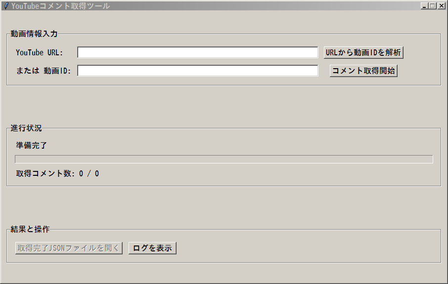

> From: https://chatgpt.com/c/6b048300-bbf4-83ee-93ce-3af4a120c3d9

# chatgpt response

画像を確認しました。これは、開発中の **YouTubeコメント取得ツール**の画面を、スクリーンショットソフトでBMP形式に保存したOCRテストサンプルですね。

画像から読み取れる画面構成は次のとおりです。

### OCR読み取り結果

**ウィンドウタイトル**
- YouTubeコメント取得ツール

**動画情報入力**
- YouTube URL：
- URLから動画IDを解析
- または 動画ID：
- コメント取得開始

**進行状況**
- 準備完了
- 取得コメント数：0 / 0

**結果と操作**
- 取得完了JSONファイルを開く
- ログを表示

### 画像ファイルの確認

| 項目 | 内容 |
|---|---|
| ファイル名 | `WS002.bmp` |
| 画像形式 | BMP |
| 画像サイズ | 906 × 575 px |
| カラーモード | RGB |
| 画面状態 | 準備完了・コメント未取得 |

### 今回のVS Codeの問題との関係

この画像は、Pythonインタープリターの選択問題を直接示すものではありません。

ただし、スクリーンショットソフトによるファイル保存とOCR処理の動作確認用サンプルとしては、画面上の文字が比較的明瞭で、ボタンや入力欄も識別しやすい画像です。

なお、先ほどの「変化ありました」という報告については、この画像がスクリーンショットソフトのOCRテスト結果だと理解しました。**インタープリターの選択状態が変化したかどうかは、まだ未確認**として扱います。

---

# you asked

message time: 2026-11-24 03:17:59

インタプリタ問題はリトルフォックスの拡張機能を無効にしたら復帰できました。
実行とデバッグのF5機動をするたびにパイソンでバッグコンソールがいくつも統合ターミナルに出てくるようになりましたけど。

---

# chatgpt response

おお、これは大きな前進です。**Python Test Explorer for Visual Studio Code（Little Fox Team）の拡張機能を無効化したことで、Pythonインタープリターの選択が復旧した**ということですね。

今回の結果から、少なくともこの拡張機能がインタープリター選択の不具合に関与していた可能性はかなり高くなりました。現時点ではアンインストールせず、無効化した状態を維持しておきましょう。

次は、F5による実行・デバッグ時のターミナル表示を整理しましょう。

### F5のたびにターミナルが増える理由

これは、必ずしも不具合ではありません。

VS CodeのPythonデバッグ設定で、次のようになっている場合、

```json
"console": "integratedTerminal"
```

デバッグ実行のたびに統合ターミナルが新しく作られる動作になります。したがって、F5を何度も実行すると、過去のデバッグ用ターミナルが複数残ることがあります。 [Visual Studio Code](https://code.visualstudio.com/docs/python/debugging?utm_source=chatgpt.com) [Visual Studio Code](https://code.visualstudio.com/docs/python/debugging?source=post_page&utm_source=chatgpt.com) [Stack Overflow](https://stackoverflow.com/questions/36688454/reading-input-during-debugging-in-python-with-vscode?utm_source=chatgpt.com)

### 対応方法は2通り

| 設定 | 動作 |
|--------|--------|
| `integratedTerminal` | 統合ターミナルに出力。標準入力も利用可能 |
| `internalConsole` | VS Codeのデバッグコンソールに出力。通常の標準入力には制約あり |

今回のプロジェクトでは、実行時のログや入力処理も確認する可能性があるため、現段階では `integratedTerminal` を維持する方が無難だと思います。

### 次に確認したいこと

まず、設定を変更せずに現在のデバッグ設定を確認しましょう。

1. VS Codeで `Ctrl + Shift + P`
2. `Debug: Open launch.json` を実行
3. 表示された `launch.json` の内容をこちらに貼り付けてください。

まだ `launch.json` が存在しない場合は、その旨を教えてください。

**設定内容を確認してから、不要なターミナルが増え続ける問題をどう扱うか判断しましょう。**

---

# you asked

message time: 2026-11-24 03:21:02

{
    // IntelliSense を使用して利用可能な属性を学べます。
    // 既存の属性の説明をホバーして表示します。
    // 詳細情報は次を確認してください: https://go.microsoft.com/fwlink/?linkid=830387
    "version": "0.2.0",
    "configurations": [
        {
            "name": "Python: 現在のファイル",
            "type": "python",
            "request": "launch",
            "program": "${file}",
            "console": "integratedTerminal",
            "justMyCode": true
        }
    ]
}

---

# chatgpt response

確認できました。現在の `launch.json` は、標準的なPythonデバッグ設定になっています。

特に、今回のターミナル増加に関係するのは次の指定です。

```json
"console": "integratedTerminal"
```

これは、デバッグ対象のPythonプログラムを統合ターミナルで実行する指定です。

### 現在の設定の評価

| 設定 | 役割 | 評価 |
|---|---|---|
| `type` | Pythonデバッグを指定 | 問題なし |
| `request` | 起動方式を指定 | 問題なし |
| `program` | 現在開いているファイルを実行 | 問題なし |
| `console` | 統合ターミナルで実行 | 今回の確認対象 |
| `justMyCode` | 自分のコードを中心にデバッグ | 問題なし |

### 改善案

現状の設定を維持しながら、ターミナルの再利用を試す方法があります。

ただし、VS Code 1.70.2のPythonデバッグ環境では、設定変更によって期待どおりにターミナルが再利用されるとは限りません。

まずは、現在の現象をもう少し正確に把握したいです。

**F5を2回、3回と実行したとき、どちらの状態になりますか？**

1. 毎回新しいターミナルが作られ、以前のターミナルも残る。
2. 新しいターミナルが作られるが、以前のターミナルは自動的に終了する。
3. 同じターミナル内にPythonデバッグコンソールのような表示が複数追加される。

この違いによって、`launch.json` の調整で対応するのか、ターミナルの終了・再利用の動作を調べるのかを判断できます。

---

# you asked

message time: 2026-11-24 03:25:49

標準でバッグコンソール出力に変更しました。

---

# chatgpt response

なるほど、統合ターミナルへの出力から、**デバッグコンソールへの出力**に変更したのですね。

それなら、F5のたびに統合ターミナルが増えていく問題を避ける方向としては合理的です。

現在の `launch.json` では、次のような変更になっているはずです。

```json
"console": "internalConsole"
```

### 変更後の動作上の違い

| 項目 | 統合ターミナル | デバッグコンソール |
|---|---|---|
| Pythonの標準出力 | 表示可能 | 表示可能 |
| Pythonの標準エラー | 表示可能 | 表示可能 |
| ターミナルの増加 | 発生する場合がある | 原則として不要 |
| `input()` による入力 | 対応 | 通常の入力には非対応 |

注意点として、今後 `input()` を使う処理をF5でデバッグする場合は、統合ターミナルに戻す必要があります。

### 次の確認

一度F5を実行してみてください。

- Pythonの実行結果がデバッグコンソールに表示されるか
- 統合ターミナルが新しく増えなくなったか
- ブレークポイントで停止できるか

この3点が確認できれば、今回のインタープリター問題とF5実行環境の復旧を、それぞれ確認できたことになります。

---

# you asked

message time: 2026-11-24 03:28:18

統合ターミナルタブのターミナル一覧内にパイソンでバッグコンソールが出現しなくなっています。

---

# chatgpt response

それは期待どおりの変化です！

`launch.json` の `console` を `internalConsole` に変更したことで、Pythonのデバッグ出力先が統合ターミナルからVS Codeの「デバッグコンソール」に切り替わっています。

つまり、次の状態になっています。

- **統合ターミナル**：Pythonデバッグ用ターミナルが新しく作られなくなった。
- **デバッグコンソール**：Pythonの実行結果やログを表示する場所になった。
- **F5**：デバッグコンソールを利用する設定になった。

ただし、まだデバッグそのものが正常に完了するかは確認できていません。

### 次の確認

F5で実行した際に、次の2点を確認しましょう。

1. Pythonの実行結果が「デバッグコンソール」に表示されるか。
2. ブレークポイントを設定した場合、そこで実行が一時停止するか。

なお、`input()` を使うプログラムでは `internalConsole` は適しません。その場合は `integratedTerminal` に戻す必要があります。

ここまで確認できれば、デバッグ環境の復旧確認はかなり進みます。

---

# you asked

message time: 2026-11-24 03:32:18

バイブコーディングの指針にユーザーでバッグなんて出来るわけ内から問題有りません。

---

# chatgpt response

なるほど（笑）。それなら、`input()` による対話入力への対応は、今回の優先事項から外してよさそうですね。

今回の開発方針では、ユーザーが手動でデバッグ操作をすることを前提にせず、テストコード・自動テスト・ログ・例外処理などで問題を検出していく、ということですね。

その前提なら、現在の設定は合理的です。

```json
"console": "internalConsole"
```

### 現時点での復旧状況

| 項目 | 状況 |
|---|---|
| Python 3.8.10の実行環境 | 確認済み |
| VS Codeのインタープリター選択 | Little Fox拡張機能の無効化で復旧 |
| F5によるデバッグ起動 | 設定変更後の動作確認待ち |
| デバッグ出力先 | デバッグコンソールへ変更済み |
| 統合ターミナルの増殖 | 発生しなくなる方向に改善 |

一点だけ、今後の設計上の区別は残しておきましょう。

**ユーザーによる手動デバッグを前提にしないことと、開発者側のデバッグ・診断機能を不要にすることは別です。**

自動テスト、ログ、トレースバック、例外情報などは、むしろ重要になります。

まずは現在の `internalConsole` 設定を維持して、F5の実行結果を確認しましょう。

---

# you asked

message time: 2026-11-24 03:33:17

殺気のサンプルは改善後のものですよ

---

# chatgpt response

ああ、そういうことでしたか。こちらの認識違いでした。失礼しました。

先ほど提示していただいた `WS002.bmp` は、すでに改善後の環境で取得・保存したOCRテストサンプルだったのですね。

それなら、スクリーンショットソフトによる画面取得・ファイル保存まで、改善後の環境で動作している実績として扱えます。

現時点では、次のように整理できます。

- Little Fox の Python Test Explorer を無効化 → インタープリター選択が復旧。
- `launch.json` の出力先を `internalConsole` に変更 → 統合ターミナルへのデバッグコンソール出現が解消。
- OCRテストサンプル → 改善後の環境で取得・保存済み。

つまり、今回の環境修復はかなり進んでいますね。今後はこの状態を基準にして、追加の変更を急がず、既存の自動テストと実行ログで安定性を確認していくのがよいと思います。

---

# you asked

message time: 2026-11-24 03:34:23

で、それを認識チェックに掛けませんか。

---

# chatgpt response

ぜひやりましょう。せっかく用意した改善後のサンプルですから、実際にOCR認識に掛けて精度を確認しましょう。

今回は単に画面を目視で読み取るのではなく、**OCRエンジンによる認識結果と、元画像に表示されている文字を照合する**形にしたいです。

確認項目は次の4点です。

1. 文字列の認識精度
2. 日本語・英数字の誤認識
3. ボタンや入力欄など、画面上の文字の読み取り漏れ
4. 改行・文字列の並び順の保持

ただ、こちらでは先ほどの `WS002.bmp` の実ファイルを再取得できていません。

**WS002.bmpをもう一度添付してもらえますか？** それを認識チェックの入力サンプルとして扱いましょう。

---

# you asked

message time: 2026-11-24 03:35:47



ローカルは"N:\(Capture)\WS002.bmp"

---

# chatgpt response

了解です。ローカルの実ファイルは次の場所ですね。

```text
N:\(Capture)\WS002.bmp
```

こちらに添付された画像も確認できています。サイズは **906 × 575 px、RGB、BMP形式**です。

今回は、以前のOCR検証で使用した \*\*Tesseract 4.1.0（日本語・英語）\*\*を使い、まず画面全体の認識を試しましょう。

### 第1段階：PSM 6でOCR認識

VS Codeのプロジェクトを開いたPowerShellで、次のコマンドを実行してください。

```powershell
& "C:\Tools\Tesseract-4.1.0\tesseract.exe" "N:\(Capture)\WS002.bmp" "N:\(Capture)\WS002_psm6" -l jpn+eng --psm 6
```

出力先：N:\\(Capture)\\WS002\_psm6.txt

この段階では画像の加工や切り抜きは行いません。スクリーンショットソフトが保存した画像を、そのまま認識させます。

実行後、次のコマンドで認識結果を表示してください。

```powershell
Get-Content "N:\(Capture)\WS002_psm6.txt" -Encoding UTF8
```

**認識結果をそのまま貼り付けてください。**

こちらで元画像と照合し、文字の正確性、誤認識、読み取り漏れを評価します。その後、必要に応じてPSM 3との比較に進みましょう。

---

# you asked

message time: 2026-11-24 03:37:24

PS P:\python-scripts\youtube_scraper> & "C:\Tools\Tesseract-4.1.0\tesseract.exe" "N:\(Capture)\WS002.bmp" "N:\(Capture)\WS002_psm6" -l jpn+eng --psm 6
用語 'C:\Tools\Tesseract-4.1.0\tesseract.exe' は、コマンドレット、関数、スクリプト ファイル、または操作可能なプログラムの名前として認識されません。名前が正しく記述されてい
ることを確認し、パスが含まれている場合はそのパスが正しいことを確認してから、再試行してください。
発生場所 行:1 文字:2
+ & <<<<  "C:\Tools\Tesseract-4.1.0\tesseract.exe" "N:\(Capture)\WS002.bmp" "N:\(Capture)\WS002_psm6" -l jpn+eng --psm 6
    + CategoryInfo          : ObjectNotFound: (C:\Tools\Tesseract-4.1.0\tesseract.exe:String) []、CommandNotFoundException
    + FullyQualifiedErrorId : CommandNotFoundException
 
PS P:\python-scripts\youtube_scraper>

---

# chatgpt response

失礼しました。こちらが実際のインストール先を確認せず、誤った実行パスを案内していました。

以前の確認記録から、正しいパスは次のとおりです。

```text
C:\Tools\Tesseract-OCR\tesseract.exe
```

また、以前に確認した実際のエンジンバージョンは **4.0.0.20190314** です。インストーラー名の4.1.0と混同していました。

### 改めて実行するコマンド

まず、バージョン確認から行いましょう。

```powershell
& "C:\Tools\Tesseract-OCR\tesseract.exe" --version
```

その後、OCRを実行します。

```powershell
& "C:\Tools\Tesseract-OCR\tesseract.exe" "N:\(Capture)\WS002.bmp" "N:\(Capture)\WS002_psm6" -l jpn+eng --psm 6
```

認識結果の表示：

```powershell
Get-Content "N:\(Capture)\WS002_psm6.txt" -Encoding UTF8
```

今回は既存のTesseract環境をそのまま利用し、余計なインストールや設定変更は行いません。

実行結果を確認してから、元画像との照合に進みましょう。

---

# you asked

message time: 2026-11-24 03:39:14

PS P:\python-scripts\youtube_scraper> & "C:\Tools\Tesseract-OCR\tesseract.exe" "N:\(Capture)\WS002.bmp" "N:\(Capture)\WS002_psm6" -l jpn+eng --psm 6
Tesseract Open Source OCR Engine v4.0.0.20190314 with Leptonica
PS P:\python-scripts\youtube_scraper> Get-Content "N:\(Capture)\WS002_psm6.txt" -Encoding UTF8
                                                                   1x
動画情報入力

YouTube URL:                                                                   URLから動画1Dを解析|

または 動画D:                                      コメント取得始

行状況

準備売了
ーーバー
取得コメント数: 0 / 0

果と操作

取得完了50Mファイルを開く| ログを表示


PS P:\python-scripts\youtube_scraper>

---

# chatgpt response

認識結果を確認しました。元画像と照合できました。

結論から言うと、**日本語の文字認識自体は動作していますが、画面全体の読み取り精度には改善の余地があります。**

ただし、今回の結果は改善後のスクリーンショット画像を加工せずに認識させたものなので、基準となる初回テストとして有用です。

## 1. 元画像との照合結果

元画像：WS002.bmp（906 × 575 px）

[images]

| 元画像の正しい表示 | OCR認識結果 | 評価 |
|--------|--------|--------|
| 動画情報入力 | 動画情報入力 | (正確) |
| YouTube URL\: | YouTube URL\: | (正確) |
| URLから動画IDを解析 | URLから動画1Dを解析 | (誤認識) |
| または 動画ID\: | または 動画D\: | (一部欠落) |
| コメント取得開始 | コメント取得始 | (末尾欠落) |
| 進行状況 | 行状況 | (先頭欠落) |
| 準備完了 | 準備売了 | (誤認識) |
| 取得コメント数: 0 / 0 | 取得コメント数: 0 / 0 | (正確) |
| 結果と操作 | 果と操作 | (先頭欠落) |
| 取得完了JSONファイルを開く | 取得完了50Mファイルを開く | (誤認識) |
| ログを表示 | ログを表示 | (正確) |

## 2. 気になる問題

今回の認識結果には、大きく3種類の問題があります。

- **文字の誤認識**：「準備完了」の「完」が「売」になる。
- **文字の脱落**：「進行状況」の先頭文字が欠落する。
- **配置の認識不良**：ボタンの文字列が隣接する領域と混ざったり、末尾が欠落したりする。

特に、`JSON` が `50M` と認識されている点は興味深いです。英数字と日本語が混在するボタンの認識精度を調べる必要があります。

## 3. 次の検証：PSM 3との比較

今回はPSM 6を使用しました。

次はページ全体のレイアウトを自動解析するPSM 3で比較してみましょう。

PowerShellで次を実行してください。

```powershell
& "C:\Tools\Tesseract-OCR\tesseract.exe" "N:\(Capture)\WS002.bmp" "N:\(Capture)\WS002_psm3" -l jpn+eng --psm 3
```

続いて結果を表示します。

```powershell
Get-Content "N:\(Capture)\WS002_psm3.txt" -Encoding UTF8
```

## 4. 今回の検証方針

| 検証段階 | 内容 |
|--------|--------|
| PSM 6 | 初回認識結果・取得済み |
| PSM 3 | ページレイアウト自動解析 |
| PSM 11 | 疎な文字配置への対応 |
| 比較評価 | 誤認識・欠落・余計な文字の比較 |

まずはPSM 3の結果を見ましょう。

**ここで重要なのは、認識結果を改善するために画像を加工する前に、OCRエンジン側の設定でどこまで改善できるかを確認することです。**

---

# you asked

message time: 2026-11-24 03:42:09

PS P:\python-scripts\youtube_scraper> & "C:\Tools\Tesseract-OCR\tesseract.exe" "N:\(Capture)\WS002.bmp" "N:\(Capture)\WS002_psm3" -l jpn+eng --psm 3
Tesseract Open Source OCR Engine v4.0.0.20190314 with Leptonica
PS P:\python-scripts\youtube_scraper> Get-Content "N:\(Capture)\WS002_psm3.txt" -Encoding UTF8
同回四|


動画情報入力

YouTube URL:                                                                   URLから動画1Dを解析
または 動画ID:                                                             コメント取得開始


TR
準備完了

I

取得コメント数: 0/0


(ER CHE

取得完了J50Mファイルを開く| ログを表示


PS P:\python-scripts\youtube_scraper>

---

# chatgpt response

PSM 3の結果を確認しました。元画像とPSM 6の結果も含めて比較すると、興味深い傾向が出ています。

**今回の画面では、PSM 3よりPSM 6の方が実用的な認識結果になっています。**

## 1. PSM 6とPSM 3の比較

| 認識対象 | PSM 6 | PSM 3 |
|--------|--------|--------|
| 動画情報入力 | 正確 | 正確 |
| YouTube URL | 正確 | 正確 |
| URLから動画IDを解析 | `1D` と誤認 | `1D` と誤認 |
| または 動画ID | `D` に欠落 | 正確 |
| コメント取得開始 | 末尾欠落 | 正確 |
| 進行状況 | 先頭欠落 | `TR` などに分断 |
| 準備完了 | 誤認識 | 正確 |
| 取得コメント数 | 正確 | 正確 |
| 結果と操作 | 先頭欠落 | `ER CHE` などに分断 |
| JSONファイルを開く | `50M` と誤認 | `J50M` と誤認 |
| ログを表示 | 正確 | 正確 |

(PSM 6優勢)

PSM 3では「準備完了」「または 動画ID」「コメント取得開始」が改善しました。

一方、画面上の余計な文字列や分断が増えています。特に `TR`、`I`、`(ER CHE` は、本来の画面に存在しない文字列です。

## 2. なぜPSM 6の方がよかったのか

今回の画像は、一般的な文章や書籍のページではなく、GUIアプリケーションのスクリーンショットです。

- 文字が画面内の複数箇所に分散している
- 入力欄やボタンが文字の周囲に存在する
- グループボックスによって画面が区画化されている
- 文字列の配置に大きな空白がある

PSM 3の自動レイアウト解析では、こうしたGUI特有の配置をうまく扱えなかった可能性があります。

PSM 6は、画像全体を単一のテキストブロックとして扱うため、今回のような画面では比較的まとまった結果になったと考えられます。

## 3. 次の検証：PSM 11

次は、疎に配置された文字を検出するPSM 11を試しましょう。

GUI画面のように、文字列が離れた場所に配置されている画像では比較する価値があります。

```powershell
& "C:\Tools\Tesseract-OCR\tesseract.exe" "N:\(Capture)\WS002.bmp" "N:\(Capture)\WS002_psm11" -l jpn+eng --psm 11
```

結果の表示：

```powershell
Get-Content "N:\(Capture)\WS002_psm11.txt" -Encoding UTF8
```

## 4. 現時点での評価

| 検証項目 | 結果 |
|--------|--------|
| OCRエンジンの起動 | (成功) |
| 日本語認識 | (成功) |
| 英数字認識 | (改善余地あり) |
| GUI文字列の認識 | (改善余地あり) |
| レイアウト保持 | PSM 6が比較的良好 |

まだ画像加工や前処理はしていません。

まずPSM 11まで比較し、その結果を踏まえて、最適なOCR設定を選定しましょう。

---

# you asked

message time: 2026-11-24 03:43:57

PS P:\python-scripts\youtube_scraper> & "C:\Tools\Tesseract-OCR\tesseract.exe" "N:\(Capture)\WS002.bmp" "N:\(Capture)\WS002_psm11" -l jpn+eng --psm 11
Tesseract Open Source OCR Engine v4.0.0.20190314 with Leptonica
PS P:\python-scripts\youtube_scraper> Get-Content "N:\(Capture)\WS002_psm11.txt" -Encoding UTF8
=

ub

Sg

Ss

= (5 xi

動画情報入力

YouTube URL:

|  。 、 、 ULから動画0を解析

または 動画ID:                                                                            コメント取得開始

TR

準備完了

I

取得コメント数: 0/0

(ER CHE

取得完了J50Mファイルを開く| ログを表示


PS P:\python-scripts\youtube_scraper>

---

# chatgpt response

PSM 11の結果を確認しました。今回のスクリーンショットでは、**PSM 11はPSM 6よりも認識結果が改善していません。むしろ、余計な誤認識が増えています。**

## 1. PSM 11の認識結果

今回の結果を実際の画面と照合すると、次のようになります。

| 画面上の文字 | PSM 11の結果 | 評価 |
|--------|--------|--------|
| 動画情報入力 | 動画情報入力 | (正確) |
| YouTube URL\: | YouTube URL\: | (正確) |
| URLから動画IDを解析 | ULから動画0を解析 | (誤認識) |
| または 動画ID\: | または 動画ID\: | (正確) |
| コメント取得開始 | コメント取得開始 | (正確) |
| 進行状況 | TR | (認識失敗) |
| 準備完了 | 準備完了 | (正確) |
| 取得コメント数: 0 / 0 | 取得コメント数: 0/0 | (ほぼ正確) |
| 結果と操作 | \(ER CHE | (認識失敗) |
| 取得完了JSONファイルを開く | 取得完了J50Mファイルを開く | (誤認識) |
| ログを表示 | ログを表示 | (正確) |

さらに、画面上に存在しない `=`、`ub`、`Sg`、`Ss` などの文字列まで出力されています。

## 2. PSM 6・3・11の比較

| 比較項目 | PSM 6 | PSM 3 | PSM 11 |
|--------|--------|--------|--------|
| 画面内の文字のまとまり | 比較的良好 | 不安定 | 不安定 |
| 正しい文字列の抽出 | 比較的良好 | 一部良好 | 一部良好 |
| 余計な文字の混入 | 少なめ | 多い | 多い |
| 空白・改行の乱れ | 比較的少ない | 多い | 多い |
| 総合評価 | **最有力** | 劣る | 劣る |

PSM 11は、画像内に散在する文字を個別に検出することを想定したモードです。今回のような、ラベル・ボタン・入力欄などが一定の画面構造を形成しているGUIでは、必ずしも適していないようです。

## 3. 現時点での判断

(暫定採用候補：PSM 6)

現段階では、PSM 6を基準にして次の検証へ進むのが合理的です。

ただし、まだPSM 6の認識精度が十分とは言えません。特に以下の問題が残っています。

- `ID` が `1D` になる。
- `JSON` が `50M` や `J50M` になる。
- GUIの枠や配置に近接する文字の先頭・末尾が欠落する。
- `進行状況` や `結果と操作` など、短い見出しの認識が不安定。

## 4. 次の検証：画像を2倍に拡大してPSM 6で認識

次は認識モードを変更するのではなく、入力画像の解像度を変更してみましょう。

Tesseract 4.0.0には画像の拡大処理もありますが、まずはImageMagickなどの追加ソフトを導入せず、Tesseract自身の `--dpi` だけを変更する方法ではなく、画像そのものを拡大した条件で比較したいところです。

そのため、まず現在の環境でPythonからPillowが利用できるか確認しましょう。

次のコマンドをPowerShellで実行してください。

```powershell
python -c "from PIL import Image; print('Pillow:', Image.__version__)"
```

この結果を確認してから、元画像を維持したまま2倍画像を作成する手順に進みます。

---
Powered by [AI Exporter](https://saveai.net)