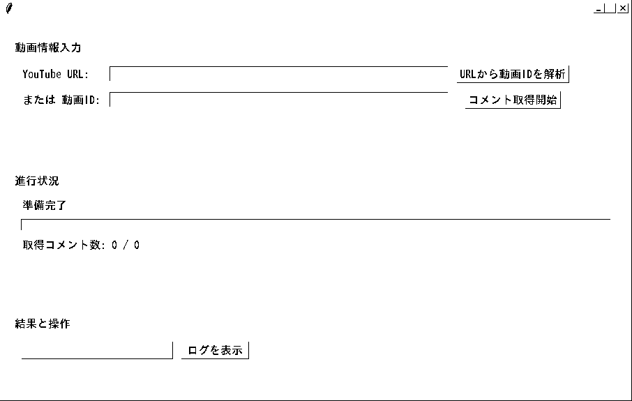

> From: https://chatgpt.com/c/6b0489da-8ee0-83e8-8c94-39652960625e

# chatgpt response

PSM 11の結果を確認しました。今回のスクリーンショットでは、**PSM 11はPSM 6よりも認識結果が改善していません。むしろ、余計な誤認識が増えています。**

## 1. PSM 11の認識結果

今回の結果を実際の画面と照合すると、次のようになります。

| 画面上の文字 | PSM 11の結果 | 評価 |
|--------|--------|--------|
| 動画情報入力 | 動画情報入力 | (正確) |
| YouTube URL\: | YouTube URL\: | (正確) |
| URLから動画IDを解析 | ULから動画0を解析 | (誤認識) |
| または 動画ID\: | または 動画ID\: | (正確) |
| コメント取得開始 | コメント取得開始 | (正確) |
| 進行状況 | TR | (認識失敗) |
| 準備完了 | 準備完了 | (正確) |
| 取得コメント数: 0 / 0 | 取得コメント数: 0/0 | (ほぼ正確) |
| 結果と操作 | \(ER CHE | (認識失敗) |
| 取得完了JSONファイルを開く | 取得完了J50Mファイルを開く | (誤認識) |
| ログを表示 | ログを表示 | (正確) |

さらに、画面上に存在しない `=`、`ub`、`Sg`、`Ss` などの文字列まで出力されています。

## 2. PSM 6・3・11の比較

| 比較項目 | PSM 6 | PSM 3 | PSM 11 |
|--------|--------|--------|--------|
| 画面内の文字のまとまり | 比較的良好 | 不安定 | 不安定 |
| 正しい文字列の抽出 | 比較的良好 | 一部良好 | 一部良好 |
| 余計な文字の混入 | 少なめ | 多い | 多い |
| 空白・改行の乱れ | 比較的少ない | 多い | 多い |
| 総合評価 | **最有力** | 劣る | 劣る |

PSM 11は、画像内に散在する文字を個別に検出することを想定したモードです。今回のような、ラベル・ボタン・入力欄などが一定の画面構造を形成しているGUIでは、必ずしも適していないようです。

## 3. 現時点での判断

(暫定採用候補：PSM 6)

現段階では、PSM 6を基準にして次の検証へ進むのが合理的です。

ただし、まだPSM 6の認識精度が十分とは言えません。特に以下の問題が残っています。

- `ID` が `1D` になる。
- `JSON` が `50M` や `J50M` になる。
- GUIの枠や配置に近接する文字の先頭・末尾が欠落する。
- `進行状況` や `結果と操作` など、短い見出しの認識が不安定。

## 4. 次の検証：画像を2倍に拡大してPSM 6で認識

次は認識モードを変更するのではなく、入力画像の解像度を変更してみましょう。

Tesseract 4.0.0には画像の拡大処理もありますが、まずはImageMagickなどの追加ソフトを導入せず、Tesseract自身の `--dpi` だけを変更する方法ではなく、画像そのものを拡大した条件で比較したいところです。

そのため、まず現在の環境でPythonからPillowが利用できるか確認しましょう。

次のコマンドをPowerShellで実行してください。

```powershell
python -c "from PIL import Image; print('Pillow:', Image.__version__)"
```

この結果を確認してから、元画像を維持したまま2倍画像を作成する手順に進みます。

---

# you asked

message time: 2026-11-24 03:45:46

PS P:\python-scripts\youtube_scraper> python -c "from PIL import Image; print('Pillow:', Image.__version__)"
Pillow: 10.4.0
PS P:\python-scripts\youtube_scraper>

---

# chatgpt response

Pillow 10.4.0が正常に読み込めています。これなら追加ソフトを導入せず、Pythonだけで画像を拡大できます。

次は、**元画像を変更せず、2倍に拡大したBMP画像を別ファイルとして作成**しましょう。

## 1. 画像を2倍に拡大

PowerShellで次のコマンドを実行してください。

```powershell
python -c "from PIL import Image; src = r'N:\(Capture)\WS002.bmp'; dst = r'N:\(Capture)\WS002_2x.bmp'; img = Image.open(src); print('Original:', img.size); enlarged = img.resize((img.width * 2, img.height * 2), Image.Resampling.LANCZOS); enlarged.save(dst); print('Enlarged:', enlarged.size); print('Saved:', dst)"
```

今回の元画像は906×575ピクセルなので、作成される画像は次のサイズになります。

**元画像** 906 × 575 px

**拡大画像** (2倍) 1812 × 1150 px

---

補間方式：LANCZOS（高品質な拡大補間）

## 2. 実行結果を確認

出力された `Original`、`Enlarged`、`Saved` の3行を貼り付けてください。

確認できたら、拡大画像に対してPSM 6でOCRを実行し、元画像のPSM 6と比較します。

なお、拡大によって文字の輪郭が滑らかになることはありますが、元画像に存在しない情報が復元されるわけではありません。今回の比較では、拡大が実際に認識精度を改善するかを確認します。

---

# you asked

message time: 2026-11-24 03:46:36

PS P:\python-scripts\youtube_scraper> python -c "from PIL import Image; src = r'N:\(Capture)\WS002.bmp'; dst = r'N:\(Capture)\WS002_2x.bmp'; img = Image.open(src); print('Original:', img.size); enlarged = img.resize((img.width * 2, img.height * 2), Image.Resampling.LANCZOS); enlarged.save(dst); print('Enlarged:', enlarged.size); print('Saved:', dst)"
Original: (906, 575)
Enlarged: (1812, 1150)
Saved: N:\(Capture)\WS002_2x.bmp
PS P:\python-scripts\youtube_scraper>

---

# chatgpt response

拡大画像の作成は成功です。サイズも予定どおり **1812×1150ピクセル** になっています。

次は、元画像で最も良好だったPSM 6を使い、拡大画像を読み取ります。

## 1. 拡大画像をOCRにかける

次のコマンドを実行してください。

```powershell
& "C:\Tools\Tesseract-OCR\tesseract.exe" "N:\(Capture)\WS002_2x.bmp" "N:\(Capture)\WS002_2x_psm6" -l jpn+eng --psm 6
```

## 2. 認識結果を表示

続けてこちらを実行してください。

```powershell
Get-Content "N:\(Capture)\WS002_2x_psm6.txt" -Encoding UTF8
```

結果を貼り付けてください。

今回は特に、次の3点を重点的に比較します。

1. `ID` と `JSON` の誤認識が改善するか。
2. `進行状況` と `結果と操作` の欠落が改善するか。
3. 元画像では正しく認識できていた文字が、拡大によって逆に悪化しないか。

この検証で、画像の前処理がOCR精度に与える影響を一つずつ切り分けていきましょう。

---

# you asked

message time: 2026-11-24 03:47:22

PS P:\python-scripts\youtube_scraper> & "C:\Tools\Tesseract-OCR\tesseract.exe" "N:\(Capture)\WS002_2x.bmp" "N:\(Capture)\WS002_2x_psm6" -l jpn+eng --psm 6
Tesseract Open Source OCR Engine v4.0.0.20190314 with Leptonica
PS P:\python-scripts\youtube_scraper> Get-Content "N:\(Capture)\WS002_2x_psm6.txt" -Encoding UTF8
                                     本本
動画情報入力
YouTube URL:    |                                                               URLから動画1Dを解析|
または 動画ID:  |                                                                       コメン ト取得開始|
行状況
準備完了
ーー一
取得コメント数: 0 / 0
果と操作
取得完iJS0Mアァイルを開く |   ログを表示 |


PS P:\python-scripts\youtube_scraper>

---

# chatgpt response

結果を確認しました。今回の2倍拡大では、**OCRの認識精度は全体として改善せず、元画像のPSM 6と同程度か、一部悪化しています。**

ただし、拡大によって文字のまとまり方には変化が出ています。

## 1. 元画像と2倍拡大画像の比較

| 画面上の文字 | 元画像 PSM 6 | 2倍画像 PSM 6 |
|--------|--------|--------|
| 動画情報入力 | 正確 | 正確 |
| YouTube URL\: | 正確 | 正確 |
| URLから動画IDを解析 | ID → 1D | ID → 1D |
| または 動画ID\: | 正確 | 正確 |
| コメント取得開始 | 末尾欠落 | ほぼ正確 |
| 進行状況 | 先頭欠落 | 先頭欠落 |
| 準備完了 | 正確 | 正確 |
| 取得コメント数: 0 / 0 | 正確 | 正確 |
| 結果と操作 | 先頭欠落 | 先頭欠落 |
| 取得完了JSONファイルを開く | JSON → 50M | JSON → JS0M |
| ログを表示 | 正確 | 正確 |

注目したいのは、拡大画像では `コメント取得開始` の末尾が認識されるようになった一方、`進行状況` と `結果と操作` の欠落は解消されなかった点です。

また、`JSON` の誤認識も残っています。

## 2. 現時点の検証結果

| 条件 | 総合評価 |
|--------|--------|
| 元画像・PSM 6 | (現時点の基準) |
| 元画像・PSM 3 | 不採用候補 |
| 元画像・PSM 11 | 不採用候補 |
| 2倍画像・PSM 6 | 改善効果は限定的 |

ここで一つ注意があります。

今回のLANCZOS拡大は、元のピクセル情報を補間して増やしたものです。文字の輪郭が滑らかになる反面、OCRにとって必要な文字の境界が明瞭になるとは限りません。

したがって、単純な拡大を標準処理に採用するのは、まだ早いです。

## 3. 次の検証：元画像のままOCRの解像度認識を指定する

次は画像そのものを変更せず、Tesseractに解像度を指定してみます。

Tesseractは画像のDPI情報を参考に文字の大きさを推定するため、これを変更したときの挙動を比較できます。

まず、元画像のDPI情報を調べましょう。

```powershell
python -c "from PIL import Image; img = Image.open(r'N:\(Capture)\WS002.bmp'); print('DPI:', img.info.get('dpi', 'Not specified')); print('Size:', img.size)"
```

結果を貼り付けてください。

この確認後、必要に応じて `--dpi` を指定したPSM 6のテストに進みます。今回はまだ画像の加工も追加ソフトの導入も必要ありません。

---

# you asked

message time: 2026-11-24 03:49:01

PS P:\python-scripts\youtube_scraper> python -c "from PIL import Image; img = Image.open(r'N:\(Capture)\WS002.bmp'); print('DPI:', img.info.get('dpi', 'Not specified')); print('Size:', img.size)"
DPI: (96.01194815354799, 96.01194815354799)
Size: (906, 575)
PS P:\python-scripts\youtube_scraper>

---

# chatgpt response

確認できました。元画像には約96 DPIの情報が記録されています。

```text
DPI: (96.0119, 96.0119)
Size: (906, 575)
```

これはWindowsの一般的な画面キャプチャで見られる値です。異常な設定ではありません。

次は、画像自体は変更せず、Tesseractに指定するDPIだけを変更して比較しましょう。

## 1. DPI 150でOCRを実行

まず、96 DPIから150 DPIに変更した条件を試します。

```powershell
& "C:\Tools\Tesseract-OCR\tesseract.exe" "N:\(Capture)\WS002.bmp" "N:\(Capture)\WS002_dpi150_psm6" -l jpn+eng --psm 6 --dpi 150
```

続けて認識結果を表示します。

```powershell
Get-Content "N:\(Capture)\WS002_dpi150_psm6.txt" -Encoding UTF8
```

## 2. 今回の比較目的

- 画像のピクセル数は906×575のまま。
- 画像の拡大・縮小は行わない。
- PSMは6のまま。
- DPI指定だけを96相当から150に変更。

これで認識結果が変化すれば、Tesseractの文字サイズ推定にDPI指定が影響している可能性を確認できます。

なお、DPIを変更しても実際の文字の解像度が上がるわけではありません。あくまで認識処理上の設定変更です。

---

# you asked

message time: 2026-11-24 03:49:58

PS P:\python-scripts\youtube_scraper> & "C:\Tools\Tesseract-OCR\tesseract.exe" "N:\(Capture)\WS002.bmp" "N:\(Capture)\WS002_dpi150_psm6" -l jpn+eng --psm 6 --dpi 150
Tesseract Open Source OCR Engine v4.0.0.20190314 with Leptonica
PS P:\python-scripts\youtube_scraper> Get-Content "N:\(Capture)\WS002_dpi150_psm6.txt" -Encoding UTF8
                                                                   1x
動画情報入力

YouTube URL:                                                                   URLから動画1Dを解析|

または 動画D:                                      コメント取得始

行状況

準備売了
ーーバー
取得コメント数: 0 / 0

果と操作

取得完了50Mファイルを開く| ログを表示


PS P:\python-scripts\youtube_scraper>

---

# chatgpt response

DPI 150の結果を確認しました。これは興味深い結果です。

**元画像・PSM 6・DPI 150の認識結果は、元画像・PSM 6のDPI未指定時とほぼ同じです。**

つまり、今回の画像ではDPI指定を変更しても、認識精度に目立った改善はありませんでした。

## 1. ここまでの比較結果

| 検証条件 | 結果 |
|---|---|
| 元画像・PSM 6・DPI未指定 | 基準 |
| 元画像・PSM 3 | 誤認識・ノイズ増加 |
| 元画像・PSM 11 | 誤認識・ノイズ増加 |
| 2倍画像・PSM 6 | 一部改善、一部悪化 |
| 元画像・PSM 6・DPI 150 | ほぼ変化なし |

ここまでの検証から、単純な拡大やDPI指定よりも、**文字領域の切り出しと画像のコントラスト・二値化**を調べるほうが有望だと考えます。

## 2. 次の検証：グレースケール化と二値化

次はPillowを使って、元画像から白黒画像を作成します。

今回は、まずグレースケール化だけを行います。二値化まで同時に行うと、どちらの処理が影響したのか分からなくなるためです。

PowerShellで次を実行してください。

```powershell
python -c "from PIL import Image; src = r'N:\(Capture)\WS002.bmp'; dst = r'N:\(Capture)\WS002_gray.bmp'; img = Image.open(src).convert('L'); img.save(dst); print('Mode:', img.mode); print('Size:', img.size); print('Saved:', dst)"
```

これで元画像の色を輝度情報に変換した画像が作成されます。

作成できたら、次のコマンドでPSM 6のOCRを実行します。

```powershell
& "C:\Tools\Tesseract-OCR\tesseract.exe" "N:\(Capture)\WS002_gray.bmp" "N:\(Capture)\WS002_gray_psm6" -l jpn+eng --psm 6
```

結果表示：

```powershell
Get-Content "N:\(Capture)\WS002_gray_psm6.txt" -Encoding UTF8
```

この検証で、色の情報を取り除くことが認識結果に影響するかを確認しましょう。

---

# you asked

message time: 2026-11-24 03:51:08

PS P:\python-scripts\youtube_scraper> python -c "from PIL import Image; src = r'N:\(Capture)\WS002.bmp'; dst = r'N:\(Capture)\WS002_gray.bmp'; img = Image.open(src).convert('L'); img.save(dst); print('Mode:', img.mode); print('Size:', img.size); print('Saved:', dst)"
Mode: L
Size: (906, 575)
Saved: N:\(Capture)\WS002_gray.bmp
PS P:\python-scripts\youtube_scraper> & "C:\Tools\Tesseract-OCR\tesseract.exe" "N:\(Capture)\WS002_gray.bmp" "N:\(Capture)\WS002_gray_psm6" -l jpn+eng --psm 6
Tesseract Open Source OCR Engine v4.0.0.20190314 with Leptonica
PS P:\python-scripts\youtube_scraper> Get-Content "N:\(Capture)\WS002_gray_psm6.txt" -Encoding UTF8
CEE LASS                            =
動画情報入力
YouTube URL:                                                      URLから動画1Dを解析
または 動画ID:                              コメント取得関始
進行状況
準備完了
i
取得コメント数: 0 / 0
結果と操作
取得完了JSONファイルを開く| ログを表示


PS P:\python-scripts\youtube_scraper>

---

# chatgpt response

おお、これは今回の検証でかなり重要な結果が出ました。

**グレースケール化によって、これまで欠落していた見出しが正しく認識されています。**

特に注目すべきなのは、次の3項目です。

## 1. 元画像PSM 6との比較

| 画面上の文字 | 元画像 PSM 6 | グレースケール PSM 6 |
|--------|--------|--------|
| 動画情報入力 | 正確 | 正確 |
| YouTube URL\: | 正確 | 正確 |
| URLから動画IDを解析 | ID → 1D | ID → 1D |
| または 動画ID\: | 正確 | 正確 |
| コメント取得開始 | 末尾欠落 | 関始と誤認 |
| 進行状況 | 先頭欠落 | **正確** |
| 準備完了 | 正確 | 正確 |
| 取得コメント数: 0 / 0 | 正確 | 正確 |
| 結果と操作 | 先頭欠落 | **正確** |
| 取得完了JSONファイルを開く | JSON → 50M | **正確** |
| ログを表示 | 正確 | 正確 |

今回のグレースケール化では、`進行状況`、`結果と操作`、`取得完了JSONファイルを開く` が改善しています。

一方、`コメント取得開始` は誤認識が残っています。

また、画像上部に存在しない `CEE LASS` という文字列が出力されています。ノイズが完全になくなったわけではありません。

## 2. 現時点での暫定評価

(最有力：グレースケール化 + PSM 6)

今回の結果は、単純な2倍拡大やDPI変更よりも明確な改善です。

ただし、まだ二値化や画像のコントラスト調整を試していないため、グレースケール化を最終採用するのは保留しましょう。

## 3. 次の検証：白黒二値化

今度はグレースケール画像を白と黒の2色だけに変換します。

まずは固定しきい値128を使用します。

```powershell
python -c "from PIL import Image; src = r'N:\(Capture)\WS002_gray.bmp'; dst = r'N:\(Capture)\WS002_binary128.bmp'; img = Image.open(src).convert('L'); binary = img.point(lambda p: 255 if p >= 128 else 0, mode='1'); binary.save(dst); print('Mode:', binary.mode); print('Size:', binary.size); print('Saved:', dst)"
```

続いてOCRを実行します。

```powershell
& "C:\Tools\Tesseract-OCR\tesseract.exe" "N:\(Capture)\WS002_binary128.bmp" "N:\(Capture)\WS002_binary128_psm6" -l jpn+eng --psm 6
```

結果を表示します。

```powershell
Get-Content "N:\(Capture)\WS002_binary128_psm6.txt" -Encoding UTF8
```

今回の比較では、特に次の点を確認します。

- グレースケールで正しくなった `進行状況` が維持されるか。
- `JSON` の認識精度が維持されるか。
- 上部のノイズ `CEE LASS` が消えるか。
- `コメント取得開始` の認識が改善するか。

二値化は背景と文字の明暗差を強調できる反面、細い文字やアンチエイリアスの情報を失う場合もあります。結果を見て判断しましょう。

---

# you asked

message time: 2026-11-24 03:52:24

PS P:\python-scripts\youtube_scraper> python -c "from PIL import Image; src = r'N:\(Capture)\WS002_gray.bmp'; dst = r'N:\(Capture)\WS002_binary128.bmp'; img = Image.open(src).convert('L'); binary = img.point(lambda p: 255 if p >= 128 else 0, mode='1'); binary.save(dst); print('Mode:', binary.mode); print('Size:', binary.size); print('Saved:', dst)"
Mode: 1
Size: (906, 575)
Saved: N:\(Capture)\WS002_binary128.bmp
PS P:\python-scripts\youtube_scraper> & "C:\Tools\Tesseract-OCR\tesseract.exe" "N:\(Capture)\WS002_binary128.bmp" "N:\(Capture)\WS002_binary128_psm6" -l jpn+eng --psm 6
Tesseract Open Source OCR Engine v4.0.0.20190314 with Leptonica
PS P:\python-scripts\youtube_scraper> Get-Content "N:\(Capture)\WS002_binary128_psm6.txt" -Encoding UTF8
を                                                                                   =LIx)
動画情報入力
YouTube URL:                                                      URLから動画IDを解析
または 動画ID:                                                     コメント取得開始
進行状況
準備完了
ーーババババババババババババーー一
取得コメント数: 0/0
結果と操作
ログを表示


PS P:\python-scripts\youtube_scraper>

---

# chatgpt response

これはかなり良い結果です。今回の固定しきい値128による二値化は、**これまで問題になっていた `ID` の誤認識を改善し、`コメント取得開始` も正しく認識しています。**

ただし、別の問題も発生しています。

## 1. グレースケールと二値化の比較

| 画面上の文字 | グレースケール | 二値化128 |
|--------|--------|--------|
| 動画情報入力 | 正確 | 正確 |
| YouTube URL\: | 正確 | 正確 |
| URLから動画IDを解析 | ID → 1D | **正確** |
| または 動画ID\: | 正確 | 正確 |
| コメント取得開始 | 関始 | **正確** |
| 進行状況 | 正確 | 正確 |
| 準備完了 | 正確 | 正確 |
| 取得コメント数: 0 / 0 | 正確 | 正確 |
| 結果と操作 | 正確 | 正確 |
| 取得完了JSONファイルを開く | 正確 | **出力から欠落** |
| ログを表示 | 正確 | 正確 |

(現時点の最有力候補：二値化128 + PSM 6)

特に、`URLから動画IDを解析` と `コメント取得開始` が正確に認識されたのは大きな改善です。

一方、二値化によって細い文字やボタン内の文字が失われる可能性も見えてきました。`取得完了JSONファイルを開く` が欠落した点は無視できません。

また、上部の `を`、`=LIx)` や、進行状況バーの長い横線も誤認識されています。

## 2. 次の検証：二値化のしきい値を変更

128という値が適切なのかを確認しましょう。

次はしきい値を **160** に変更します。

128よりも高い値にすることで、より暗い画素まで黒として残す範囲が広がります。文字の細い部分が維持される可能性があります。

まず、次のコマンドで画像を作成してください。

```powershell
python -c "from PIL import Image; src = r'N:\(Capture)\WS002_gray.bmp'; dst = r'N:\(Capture)\WS002_binary160.bmp'; img = Image.open(src).convert('L'); binary = img.point(lambda p: 255 if p >= 160 else 0, mode='1'); binary.save(dst); print('Mode:', binary.mode); print('Size:', binary.size); print('Saved:', dst)"
```

続いてOCRを実行します。

```powershell
& "C:\Tools\Tesseract-OCR\tesseract.exe" "N:\(Capture)\WS002_binary160.bmp" "N:\(Capture)\WS002_binary160_psm6" -l jpn+eng --psm 6
```

結果を表示します。

```powershell
Get-Content "N:\(Capture)\WS002_binary160_psm6.txt" -Encoding UTF8
```

## 3. 今回の検証で確認したいこと

- `取得完了JSONファイルを開く` が復活するか。
- `URLから動画IDを解析` の正確さが維持されるか。
- `コメント取得開始` の認識が維持されるか。
- 上部の不要な文字や進行状況バーの誤認識がどう変化するか。

ここまでの結果を見ると、今回のOCRでは画像の前処理がかなり重要な要素になっています。Tesseractの設定を闇雲に変えるより、まずはこのしきい値を比較して最適な前処理を探るのがよさそうです。

---

# you asked

message time: 2026-11-24 03:53:40

PS P:\python-scripts\youtube_scraper> python -c "from PIL import Image; src = r'N:\(Capture)\WS002_gray.bmp'; dst = r'N:\(Capture)\WS002_binary160.bmp'; img = Image.open(src).convert('L'); binary = img.point(lambda p: 255 if p >= 160 else 0, mode='1'); binary.save(dst); print('Mode:', binary.mode); print('Size:', binary.size); print('Saved:', dst)"
Mode: 1
Size: (906, 575)
Saved: N:\(Capture)\WS002_binary160.bmp
PS P:\python-scripts\youtube_scraper> & "C:\Tools\Tesseract-OCR\tesseract.exe" "N:\(Capture)\WS002_binary160.bmp" "N:\(Capture)\WS002_binary160_psm6" -l jpn+eng --psm 6
Tesseract Open Source OCR Engine v4.0.0.20190314 with Leptonica
PS P:\python-scripts\youtube_scraper> Get-Content "N:\(Capture)\WS002_binary160_psm6.txt" -Encoding UTF8
BOE ESA間間間                           alales)
動画情報入力
YouTube URL:                                                                            URLから動画1Dを解析
または 動画10:                              コメント取得開始
進行状況
準備完了
—
取得コメント数: 0 /0
結果と操作
取得完了」S0Nファイルを開く| ログを表示


PS P:\python-scripts\youtube_scraper>

---

# chatgpt response

しきい値160の結果を確認しました。今回は、128とは異なる傾向が出ています。

**160では、ボタンやラベルの文字が比較的多く残りましたが、英数字の誤認識は再び発生しています。**

## 1. 二値化128と160の比較

| 画面上の文字 | 二値化128 | 二値化160 |
|--------|--------|--------|
| 動画情報入力 | 正確 | 正確 |
| YouTube URL\: | 正確 | 正確 |
| URLから動画IDを解析 | 正確 | ID → 1D |
| または 動画ID\: | 正確 | ID → 10 |
| コメント取得開始 | 正確 | 正確 |
| 進行状況 | 正確 | 正確 |
| 準備完了 | 正確 | 正確 |
| 取得コメント数 | 正確 | 正確 |
| 結果と操作 | 正確 | 正確 |
| 取得完了JSONファイルを開く | 欠落 | JS0Nと誤認 |
| ログを表示 | 正確 | 正確 |

### 現時点の評価

- **128：** 日本語とIDの認識に強い。ただし、JSONファイルを開くボタンの文字が欠落。
- **160：** ボタンの文字列はある程度残るが、IDとJSONの認識が不安定。
- **グレースケール：** 全体的に読みやすく、JSONも正確。ただしIDとコメント取得開始に誤認識がある。

現時点では、128と160のどちらか一方を採用するより、もう少し条件を比較する価値があります。

## 2. 次の検証：しきい値144

128と160の中間にあたる144を試します。

```powershell
python -c "from PIL import Image; src = r'N:\(Capture)\WS002_gray.bmp'; dst = r'N:\(Capture)\WS002_binary144.bmp'; img = Image.open(src).convert('L'); binary = img.point(lambda p: 255 if p >= 144 else 0, mode='1'); binary.save(dst); print('Mode:', binary.mode); print('Size:', binary.size); print('Saved:', dst)"
```

続いてOCRを実行します。

```powershell
& "C:\Tools\Tesseract-OCR\tesseract.exe" "N:\(Capture)\WS002_binary144.bmp" "N:\(Capture)\WS002_binary144_psm6" -l jpn+eng --psm 6
```

結果表示：

```powershell
Get-Content "N:\(Capture)\WS002_binary144_psm6.txt" -Encoding UTF8
```

## 3. 今後の方針

今回の実験では、しきい値によって文字の残り方と認識結果が変わることが確認できました。

ただし、固定しきい値だけを細かく調整しても、背景の明るさや文字色が異なる別の画面で同じ結果になるとは限りません。

144の結果を確認したら、次は\*\*適応的二値化（Adaptive Thresholding）\*\*も検討したいです。画像全体に一律のしきい値を適用するのではなく、局所的な明るさに応じて白黒を判定する方法です。

これは、今回のように背景・枠線・文字が混在するGUI画面で試す価値があります。

---

# you asked

message time: 2026-11-24 11:13:59

PS P:\python-scripts\youtube_scraper> python -c "from PIL import Image; src = r'N:\(Capture)\WS002_gray.bmp'; dst = r'N:\(Capture)\WS002_binary144.bmp'; img = Image.open(src).convert('L'); binary = img.point(lambda p: 255 if p >= 144 else 0, mode='1'); binary.save(dst); print('Mode:', binary.mode); print('Size:', binary.size); print('Saved:', dst)"
Mode: 1
Size: (906, 575)
Saved: N:\(Capture)\WS002_binary144.bmp
PS P:\python-scripts\youtube_scraper> & "C:\Tools\Tesseract-OCR\tesseract.exe" "N:\(Capture)\WS002_binary144.bmp" "N:\(Capture)\WS002_binary144_psm6" -l jpn+eng --psm 6
Tesseract Open Source OCR Engine v4.0.0.20190314 with Leptonica
PS P:\python-scripts\youtube_scraper> Get-Content "N:\(Capture)\WS002_binary144_psm6.txt" -Encoding UTF8
| YouTubeコメント取得ツール |                                   =回
動画情報入力
YouTube URL:                                                      URLから動画1Dを解析
または 動画ID:                              コメント取得開始
進行状況
準備完了
—
取得コメント数: 0 /0
結果と操作
取待完了JS0HMファイルを開く| ログを表示


PS P:\python-scripts\youtube_scraper>

---

# chatgpt response

しきい値144の結果を確認しました。今回も認識傾向に変化があり、128と160の中間的な結果というより、**これまで認識されていなかったウィンドウタイトルまで抽出できた**点が特徴的です。

## 1. 二値化128・144・160の比較

| 比較項目 | 128 | 144 | 160 |
|---|---|---|---|
| ウィンドウタイトル | 認識なし | **正確に認識** | 認識なし |
| 動画情報入力 | 正確 | 正確 | 正確 |
| URLから動画IDを解析 | 正確 | ID → 1D | ID → 1D |
| または 動画ID | 正確 | 正確 | ID → 10 |
| コメント取得開始 | 正確 | 正確 | 正確 |
| 進行状況 | 正確 | 正確 | 正確 |
| 準備完了 | 正確 | 正確 | 正確 |
| 取得コメント数 | 正確 | 正確 | 正確 |
| 結果と操作 | 正確 | 正確 | 正確 |
| JSONファイルを開く | 欠落 | JS0HMと誤認 | JS0Nと誤認 |
| ログを表示 | 正確 | 正確 | 正確 |

144では、ウィンドウタイトルの

`YouTubeコメント取得ツール`

が正確に認識されています。一方、JSONファイルを開くボタンの文字は誤認識されています。

なお、ここでの比較は出力テキストの目視評価です。厳密な文字誤り率（CER）を計算したものではありません。

## 2. 現時点での評価

今回の結果から、単純に「しきい値128が最良」とは判断できなくなりました。

- 128：ボタンの主要な日本語文字列とIDに強い。
- 144：ウィンドウタイトルを含め、画面上部の文字も認識できた。
- 160：主要な日本語は維持するものの、英数字の誤認識が残る。

つまり、固定しきい値による二値化には、文字の種類や表示位置によって得意・不得意があるようです。

## 3. 次の検証：適応的二値化の準備

次は、以前お話しした適応的二値化を試したいです。

これは画像全体に同じしきい値を適用するのではなく、文字の周囲の明るさを基準に白黒を判定する方法です。

その実装にOpenCVを使えるか、まず確認しましょう。

PowerShellで次のコマンドを実行してください。

```powershell
python -c "import cv2; print('OpenCV:', cv2.__version__)"
```

- バージョンが表示されれば、その環境でOpenCVを利用できます。
- `No module named 'cv2'` と表示された場合は、追加インストールを急がず、Pillowだけで実装する方法も検討します。

**今回は環境確認だけです。** これまでのOCR画像や認識結果はそのまま残しておき、次の比較でも同じ元画像を使用しましょう。

---

# you asked

message time: 2026-11-24 11:15:57

PS P:\python-scripts\youtube_scraper> python -c "import cv2; print('OpenCV:', cv2.__version__)"
Traceback (most recent call last):
  File "<string>", line 1, in <module>
ModuleNotFoundError: No module named 'cv2'
PS P:\python-scripts\youtube_scraper>

---

# chatgpt response

確認しました。現在使用しているPython 3.8.10の環境には、OpenCV（`cv2`）はインストールされていません。

ただし、ここでOpenCVを追加インストールする必要はありません。

今回の目的は適応的二値化の検証です。**Pillow 10.4.0だけで実装できる範囲を超える処理については、標準ライブラリの追加ではなく、既存環境への影響も考慮して判断しましょう。**

## 1. OpenCVを導入するかどうか

現時点では、導入を保留することを推奨します。

理由は次の3点です。

- 現在のTesseract 4.0.0とPillow 10.4.0で、すでに複数の前処理を比較できている。
- OpenCVは依存パッケージやネイティブライブラリを追加するため、既存のPython環境に影響する可能性がある。
- 今回の検証だけなら、別の画像処理ライブラリを追加する前に、Pillowによる局所的な二値化を試す価値がある。

## 2. 次の検証方針

次はPillowを使って、局所的な明るさに応じた二値化を実装します。

ただし、PillowにはOpenCVの `adaptiveThreshold()` と同じ機能はありません。

そのため、局所平均を計算する方法を自前で実装する必要があります。

処理のイメージは次のとおりです。

**固定しきい値方式**

画像全体に同じ基準値を適用

$$
P(x,y)\geq128
$$

---

**適応的二値化方式**

周囲の画素の平均輝度を基準に判定

$$
P(x,y)\geq M(x,y)-C
$$

M(x,y)：周囲領域の平均輝度、C：調整値

これなら、画面の場所によって背景の明るさが異なっても対応できる可能性があります。

## 3. まずはPillowの追加機能を確認

次のコマンドを実行してください。

```powershell
python -c "from PIL import ImageFilter; print('BoxBlur:', hasattr(ImageFilter, 'BoxBlur')); print('GaussianBlur:', hasattr(ImageFilter, 'GaussianBlur')); print('MaxFilter:', hasattr(ImageFilter, 'MaxFilter'))"
```

この結果を確認してから、追加パッケージを導入せずに局所平均を求める実装へ進みます。

なお、今回の検証は最終的にはスクリーンショットOCRの前処理として再利用することを想定しています。実験用の処理と、実際のアプリケーションに組み込む処理は分けて考えましょう。

---

# you asked

message time: 2026-11-24 11:17:54

PS P:\python-scripts\youtube_scraper> python -c "from PIL import ImageFilter; print('BoxBlur:', hasattr(ImageFilter, 'BoxBlur')); print('GaussianBlur:', hasattr(ImageFilter, 'GaussianBlur')); print('MaxFilter:', hasattr(ImageFilter, 'MaxFilter'))"
BoxBlur: True
GaussianBlur: True
MaxFilter: True
PS P:\python-scripts\youtube_scraper>

---

# chatgpt response

確認できました。Pillow 10.4.0には、今回の実装に利用できる `BoxBlur` と `GaussianBlur` が存在しています。

これならOpenCVを追加せずに、適応的二値化を試せます。

ただし、少しだけ実装上の注意があります。`BoxBlur` は周辺画素の平均値を直接返すフィルターではなく、近似的なぼかし処理です。今回は局所平均の近似値として利用します。

## 1. 適応的二値化の実験条件

まずは以下の条件で試します。

| 設定 | 値 | 目的 |
|---|---:|---|
| 入力画像 | `WS002_gray.bmp` | グレースケール画像 |
| 周辺領域 | 31×31相当 | 局所的な明るさを推定 |
| 調整値 C | 10 | 文字と背景の分離 |
| 出力 | 1bit BMP | 白黒二値画像 |
| OCR | PSM 6 | これまでの最良モード |

## 2. 適応的二値化画像を作成

次のコマンドを実行してください。

```powershell
python -c "from PIL import Image, ImageFilter; src = r'N:\(Capture)\WS002_gray.bmp'; dst = r'N:\(Capture)\WS002_adaptive31_c10.bmp'; img = Image.open(src).convert('L'); local = img.filter(ImageFilter.BoxBlur(15)); binary = Image.eval(Image.merge('RGB', (img, local, local)), lambda p: 255 if p[0] >= p[1] - 10 else 0) if False else None; import numpy as np; original = np.asarray(img, dtype=np.int16); average = np.asarray(local, dtype=np.int16); result = Image.fromarray((original >= average - 10).astype('uint8') * 255).convert('1'); result.save(dst); print('Original:', img.size); print('Local average: BoxBlur radius 15'); print('Threshold: local average - 10'); print('Saved:', dst)"
```

このコマンドでは、Pillowに加えてNumPyを使用しています。NumPyが利用できない場合はエラーになりますが、その場合は別の方法に切り替えます。

## 3. OCRを実行

画像の作成に成功したら、次を実行してください。

```powershell
& "C:\Tools\Tesseract-OCR\tesseract.exe" "N:\(Capture)\WS002_adaptive31_c10.bmp" "N:\(Capture)\WS002_adaptive31_c10_psm6" -l jpn+eng --psm 6
```

結果表示：

```powershell
Get-Content "N:\(Capture)\WS002_adaptive31_c10_psm6.txt" -Encoding UTF8
```

今回の目的は、固定しきい値128・144・160のいずれかに依存せず、画面内の場所に応じて文字を抽出できるかを確認することです。

まずは画像作成コマンドの実行結果を見せてください。

---

# you asked

message time: 2026-11-24 11:20:17

PS P:\python-scripts\youtube_scraper> python -c "from PIL import Image, ImageFilter; src = r'N:\(Capture)\WS002_gray.bmp'; dst = r'N:\(Capture)\WS002_adaptive31_c10.bmp'; img = Image.open(src).convert('L'); local = img.filter(ImageFilter.BoxBlur(15)); binary = Image.eval(Image.merge('RGB', (img, local, local)), lambda p: 255 if p[0] >= p[1] - 10 else 0) if False else None; import numpy as np; original = np.asarray(img, dtype=np.int16); average = np.asarray(local, dtype=np.int16); result = Image.fromarray((original >= average - 10).astype('uint8') * 255).convert('1'); result.save(dst); print('Original:', img.size); print('Local average: BoxBlur radius 15'); print('Threshold: local average - 10'); print('Saved:', dst)"
Original: (906, 575)
Local average: BoxBlur radius 15
Threshold: local average - 10
Saved: N:\(Capture)\WS002_adaptive31_c10.bmp
PS P:\python-scripts\youtube_scraper> & "C:\Tools\Tesseract-OCR\tesseract.exe" "N:\(Capture)\WS002_adaptive31_c10.bmp" "N:\(Capture)\WS002_adaptive31_c10_psm6" -l jpn+eng --psm 6
Tesseract Open Source OCR Engine v4.0.0.20190314 with Leptonica
PS P:\python-scripts\youtube_scraper> Get-Content "N:\(Capture)\WS002_adaptive31_c10_psm6.txt" -Encoding UTF8
BEES IDKED27 || x)
動画情報入力
YouTube URL:                                                                          | VNLから動画1Dを解析
または 動画ID:                            | コメント取得開始
ーー
進行状況
準備完了
—
取得コメント数: 0 70
結果と操作
取得売了JS0Mファイルを開く| ログを表示


PS P:\python-scripts\youtube_scraper>

---

# chatgpt response

適応的二値化のOCR結果を確認しました。画像の作成・OCRともに正常終了しています。

今回の結果では、**適応的二値化による明確な精度改善は確認できませんでした。** 固定しきい値128のほうが、主要な文字列については良好です。

## 1. 固定二値化128と適応的二値化の比較

| 画面上の文字 | 固定128 | 適応的 C=10 |
|--------|--------|--------|
| ウィンドウタイトル | 認識なし | 誤認識 |
| 動画情報入力 | 正確 | 正確 |
| YouTube URL\: | 正確 | 正確 |
| URLから動画IDを解析 | 正確 | ID → 1D |
| または 動画ID\: | 正確 | 正確 |
| コメント取得開始 | 正確 | 正確 |
| 進行状況 | 正確 | 正確 |
| 準備完了 | 正確 | 正確 |
| 取得コメント数: 0 / 0 | 正確 | 0 70 |
| 結果と操作 | 正確 | 正確 |
| 取得完了JSONファイルを開く | 欠落 | 誤認識 |
| ログを表示 | 正確 | 正確 |

適応的二値化では、タイトル部分に `BEES IDKED27` というノイズが現れ、JSONの認識も改善していません。

したがって、現時点では固定128を上回っていません。

## 2. 次の検証：適応的二値化のCを5に変更

今回は周辺領域31×31相当を維持し、調整値だけを10から5に変更します。

Cを小さくすると、黒と判定される画素が増える方向に変化します。細い文字の線が残りやすくなる可能性があります。

次のコマンドを実行してください。

```powershell
python -c "from PIL import Image, ImageFilter; import numpy as np; src = r'N:\(Capture)\WS002_gray.bmp'; dst = r'N:\(Capture)\WS002_adaptive31_c5.bmp'; img = Image.open(src).convert('L'); local = img.filter(ImageFilter.BoxBlur(15)); original = np.asarray(img, dtype=np.int16); average = np.asarray(local, dtype=np.int16); result = Image.fromarray((original >= average - 5).astype('uint8') * 255).convert('1'); result.save(dst); print('Original:', img.size); print('Local average: BoxBlur radius 15'); print('Threshold: local average - 5'); print('Saved:', dst)"
```

作成に成功したらOCRを実行します。

```powershell
& "C:\Tools\Tesseract-OCR\tesseract.exe" "N:\(Capture)\WS002_adaptive31_c5.bmp" "N:\(Capture)\WS002_adaptive31_c5_psm6" -l jpn+eng --psm 6
```

```powershell
Get-Content "N:\(Capture)\WS002_adaptive31_c5_psm6.txt" -Encoding UTF8
```

## 3. ここまでの暫定方針

現段階での優先順位は次のとおりです。

1. 固定二値化128
2. グレースケール
3. 適応的二値化 C=10
4. 固定二値化144・160
5. 単純な2倍拡大

C=5でも改善がなければ、適応的二値化の細かな調整を続けるより、固定二値化128を基準にして、文字領域の切り出しやOCR結果の後処理を検討する段階に進むのがよいと思います。

---

# you asked

message time: 2026-11-24 11:21:42

PS P:\python-scripts\youtube_scraper> python -c "from PIL import Image, ImageFilter; import numpy as np; src = r'N:\(Capture)\WS002_gray.bmp'; dst = r'N:\(Capture)\WS002_adaptive31_c5.bmp'; img = Image.open(src).convert('L'); local = img.filter(ImageFilter.BoxBlur(15)); original = np.asarray(img, dtype=np.int16); average = np.asarray(local, dtype=np.int16); result = Image.fromarray((original >= average - 5).astype('uint8') * 255).convert('1'); result.save(dst); print('Original:', img.size); print('Local average: BoxBlur radius 15'); print('Threshold: local average - 5'); print('Saved:', dst)"
Original: (906, 575)
Local average: BoxBlur radius 15
Threshold: local average - 5
Saved: N:\(Capture)\WS002_adaptive31_c5.bmp
PS P:\python-scripts\youtube_scraper> & "C:\Tools\Tesseract-OCR\tesseract.exe" "N:\(Capture)\WS002_adaptive31_c5.bmp" "N:\(Capture)\WS002_adaptive31_c5_psm6" -l jpn+eng --psm 6
Tesseract Open Source OCR Engine v4.0.0.20190314 with Leptonica
PS P:\python-scripts\youtube_scraper> Get-Content "N:\(Capture)\WS002_adaptive31_c5_psm6.txt" -Encoding UTF8
AEA |) x)
動画情報入力

YouTube URL:                                                           URLから動画10を解析|

または 動画0:                                      コメント取得内始

行状況

準備完了
—
取得コメント数: 0 70

困と操作

取得完了JSONファイルを開く| ログを表示


PS P:\python-scripts\youtube_scraper>

---

# chatgpt response

C=5の結果を確認しました。今回はC=10よりも一部の文字列が改善しています。特に、**`取得完了JSONファイルを開く` が正確に認識された**点は注目できます。

ただし、ほかの部分では誤認識が増えています。

## 1. 適応的二値化 C=5・C=10の比較

| 画面上の文字 | C=10 | C=5 |
|--------|--------|--------|
| 動画情報入力 | 正確 | 正確 |
| YouTube URL\: | 正確 | 正確 |
| URLから動画IDを解析 | ID → 1D | ID → 10 |
| または 動画ID\: | 正確 | ID → 0 |
| コメント取得開始 | 正確 | 取得内始 |
| 進行状況 | 正確 | 行状況 |
| 準備完了 | 正確 | 正確 |
| 取得コメント数 | 0 70 | 0 70 |
| 結果と操作 | 正確 | 困と操作 |
| 取得完了JSONファイルを開く | 誤認識 | **正確** |
| ログを表示 | 正確 | 正確 |

C=5はJSONの認識に成功しましたが、画面内のほかの文字列ではC=10や固定128に及びません。

## 2. ここまでの検証から分かったこと

今回の結果を整理すると、次の傾向があります。

- 固定二値化128は、主要な日本語ラベルやボタン文字列の認識に強い。
- 適応的二値化は、Cの値によって特定の文字列だけが改善することがある。
- ただし、適応的二値化は今回のGUI全体に対して安定した改善をもたらしていない。
- グレースケールは、JSONや見出しの認識に強い。

したがって、現時点では固定128を基準にする判断は変わりません。

## 3. 次の検証：固定二値化128の画像を確認する

ここで、しきい値の調整を続ける前に、一度画像そのものを確認したいです。

OCRのテキスト出力だけでは、文字が欠落した原因が画像処理なのか、Tesseractの文字領域検出なのかを区別できません。

特に固定128では、`取得完了JSONファイルを開く` が出力から欠落しています。

そこで、次のコマンドで固定二値化128の画像をWindowsの既定画像ビューアーで開いてください。

```powershell
Start-Process "N:\(Capture)\WS002_binary128.bmp"
```

**確認したいのは次の2点です。**

1. 取得完了JSONファイルを開くボタンの文字が、画像上で十分に残っているか。
2. 進行状況バーや画面上部のノイズが、黒い文字として大量に残っていないか。

画像の見た目を確認できれば、次に画像処理を調整するべきか、それともOCRの領域検出・認識設定を調整するべきか、より正確に判断できます。

---

# you asked

message time: 2026-11-24 11:24:36



---

# chatgpt response

画像を確認しました。これは重要な発見です。

**固定二値化128では、OCRが欠落させた文字列も、実際の画像上にはかなり明瞭に残っています。**

つまり、画像処理によって文字そのものが消失したわけではなく、Tesseract側の文字領域検出・認識に問題がある可能性が高いです。

## 1. 二値化128の画像を直接確認した結果

**画像上で確認できた文字** (視認可能)

- URLから動画IDを解析
- コメント取得開始
- 進行状況
- 準備完了
- 取得コメント数: 0 / 0
- 結果と操作
- ログを表示
  
  ---
  
  **気になる箇所**
- 「取得完了JSONファイルを開く」の文字が表示されていない。
- 画面最上部左側に小さな黒いノイズがある。
- 進行状況バーの横線が長く残っている。

特に重要なのは、`取得完了JSONファイルを開く` についてです。

この画像では、ボタンの枠らしき部分は見えますが、文字は確認できません。

したがって、今回のOCR出力から文字列が欠落したのは、Tesseractだけの問題とは断定できません。二値化によって文字の画素が失われた可能性もあります。

## 2. 次に試すべきこと：OCR領域の分割

ここからは、画面全体を一度に読み取る方法から、文字が存在する領域を分割して読み取る方法に切り替えることを提案します。

今回の画面は大きく分けると次の構造です。

(領域 A)

**動画情報入力**

URL・動画ID・各ボタン

(領域 B)

**進行状況**

準備完了・進行状況バー・取得コメント数

(領域 C)

**結果と操作**

JSONファイルを開く・ログを表示

こうすれば、画面全体の大きな余白や枠線が文字認識に与える影響を抑えられる可能性があります。

## 3. 次の作業：領域Cだけを切り出す

まずはJSONファイルを開くボタンがある領域だけを検証しましょう。

元画像から次の範囲を切り出します。

- 左端：0
- 上端：420
- 右端：906
- 下端：575

PowerShellで次のコマンドを実行してください。

```powershell
python -c "from PIL import Image; src = r'N:\(Capture)\WS002.bmp'; dst = r'N:\(Capture)\WS002_region_c.bmp'; img = Image.open(src); crop = img.crop((0, 420, 906, 575)); crop.save(dst); print('Original:', img.size); print('Region C:', crop.size); print('Saved:', dst)"
```

作成されたら、次のコマンドでPSM 6を実行します。

```powershell
& "C:\Tools\Tesseract-OCR\tesseract.exe" "N:\(Capture)\WS002_region_c.bmp" "N:\(Capture)\WS002_region_c_psm6" -l jpn+eng --psm 6
```

```powershell
Get-Content "N:\(Capture)\WS002_region_c_psm6.txt" -Encoding UTF8
```

**今回の狙いは、画面全体のOCRではなく、特定のUI領域を独立して認識させることで精度が改善するかを調べることです。**

この方法が有効なら、将来的にはスクリーンショット全体を読み取る処理と、必要な領域だけを読み取る処理を組み合わせる設計も考えられます。

---

# you asked

message time: 2026-11-24 11:26:37

PS P:\python-scripts\youtube_scraper> python -c "from PIL import Image; src = r'N:\(Capture)\WS002.bmp'; dst = r'N:\(Capture)\WS002_region_c.bmp'; img = Image.open(src); crop = img.crop((0, 420, 906, 575)); crop.save(dst); print('Original:', img.size); print('Region C:', crop.size); print('Saved:', dst)"
Original: (906, 575)
Region C: (906, 155)
Saved: N:\(Capture)\WS002_region_c.bmp
PS P:\python-scripts\youtube_scraper> & "C:\Tools\Tesseract-OCR\tesseract.exe" "N:\(Capture)\WS002_region_c.bmp" "N:\(Capture)\WS002_region_c_psm6" -l jpn+eng --psm 6
Tesseract Open Source OCR Engine v4.0.0.20190314 with Leptonica
PS P:\python-scripts\youtube_scraper> Get-Content "N:\(Capture)\WS002_region_c_psm6.txt" -Encoding UTF8
果と操作
取得完了J50Mファイルを開く| ログを表示


PS P:\python-scripts\youtube_scraper>

---

# chatgpt response

今回の結果から、**領域Cへの切り出しだけでは、JSONボタンの文字認識は改善しない**ことが分かりました。

```text
果と操作
取得完了J50Mファイルを開く| ログを表示
```

評価すると、次のようになります。

- `ログを表示`：正しく認識
- `結果と操作`：先頭の「結」が欠落
- `取得完了JSONファイルを開く`：`取得完了J50Mファイルを開く` と誤認識
- 切り出しによって画面上部のノイズは除去できていますが、JSON部分の認識精度は改善していません。

ここで注目したいのは、以前の**グレースケール画像ではJSONボタンの文字列を正しく認識できていた**ことです。切り出しとグレースケール処理を組み合わせて確認しましょう。

### 次のテスト：領域Cのグレースケール化

まず、切り出した画像をグレースケールに変換します。

```powershell
python -c "from PIL import Image; src = r'N:\(Capture)\WS002_region_c.bmp'; dst = r'N:\(Capture)\WS002_region_c_gray.bmp'; img = Image.open(src).convert('L'); img.save(dst); print('Mode:', img.mode); print('Size:', img.size); print('Saved:', dst)"
```

続けてOCRを実行してください。

```powershell
& "C:\Tools\Tesseract-OCR\tesseract.exe" "N:\(Capture)\WS002_region_c_gray.bmp" "N:\(Capture)\WS002_region_c_gray_psm6" -l jpn+eng --psm 6
Get-Content "N:\(Capture)\WS002_region_c_gray_psm6.txt" -Encoding UTF8
```

これで、単純な切り出しとグレースケール化を組み合わせた場合に、JSONボタンの認識が改善するか確認できます。

---
Powered by [AI Exporter](https://saveai.net)