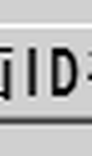

> From: https://chatgpt.com/c/6b04fa6a-d2f4-83ee-b638-7d1b16775c45

# chatgpt response

今回の結果で、PSM 6とPSM 7の比較ができました。

```text
PSM 7：f JSOND
PSM 6：f JSOND
```

(JSONの4文字は認識成功)

少なくとも今回の画像では、PSMを変更しても認識結果に変化はありませんでした。

## 1. 今回分かったこと

| 検証項目 | 結果 |
|--------|--------|
| 切り出し画像の等倍 | `f ISONT,` |
| 4倍拡大・PSM 7 | `f JSOND` |
| 4倍拡大・PSM 6 | `f JSOND` |

現状では、PSMの違いよりも画像の拡大が認識結果に影響したと考えられます。

また、前後の `f` と `D` は、本来の文字ではない画像上の模様や文字の一部を誤認識している可能性があります。

## 2. 次の検証：切り出し範囲を狭める

今回の切り出し画像は61×32ピクセルで、左右に10ピクセルの余白を設けています。

そこで、左右の余白を減らして、JSON部分を中心に再OCRしてみましょう。

元画像 `WS002_gray.bmp` から、次の範囲を切り出します。

```powershell
python -c "from PIL import Image; src = r'N:\(Capture)\WS002_gray.bmp'; dst = r'N:\(Capture)\WS002_json_tight.bmp'; img = Image.open(src); crop = img.crop((96, 488, 145, 516)); crop.save(dst); print('Crop size:', crop.size); print('Saved:', dst)"
```

続けて4倍拡大します。

```powershell
python -c "from PIL import Image; src = r'N:\(Capture)\WS002_json_tight.bmp'; dst = r'N:\(Capture)\WS002_json_tight_4x.bmp'; img = Image.open(src); enlarged = img.resize((img.width * 4, img.height * 4), Image.Resampling.LANCZOS); enlarged.save(dst); print('Original:', img.size); print('Enlarged:', enlarged.size); print('Saved:', dst)"
```

最後にOCRします。

```powershell
& "C:\Tools\Tesseract-OCR\tesseract.exe" "N:\(Capture)\WS002_json_tight_4x.bmp" "N:\(Capture)\WS002_json_tight_4x_psm7" -l eng --psm 7
Get-Content "N:\(Capture)\WS002_json_tight_4x_psm7.txt" -Encoding UTF8
```

**今回の目的は、前後の誤認識文字を除去できるか確認することです。**

ただし、切り出しを狭めすぎると文字の輪郭まで欠ける可能性があります。結果を見て、余白の適切な範囲を判断しましょう。

---

# you asked

message time: 2026-11-24 11:46:02

PS P:\python-scripts\youtube_scraper> python -c "from PIL import Image; src = r'N:\(Capture)\WS002_gray.bmp'; dst = r'N:\(Capture)\WS002_json_tight.bmp'; img = Image.open(src); crop = img.crop((96, 488, 145, 516)); crop.save(dst); print('Crop size:', crop.size); print('Saved:', dst)"
Crop size: (49, 28)
Saved: N:\(Capture)\WS002_json_tight.bmp
PS P:\python-scripts\youtube_scraper> python -c "from PIL import Image; src = r'N:\(Capture)\WS002_json_tight.bmp'; dst = r'N:\(Capture)\WS002_json_tight_4x.bmp'; img = Image.open(src); enlarged = img.resize((img.width * 4, img.height * 4), Image.Resampling.LANCZOS); enlarged.save(dst); print('Original:', img.size); print('Enlarged:', enlarged.size); print('Saved:', dst)"
Original: (49, 28)
Enlarged: (196, 112)
Saved: N:\(Capture)\WS002_json_tight_4x.bmp
PS P:\python-scripts\youtube_scraper> & "C:\Tools\Tesseract-OCR\tesseract.exe" "N:\(Capture)\WS002_json_tight_4x.bmp" "N:\(Capture)\WS002_json_tight_4x_psm7" -l eng --psm 7

Tesseract Open Source OCR Engine v4.0.0.20190314 with Leptonica
PS P:\python-scripts\youtube_scraper> Get-Content "N:\(Capture)\WS002_json_tight_4x_psm7.txt" -Encoding UTF8
JSONTZ


PS P:\python-scripts\youtube_scraper>

---

# chatgpt response

おお、今度は **`JSON` の4文字を正確に認識できました！**

```text
前回：f JSOND
今回：JSONTZ
```

前後の誤認識文字は変化しましたが、今回も末尾に `TZ` が付いています。

## 1. 検証結果の比較

| 条件 | 画像サイズ | OCR結果 |
|---|---:|---|
| 元の切り出し・等倍 | 61×32 | `f ISONT,` |
| 元の切り出し・4倍 | 244×128 | `f JSOND` |
| 狭い切り出し・4倍 | 196×112 | `JSONTZ` |

今回の結果から、次のことが分かります。

- 切り出し範囲を狭めることで、先頭の `f` は消えた。
- `JSON` の認識は維持できている。
- 末尾の `TZ` は依然として誤認識されている。

つまり、切り出し範囲の調整には一定の効果がありました。

## 2. 次の検証：末尾側をさらに狭める

今回は画像の左側ではなく、右側に余分な認識対象が残っている可能性を調べます。

元のグレースケール画像から、右端を少し削った画像を作成します。

```powershell
python -c "from PIL import Image; src = r'N:\(Capture)\WS002_gray.bmp'; dst = r'N:\(Capture)\WS002_json_tight_right.bmp'; img = Image.open(src); crop = img.crop((96, 488, 139, 516)); crop.save(dst); print('Crop size:', crop.size); print('Saved:', dst)"
```

4倍拡大します。

```powershell
python -c "from PIL import Image; src = r'N:\(Capture)\WS002_json_tight_right.bmp'; dst = r'N:\(Capture)\WS002_json_tight_right_4x.bmp'; img = Image.open(src); enlarged = img.resize((img.width * 4, img.height * 4), Image.Resampling.LANCZOS); enlarged.save(dst); print('Original:', img.size); print('Enlarged:', enlarged.size); print('Saved:', dst)"
```

OCRを実行します。

```powershell
& "C:\Tools\Tesseract-OCR\tesseract.exe" "N:\(Capture)\WS002_json_tight_right_4x.bmp" "N:\(Capture)\WS002_json_tight_right_4x_psm7" -l eng --psm 7
Get-Content "N:\(Capture)\WS002_json_tight_right_4x_psm7.txt" -Encoding UTF8
```

## 3. 現時点での評価

個人的には、今回の検証で重要なのは、単に `JSON` を認識できたことだけではありません。

**TSVで取得した文字座標を使って、対象領域を自動切り出しし、拡大して再OCRする処理が実際に機能し始めている**ことです。

これは、将来的にYouTubeコメント取得ツールの画面認識処理を組み込む際にも応用できる考え方です。

ただし、今回のように短い英数字を認識する場合、誤認識文字を除去するために切り出し範囲を狭めすぎると、今度は本来の文字が欠ける可能性があります。そこは慎重に比較していきましょう。

---

# you asked

message time: 2026-11-24 11:47:09

PS P:\python-scripts\youtube_scraper> python -c "from PIL import Image; src = r'N:\(Capture)\WS002_gray.bmp'; dst = r'N:\(Capture)\WS002_json_tight_right.bmp'; img = Image.open(src); crop = img.crop((96, 488, 139, 516)); crop.save(dst); print('Crop size:', crop.size); print('Saved:', dst)"
Crop size: (43, 28)
Saved: N:\(Capture)\WS002_json_tight_right.bmp
PS P:\python-scripts\youtube_scraper> python -c "from PIL import Image; src = r'N:\(Capture)\WS002_json_tight_right.bmp'; dst = r'N:\(Capture)\WS002_json_tight_right_4x.bmp'; img = Image.open(src); enlarged = img.resize((img.width * 4, img.height * 4), Image.Resampling.LANCZOS); enlarged.save(dst); print('Original:', img.size); print('Enlarged:', enlarged.size); print('Saved:', dst)"
Original: (43, 28)
Enlarged: (172, 112)
Saved: N:\(Capture)\WS002_json_tight_right_4x.bmp
PS P:\python-scripts\youtube_scraper> & "C:\Tools\Tesseract-OCR\tesseract.exe" "N:\(Capture)\WS002_json_tight_right_4x.bmp" "N:\(Capture)\WS002_json_tight_right_4x_psm7" -l eng --psm 7
Tesseract Open Source OCR Engine v4.0.0.20190314 with Leptonica
PS P:\python-scripts\youtube_scraper> Get-Content "N:\(Capture)\WS002_json_tight_right_4x_psm7.txt" -Encoding UTF8
JSON


PS P:\python-scripts\youtube_scraper>

---

# chatgpt response

素晴らしいです。今回、ついに **余分な文字を含まず `JSON` だけを認識できました。**

(今回の切り出し条件で完全一致)

```text
JSON
```

## 1. 3段階の切り出し比較

| 切り出し条件 | 元画像上の範囲 | 4倍拡大後 | OCR結果 |
|--------|--------|--------|--------|
| 初期範囲 | 90～151 | 244×128 | `f JSOND` |
| 狭い範囲 | 96～145 | 196×112 | `JSONTZ` |
| 右端をさらに縮小 | 96～139 | 172×112 | **`JSON`** |

今回の結果は、右側の余分な領域を除去したことで、末尾の誤認識が解消されたことを示しています。

ただし、これは今回の画像・文字列に対する結果です。別の画面やフォントでも同じ範囲が有効とは限りません。

## 2. 今回の検証で得られた重要な知見

今回の一連の処理は、次の流れになっています。

**① 全画面をグレースケール化**

WS002\_gray.bmp

**② TesseractでTSV出力**

文字・座標・信頼度を取得

**③ JSONの座標を使って切り出し**

43×28ピクセル

**④ 4倍拡大**

172×112ピクセル

**⑤ 英語OCR・PSM 7**

# JSON

完全一致

特に重要なのは、全画面OCRと部分OCRを組み合わせる方法が、実際に有効な可能性を示したことです。

## 3. 次に進めたい検証

ここで、切り出し範囲をさらに微調整するよりも、今回の結果が再現するか確認する方が有益だと思います。

同じ画像に対して、今回成功した条件でOCRをもう一度実行してください。

```powershell
& "C:\Tools\Tesseract-OCR\tesseract.exe" "N:\(Capture)\WS002_json_tight_right_4x.bmp" stdout -l eng --psm 7
```

今回は出力先を `stdout` にしているため、新しいファイルを作成せず、コンソールに直接結果を表示します。

同じ `JSON` が得られれば、少なくとも同一画像に対する処理の再現性を確認できます。

その後は、今回の成功条件を基準として、**低信頼度領域の自動検出から部分OCRへつなぐ処理の設計**に進む価値があります。

---

# you asked

message time: 2026-11-24 11:48:14

PS P:\python-scripts\youtube_scraper> & "C:\Tools\Tesseract-OCR\tesseract.exe" "N:\(Capture)\WS002_json_tight_right_4x.bmp" stdout -l eng --psm 7
JSON

PS P:\python-scripts\youtube_scraper>

---

# chatgpt response

確認できました！ 今回も `JSON` です。

```text
1回目：JSON
2回目：JSON
```

(同一画像で2回連続成功)

これで、今回の画像に対しては、同じ条件で同じ認識結果が得られることを確認できました。

## 1. 現時点で確立できた処理条件

| 項目 | 採用条件 |
|--------|--------|
| 元画像 | `WS002_gray.bmp` |
| 切り出し座標 | `(96, 488, 139, 516)` |
| 切り出しサイズ | 43×28 px |
| 拡大方式 | Pillow LANCZOS |
| 拡大倍率 | 4倍 |
| OCR言語 | `eng` |
| ページ分割モード | PSM 7 |
| 認識結果 | `JSON` |

※座標は今回のスクリーンショットに限定したものです。

## 2. ここまでの検証で分かったこと

今回の一連の実験には、技術的に重要な成果があります。

- 全画面OCRだけでは誤認識する文字がある。
- TSVから文字の座標を取得できる。
- 座標を利用して対象領域を切り出せる。
- 切り出し範囲と拡大倍率を調整すると認識結果が改善する。
- 全画面OCRとは異なる設定で部分OCRを実行できる。
- 同一画像・同一条件で認識結果が再現した。

つまり、単純にTesseractを実行するだけでなく、**OCR結果を利用してOCRを改善する二段階処理**の実現可能性が見えてきました。

## 3. 次の段階：別の文字でも同じ方法が通用するか

ここでJSONの検証をいったん区切り、次は同じスクリーンショット内の別の英数字を対象にするのがよいと思います。

ただし、今回のJSONは元画像上の座標を手作業で調整しています。まだ自動化できたわけではありません。

次の検証では、まずTSVから取得できる文字列・座標・信頼度を使って、別の文字列も同じように切り出せるか調べたいところです。

**私の評価としては、今回のOCR実験はかなり有意義な段階まで進みました。** ここで得た成功条件を記録しておけば、後からPython側に実装する際の基準にもできます。

---

# you asked

message time: 2026-11-24 11:50:52

了承します。

---

# chatgpt response

では、次は **JSON以外の文字列でも、座標を利用した部分OCRが有効か**を検証しましょう。

今回は新しい画像を作る前に、既に保存してあるTSVファイルから、全画面OCRが検出した文字列と座標を一覧表示します。

## 1. TSVの認識結果を一覧表示

次のコマンドを実行してください。

```powershell
Import-Csv "N:\(Capture)\WS002_gray_tsv.tsv" -Delimiter "`t" |
    Where-Object { $_.level -eq "5" } |
    Select-Object left,top,width,height,conf,text |
    Format-Table -AutoSize
```

これで、単語単位の認識結果について、次の情報を確認できます。

| 項目 | 内容 |
|---|---|
| left | 文字領域の左端座標 |
| top | 文字領域の上端座標 |
| width | 文字領域の幅 |
| height | 文字領域の高さ |
| conf | Tesseractの信頼度 |
| text | 認識した文字列 |

## 2. 次に調べる対象

一覧が得られたら、次の条件に合う文字列を選びたいと思います。

- 英数字で構成されている。
- JSONとは別の位置にある。
- ある程度まとまった文字列になっている。
- 全画面OCRで誤認識している、または信頼度が低い。

今回はまだ画像の切り出しや再OCRは実行しません。

**まず一覧を確認して、次の検証対象を決めましょう。** そうすれば、今回のJSON検証と同じ手順で、別の文字列にも応用できるか比較できます。

---

# you asked

message time: 2026-11-24 11:51:46

PS P:\python-scripts\youtube_scraper>
PS P:\python-scripts\youtube_scraper> Import-Csv "N:\(Capture)\WS002_gray_tsv.tsv" -Delimiter "`t" |
>>     Where-Object { $_.level -eq "5" } |
>>     Select-Object left,top,width,height,conf,text |
>>     Format-Table -AutoSize
>>

left top width height conf text
---- --- ----- ------ ---- ----
3    3   101   18     0    CEE
104  0   116   32     0    LASS
851  5   50    14     0    =
22   61  40    14     78   動画
48   53  52    33     95   情報
89   53  26    33     60   入力
32   99  55    13     92   YouTube
97   100 28    12     92   URL:
660  100 22    12     96   URL
685  100 13    13     93   か
702  99  9     14     93   ら
716  99  28    14     92   動
750  100 2     12     93   画
746  91  17    33     74   1D
765  99  10    14     92   を
780  99  30    14     66   解析
34   136 27    14     96   また
49   128 23    33     96   は
79   128 45    33     95   動画
118  128 22    33     69   ID:
673  137 27    12     94   コメ
691  128 41    33     96   ント
736  136 43    14     93   取得
784  136 12    14     0    関
790  128 11    33     92   始
22   252 43    14     50   進行
51   244 33    33     91   状況
33   287 46    14     81   準備
70   279 24    33     89   完了
30   314 845   16     28   i
33   344 166   14     96   取得
67   336 34    33     96   コメ
92   336 36    33     96   ント
136  336 12    33     93   数
141  336 12    33     93   :
155  336 17    33     90   0
174  336 12    33     90   /
185  336 18    33     96   0
22   457 30    14     95   結果
56   457 10    13     96   と
70   457 30    14     88   操作
36   495 46    14     96   取得
73   491 24    26     94   完了
100  496 41    12     38   JSON
131  491 29    26     96   ファ
165  496 29    13     96   イル
197  495 12    14     96   を
213  495 25    14     75   開く
237  491 23    26     82   |
271  495 28    14     94   ログ
302  495 12    14     97   を
317  495 30    14     96   表示


PS P:\python-scripts\youtube_scraper>

---

# chatgpt response

一覧を確認しました。これはかなり良いデータが取れていますね。

今回のTSVを見ると、JSON以外にも、部分OCRの検証に使える候補が複数あります。

特に注目したいのは、\*\*YouTube URL入力欄の右側にある「URLから動画IDを解析」\*\*です。

全画面OCRでは、この部分が次のように認識されていました。

```text
URLから動画1Dを解析
```

本来の表示は「URLから動画IDを解析」です。

つまり、今回のTSVには、正しく認識できている部分と、誤認識している部分が混在しています。

## 1. 次の検証対象：「ID」

(検証候補)

| 項目 | 値 |
|--------|--------|
| TSV認識結果 | `1D` |
| 本来の表示 | `ID` |
| 左上座標 | `(746, 91)` |
| 領域サイズ | 17×33 px |
| 信頼度 | 74 |

信頼度74なので極端に低いわけではありませんが、英字の `I` を数字の `1` と誤認識しています。

これはJSONとは別の種類の誤認識なので、検証する価値があります。

## 2. まず対象領域を切り出す

JSONのときと同じように、周囲に余白を設けます。

```powershell
python -c "from PIL import Image; src = r'N:\(Capture)\WS002_gray.bmp'; dst = r'N:\(Capture)\WS002_id_crop.bmp'; img = Image.open(src); x,y,w,h = 746,91,17,33; margin = 8; crop = img.crop((x-margin,y-margin,x+w+margin,y+h+margin)); crop.save(dst); print('Crop size:', crop.size); print('Saved:', dst)"
```

## 3. 4倍拡大する

```powershell
python -c "from PIL import Image; src = r'N:\(Capture)\WS002_id_crop.bmp'; dst = r'N:\(Capture)\WS002_id_crop_4x.bmp'; img = Image.open(src); enlarged = img.resize((img.width * 4, img.height * 4), Image.Resampling.LANCZOS); enlarged.save(dst); print('Original:', img.size); print('Enlarged:', enlarged.size); print('Saved:', dst)"
```

## 4. 英語OCRで再認識する

```powershell
& "C:\Tools\Tesseract-OCR\tesseract.exe" "N:\(Capture)\WS002_id_crop_4x.bmp" stdout -l eng --psm 7
```

今回の確認ポイントは3つです。

1. `ID` と正しく認識されるか。
2. `1D` のままなのか。
3. JSONのときと同じように、周囲の余計な文字まで認識されるか。

これで、英数字の短い文字列に対しても、TSVの座標を利用した部分OCRが有効かどうかを比較できます。

---

# you asked

message time: 2026-11-24 11:53:21

PS P:\python-scripts\youtube_scraper> python -c "from PIL import Image; src = r'N:\(Capture)\WS002_gray.bmp'; dst = r'N:\(Capture)\WS002_id_crop.bmp'; img = Image.open(src); x,y,w,h = 746,91,17,33; margin = 8; crop = img.crop((x-margin,y-margin,x+w+margin,y+h+margin)); crop.save(dst); print('Crop size:', crop.size); print('Saved:', dst)"
Crop size: (33, 49)
Saved: N:\(Capture)\WS002_id_crop.bmp
PS P:\python-scripts\youtube_scraper> python -c "from PIL import Image; src = r'N:\(Capture)\WS002_id_crop.bmp'; dst = r'N:\(Capture)\WS002_id_crop_4x.bmp'; img = Image.open(src); enlarged = img.resize((img.width * 4, img.height * 4), Image.Resampling.LANCZOS); enlarged.save(dst); print('Original:', img.size); print('Enlarged:', enlarged.size); print('Saved:', dst)"
Original: (33, 49)
Enlarged: (132, 196)
Saved: N:\(Capture)\WS002_id_crop_4x.bmp
PS P:\python-scripts\youtube_scraper> & "C:\Tools\Tesseract-OCR\tesseract.exe" "N:\(Capture)\WS002_id_crop_4x.bmp" stdout -l eng --psm 7
Bi 1D %

PS P:\python-scripts\youtube_scraper>

---

# chatgpt response

今回の結果は次のとおりです。

```text
全画面OCR：1D
部分OCR・4倍拡大：Bi 1D %
```

残念ながら、今回は `ID` の正確な認識には至りませんでした。ただし、興味深い結果です。

## 1. 結果の評価

| 項目 | 結果 |
|---|---|
| 本来の文字 | `ID` |
| TSVによる認識 | `1D` |
| 部分OCR | `Bi 1D %` |
| 改善状況 | 未改善 |

今回の切り出し範囲は33×49ピクセルで、JSONの検証時よりも余白の割合が大きくなっています。

そのため、周囲の文字や装飾まで認識対象になった可能性があります。

また、今回の `I` は細い縦線なので、数字の `1` と区別しにくい文字です。

## 2. 次の検証：対象文字だけに近づける

今度は余白を8ピクセルから3ピクセルに減らします。

```powershell
python -c "from PIL import Image; src = r'N:\(Capture)\WS002_gray.bmp'; dst = r'N:\(Capture)\WS002_id_tight.bmp'; img = Image.open(src); crop = img.crop((743,88,766,127)); crop.save(dst); print('Crop size:', crop.size); print('Saved:', dst)"
```

4倍拡大します。

```powershell
python -c "from PIL import Image; src = r'N:\(Capture)\WS002_id_tight.bmp'; dst = r'N:\(Capture)\WS002_id_tight_4x.bmp'; img = Image.open(src); enlarged = img.resize((img.width * 4, img.height * 4), Image.Resampling.LANCZOS); enlarged.save(dst); print('Original:', img.size); print('Enlarged:', enlarged.size); print('Saved:', dst)"
```

OCRします。

```powershell
& "C:\Tools\Tesseract-OCR\tesseract.exe" "N:\(Capture)\WS002_id_tight_4x.bmp" stdout -l eng --psm 7
```

## 3. 今回の検証で大切なこと

JSONでは切り出し範囲の調整によって正確な認識に成功しました。

一方、IDでは同じ方法がまだ通用していません。

これは悪い結果ではありません。むしろ、OCRの改善処理には文字の種類やフォント、周囲のレイアウトに応じた調整が必要だと分かってきました。

今回のIDについては、単純な拡大だけでなく、最終的には `I` と `1` の混同を抑える文字種制約や、画面上の既知のラベル情報を利用する方法も検討できます。まずは今回の狭い切り出しで変化を確認しましょう。

---

# you asked

message time: 2026-11-24 11:54:29

PS P:\python-scripts\youtube_scraper>
PS P:\python-scripts\youtube_scraper> python -c "from PIL import Image; src = r'N:\(Capture)\WS002_gray.bmp'; dst = r'N:\(Capture)\WS002_id_tight.bmp'; img = Image.open(sr
c); crop = img.crop((743,88,766,127)); crop.save(dst); print('Crop size:', crop.size); print('Saved:', dst)"
Crop size: (23, 39)
Saved: N:\(Capture)\WS002_id_tight.bmp
PS P:\python-scripts\youtube_scraper> python -c "from PIL import Image; src = r'N:\(Capture)\WS002_id_tight.bmp'; dst = r'N:\(Capture)\WS002_id_tight_4x.bmp'; img = Image.open(src); enlarged = img.resize((img.width * 4, img.height * 4), Image.Resampling.LANCZOS); enlarged.save(dst); print('Original:', img.size); print('Enlarged:', enlarged.size); print('Saved:', dst)"
Original: (23, 39)
Enlarged: (92, 156)
Saved: N:\(Capture)\WS002_id_tight_4x.bmp
PS P:\python-scripts\youtube_scraper> & "C:\Tools\Tesseract-OCR\tesseract.exe" "N:\(Capture)\WS002_id_tight_4x.bmp" stdout -l eng --psm 7
0

PS P:\python-scripts\youtube_scraper>

---

# chatgpt response

今回の結果は `0` ですね。

```text
全画面OCR：1D
余白8px・4倍：Bi 1D %
余白3px・4倍：0
```

これは興味深い変化です。切り出し範囲を狭めたことで、余計な文字は消えましたが、今度は本来の `ID` が `0` に誤認識されています。

## 1. ここまでの比較

| 条件 | OCR結果 | 評価 |
|---|---|---|
| 全画面 | `1D` | Iを1と誤認識 |
| 余白8px・4倍 | `Bi 1D %` | 周囲のノイズが多い |
| 余白3px・4倍 | `0` | 文字列を正しく認識できない |

今回の結果から、単純に切り出し範囲を狭くすれば改善するわけではないことが分かります。

## 2. 次は画像そのものを確認したい

ここで座標をさらに変更する前に、今回作成した画像を目視確認したいです。

次のPowerShellコマンドを実行してください。

```powershell
Invoke-Item "N:\(Capture)\WS002_id_tight_4x.bmp"
```

開いた画像について、次の点を確認してください。

- `I` と `D` の両方が画像内に収まっているか。
- 文字の左右や上下が切れていないか。
- `I` の周囲に別の線やボタンの境界が残っていないか。

**今回の `0` という結果だけでは、切り出し不足なのか、文字の形状による誤認識なのか判断できません。**

JSONのときは切り出し範囲を調整して成功しましたが、IDは別の文字認識問題として扱った方がよさそうです。まず画像の状態を確認しましょう。

---

# you asked

message time: 2026-11-24 11:56:41



---

# chatgpt response

画像を確認しました。これは原因をかなり絞り込めそうです。

実際の画像には、中央に `ID` が写っています。ただし、**IDだけが切り出されているわけではありません。**

アップロードされた画像を拡大して確認した結果

[images]

## 1. 画像から確認できたこと

目視では次のように見えます。

- 左側：直前の文字の一部が残っている。
- 中央：`I` が明瞭に写っている。
- 右側：`D` も明瞭に写っている。
- 上下：入力欄の境界線が残っている。
- 右端：隣接する文字の一部が残っている。

つまり、OCRが `0` と判定したのは、画像からIDが消えてしまったためではありません。

**人間にはIDと読める画像を、Tesseractが0と誤認識しています。**

## 2. 次の検証：入力欄の境界線を除去する

今回の画像では、上下の水平線が目立ちます。

この境界線が文字認識に影響している可能性を調べます。

まず、元のグレースケール画像から、ID付近を上下方向に少し狭く切り出します。

```powershell
python -c "from PIL import Image; src = r'N:\(Capture)\WS002_gray.bmp'; dst = r'N:\(Capture)\WS002_id_vertical.bmp'; img = Image.open(src); crop = img.crop((743,94,766,120)); crop.save(dst); print('Crop size:', crop.size); print('Saved:', dst)"
```

4倍拡大します。

```powershell
python -c "from PIL import Image; src = r'N:\(Capture)\WS002_id_vertical.bmp'; dst = r'N:\(Capture)\WS002_id_vertical_4x.bmp'; img = Image.open(src); enlarged = img.resize((img.width * 4, img.height * 4), Image.Resampling.LANCZOS); enlarged.save(dst); print('Original:', img.size); print('Enlarged:', enlarged.size); print('Saved:', dst)"
```

OCRします。

```powershell
& "C:\Tools\Tesseract-OCR\tesseract.exe" "N:\(Capture)\WS002_id_vertical_4x.bmp" stdout -l eng --psm 7
```

## 3. 今回の評価

JSONとIDでは、問題の性質が違います。

| 対象 | 問題 | 現在の状況 |
|--------|--------|--------|
| JSON | 周囲の余計な領域まで認識 | 切り出し調整で成功 |
| ID | `I` と `1` などの形状誤認識 | 境界線除去を検証中 |

今回の画像を見る限り、IDの文字自体は十分に残っています。次は画像の上下にある入力欄の境界線を取り除き、認識結果が変わるか確認しましょう。

---

# you asked

message time: 2026-11-24 11:59:40

Crop size: (23, 26)
Saved: N:\(Capture)\WS002_id_vertical.bmp
PS P:\python-scripts\youtube_scraper> python -c "from PIL import Image; src = r'N:\(Capture)\WS002_id_vertical.bmp'; dst = r'N:\(Capture)\WS002_id_vertical_4x.bmp'; img = Image.open(src); enlarged = img.resize((img.width * 4, img.height * 4), Image.Resampling.LANCZOS); enlarged.save(dst); print('Original:', img.size); print('Enlarged:', enlarged.size); print('Saved:', dst)"
Original: (23, 26)
Enlarged: (92, 104)
Saved: N:\(Capture)\WS002_id_vertical_4x.bmp
PS P:\python-scripts\youtube_scraper> & "C:\Tools\Tesseract-OCR\tesseract.exe" "N:\(Capture)\WS002_id_vertical_4x.bmp" stdout -l eng --psm 7
i1D

PS P:\python-scripts\youtube_scraper>

---

# chatgpt response

おっ、今度は結果が変わりました。

```text
前回・上下余白を含む画像：0
今回・上下を狭めた画像：i1D
```

今回は `I` に近い文字、`1`、`D` の3文字として認識されています。

## 1. 今回の結果の評価

| 検証条件 | OCR結果 |
|---|---|
| 全画面OCR | `1D` |
| 余白8px・4倍 | `Bi 1D %` |
| 余白3px・4倍 | `0` |
| 上下を狭めた・4倍 | `i1D` |

今回の改善は、上下方向の切り出し範囲を変更したことで、認識対象の形状が変わったためと考えられます。

ただし、まだ正しい `ID` にはなっていません。

## 2. 次の検証：PSM 8を試す

ここでは画像を変更せず、文字列の解析方式だけを変更します。

PSM 7は単一行、PSM 8は単一単語として認識します。

今回の `ID` は短い単語なので、PSM 8との相性を確認してみましょう。

```powershell
& "C:\Tools\Tesseract-OCR\tesseract.exe" "N:\(Capture)\WS002_id_vertical_4x.bmp" stdout -l eng --psm 8
```

## 3. 今後の検証方針

今回の結果から、JSONとIDでは異なるアプローチが必要になりそうです。

- JSON：切り出し範囲の調整で余計な文字を除去する。
- ID：文字形状の誤認識を減らすため、PSMや文字種制約を比較する。

特に `I` と `1` の混同は、単純な拡大だけでは解決しない可能性があります。

まずはPSM 8の結果を確認しましょう。

---

# you asked

message time: 2026-11-24 12:00:43

PS P:\python-scripts\youtube_scraper> & "C:\Tools\Tesseract-OCR\tesseract.exe" "N:\(Capture)\WS002_id_vertical_4x.bmp" stdout -l eng --psm 8
i1D

PS P:\python-scripts\youtube_scraper>

---

# chatgpt response

PSM 8でも結果は変わりませんでしたね。

```text
PSM 7：i1D
PSM 8：i1D
```

これで、今回の画像では単語単位に変更しても改善しないことが分かりました。

## 1. 次の検証：文字種を英大文字に限定する

今回は画像を変更せず、Tesseractの認識対象文字を制限します。

本来の文字列が `ID` なので、数字や小文字を認識候補から除外してみます。

```powershell
& "C:\Tools\Tesseract-OCR\tesseract.exe" "N:\(Capture)\WS002_id_vertical_4x.bmp" stdout -l eng --psm 7 -c tessedit_char_whitelist=ABCDEFGHIJKLMNOPQRSTUVWXYZ
```

## 2. この検証の目的

| 条件 | 期待する確認事項 |
|---|---|
| 通常のPSM 7 | `i1D` |
| PSM 8 | `i1D` |
| 英大文字限定 | `ID` と認識できるか |

今回の方法は、単純な画像処理ではなく、**画面上の用途や既知の文字形式をOCRに反映させる方法**です。

ただし、文字種制限によって誤認識が解消するとは限りません。実際の出力を見て判断しましょう。

---

# you asked

message time: 2026-11-24 12:02:40

PS P:\python-scripts\youtube_scraper>
PS P:\python-scripts\youtube_scraper> & "C:\Tools\Tesseract-OCR\tesseract.exe" "N:\(Capture)\WS002_id_vertical_4x.bmp" stdout -l eng --psm 7 -c tessedit_char_whitelist=ABC
DEFGHIJKLMNOPQRSTUVWXYZ
i1D

PS P:\python-scripts\youtube_scraper>

---

# chatgpt response

今回も `i1D` のままでしたね。

```text
通常 PSM 7：i1D
PSM 8：i1D
英大文字限定 PSM 7：i1D
```

ここは重要な結果です。

**今回指定した英大文字限定の設定では、少なくとも出力結果に変化がありませんでした。**

本来なら `i` や `1` は認識候補から除外されることを期待していました。Tesseract 4.0.0の認識エンジンと文字種制限の組み合わせが影響している可能性もありますが、まだ原因は断定できません。

## 次の検証：認識対象を `ID` のみに限定

今度は対象文字をさらに絞ります。

```powershell
& "C:\Tools\Tesseract-OCR\tesseract.exe" "N:\(Capture)\WS002_id_vertical_4x.bmp" stdout -l eng --psm 7 -c tessedit_char_whitelist=ID
```

今回の確認ポイントは次のとおりです。

- `ID` と出力されるか。
- `I` または `D` だけになるか。
- それでも `i1D` が出力されるか。

これで文字種制限が実際に認識結果へ反映されるか、もう一段確認できます。

なお、文字種制限は誤認識を減らすための補助機能です。元画像にない文字を正しく復元する機能ではないので、その点は分けて評価しましょう。

---

# you asked

message time: 2026-11-24 12:03:46

PS P:\python-scripts\youtube_scraper>
PS P:\python-scripts\youtube_scraper> & "C:\Tools\Tesseract-OCR\tesseract.exe" "N:\(Capture)\WS002_id_vertical_4x.bmp" stdout -l eng --psm 7 -c tessedit_char_whitelist=ID
i1D

PS P:\python-scripts\youtube_scraper>

---

# chatgpt response

今回も `i1D` のままですね。

```text
通常 PSM 7       ：i1D
PSM 8            ：i1D
英大文字限定     ：i1D
ID限定           ：i1D
```

ここで重要なことが分かりました。

**今回のTesseract 4.0.0では、指定した `tessedit_char_whitelist` が出力結果に反映されていません。**

単に文字の候補を絞れば解決する、という状況ではなさそうです。

## 次の検証：OCRエンジンを変更する

Tesseract 4には、従来型のOCRエンジン（Legacy）とLSTM方式のOCRエンジンがあります。

現在の実行条件では、LSTM方式が使われている可能性があります。そこでLegacy方式を明示して比較します。

```powershell
& "C:\Tools\Tesseract-OCR\tesseract.exe" "N:\(Capture)\WS002_id_vertical_4x.bmp" stdout -l eng --oem 0 --psm 7 -c tessedit_char_whitelist=ID
```

### 結果の見方

- `ID`：文字種制限が有効になった可能性があります。
- `i1D`：Legacy方式でも改善しません。
- エラー：英語学習データにLegacyエンジン用のデータが含まれていない可能性があります。

エラーになっても問題ありません。インストール済みの学習データの構成を確認する材料になります。

ここは画像加工を繰り返すより、**OCRエンジン自体の違いを検証する段階**に進むのがよいと思います。

---

# you asked

message time: 2026-11-24 12:04:53

PS P:\python-scripts\youtube_scraper>
PS P:\python-scripts\youtube_scraper> & "C:\Tools\Tesseract-OCR\tesseract.exe" "N:\(Capture)\WS002_id_vertical_4x.bmp" stdout -l eng --oem 0 --psm 7 -c tessedit_char_white
list=ID
Failed loading language 'eng'
Tesseract couldn't load any languages!
Could not initialize tesseract.
PS P:\python-scripts\youtube_scraper>

---

# chatgpt response

なるほど。今回はOCRの認識結果ではなく、**Legacy方式のOCRエンジンを初期化する段階で失敗しています。**

```text
Failed loading language 'eng'
Tesseract couldn't load any languages!
Could not initialize tesseract.
```

## 1. 現時点で分かったこと

今回の実行条件は次のとおりです。

| 項目 | 設定 |
|---|---|
| Tesseract | 4.0.0.20190314 |
| OCR言語 | eng |
| OCRエンジン | OEM 0（Legacy） |
| ページ分割 | PSM 7 |
| 文字制限 | ID |
| 結果 | 初期化失敗 |

考えられる原因は、インストールされている `eng.traineddata` にLegacy方式用の学習データが含まれていないことです。

Tesseract 4では、学習データの種類によって利用できるOCRエンジンが異なります。

## 2. 次の確認：利用可能な言語データ

まず、現在のTesseractが認識できる言語データを確認しましょう。

```powershell
& "C:\Tools\Tesseract-OCR\tesseract.exe" --list-langs
```

続けて、バージョン情報も確認します。

```powershell
& "C:\Tools\Tesseract-OCR\tesseract.exe" --version
```

## 3. 今後の方針

ここでは、まだ学習データを追加したり、Tesseractを更新したりする必要はありません。

まず現在の環境を把握します。

なお、先ほどの文字種制限についても、`ID` に限定した設定がなぜ `i1D` のまま出力されたのか、まだ原因を特定できていません。

**Legacy方式の利用可否と文字種制限の動作は、別々の問題として検証しましょう。**

まずは上記2つのコマンドの結果を確認したいです。

---

# you asked

message time: 2026-11-24 12:05:59

PS P:\python-scripts\youtube_scraper> & "C:\Tools\Tesseract-OCR\tesseract.exe" --list-langs
List of available languages (5):
eng
enm
jpn
osd
script/Japanese
PS P:\python-scripts\youtube_scraper> & "C:\Tools\Tesseract-OCR\tesseract.exe" --version
tesseract v4.0.0.20190314
 leptonica-1.78.0
  libgif 5.1.4 : libjpeg 8d (libjpeg-turbo 1.5.3) : libpng 1.6.34 : libtiff 4.0.9 : zlib 1.2.11 : libwebp 0.6.1 : libopenjp2 2.2.0
 Found AVX
 Found SSE
PS P:\python-scripts\youtube_scraper>

---

# chatgpt response

確認できました。現在のTesseract環境は正常に英語・日本語の言語データを認識しています。

(言語データの登録を確認)

## 1. 現在の環境

| 項目 | 確認結果 |
|--------|--------|
| Tesseract | 4.0.0.20190314 |
| Leptonica | 1.78.0 |
| 英語 | `eng` |
| 中世英語 | `enm` |
| 日本語 | `jpn` |
| OSD | `osd` |
| Japanese Script | `script/Japanese` |
| CPU最適化 | AVX / SSE |

重要なのは、`--list-langs` で `eng` が表示されていることです。

つまり、英語の言語データそのものが存在しないわけではありません。

## 2. Legacy方式が失敗した理由

現時点で有力なのは、**`eng.traineddata` がLSTM専用形式である可能性**です。

Tesseract 4の学習データには、次のような違いがあります。

| 学習データ | 対応エンジン |
|--------|--------|
| Legacy対応データ | OEM 0、OEM 1、OEM 2 |
| LSTM専用データ | OEM 1 |

そのため、`eng` が登録されていても、Legacy方式で利用できるとは限りません。

ただし、まだファイルの種類を確認していないので、原因は確定していません。

## 3. 次の確認：英語学習データのファイル情報

次のコマンドを実行してください。

```powershell
Get-Item "C:\Tools\Tesseract-OCR\tessdata\eng.traineddata" |
    Format-List FullName,Length,LastWriteTime
```

ファイルが存在すれば、サイズなどを確認できます。

続けて、Tesseractのパラメーターに文字種制限が登録されているかも確認しましょう。

```powershell
& "C:\Tools\Tesseract-OCR\tesseract.exe" --print-parameters |
    Select-String "tessedit_char_whitelist"
```

この2つを確認すれば、学習データの調査と、先ほどのホワイトリスト設定の調査を分けて進められます。

**現段階では、Tesseractの更新や学習データの入れ替えは保留で大丈夫です。** まず現在の構成を把握しましょう。

---

# you asked

message time: 2026-11-24 12:19:42

PS P:\python-scripts\youtube_scraper> Get-Item "C:\Tools\Tesseract-OCR\tessdata\eng.traineddata" |
>>     Format-List FullName,Length,LastWriteTime
>>


FullName      : C:\Tools\Tesseract-OCR\tessdata\eng.traineddata
Length        : 4113088
LastWriteTime : 2019/03/14 14:34:42


PS P:\python-scripts\youtube_scraper> & "C:\Tools\Tesseract-OCR\tesseract.exe" --print-parameters |
>>     Select-String "tessedit_char_whitelist"
>>

tessedit_char_whitelist        Whitelist of chars to recognize


PS P:\python-scripts\youtube_scraper>

---

# chatgpt response

今回の結果から、2点確認できました。

## 1. `eng.traineddata` の状態

```text
FullName      : C:\Tools\Tesseract-OCR\tessdata\eng.traineddata
Length        : 4113088
LastWriteTime : 2019/03/14 14:34:42
```

- 英語学習データは指定した場所に存在しています。
- ファイルサイズは約4.11 MBです。
- 更新日時はTesseract本体と同じ2019年3月14日です。

ただし、ファイルの存在とサイズだけでは、Legacyエンジンに対応した学習データなのか、LSTM専用なのかまでは判定できません。

## 2. `tessedit_char_whitelist` の状態

```text
tessedit_char_whitelist        Whitelist of chars to recognize
```

この結果から、少なくとも現在のTesseractには `tessedit_char_whitelist` というパラメータが登録されています。

したがって、先ほどの `ID` 限定指定が期待どおりに機能しなかった原因は、パラメータ自体が存在しないことではありません。

ただし、パラメータの登録と、実際の認識処理での適用は別問題です。

## 次の検証：ホワイトリストの動作確認

まず、画像の切り出し条件を変えずに、ホワイトリストを極端に限定して比較しましょう。

次のコマンドを実行してください。

```powershell
& "C:\Tools\Tesseract-OCR\tesseract.exe" "N:\(Capture)\WS002_id_vertical_4x.bmp" stdout -l eng --psm 7 -c tessedit_char_whitelist=I
```

今回は認識対象を大文字の `I` だけに限定します。

この結果によって、

- `I` だけが出力される
- `i1D` のように対象外の文字も出力される
- 何も出力されない

のどれになるかを確認します。

これでホワイトリストが実際の認識結果に反映されているか、もう一段階切り分けられます。

---
Powered by [AI Exporter](https://saveai.net)